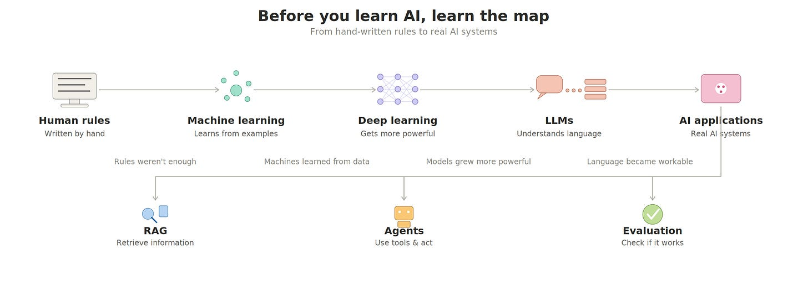

# Week 1, Day 1: Before AI, Learn the Map

*August 26, 2026 · [Originally published on Substack](https://niharikabatra.substack.com/p/week-1-day-1-before-ai-learn-the)*

If you’re trying to transition into AI, you’ve probably seen these words everywhere:

**AI. Machine Learning. Deep Learning. LLMs. RAG. Agents.**

And after a while, you’re thinking:

*“Do I really need to learn all of this?”*

Let’s make it simple.

**Start with AI.**

At its simplest, AI is about getting computers to perform tasks that normally require some form of human intelligence.

For example:

- recognizing a face
- understanding a question
- recommending a movie
- predicting whether someone will cancel a subscription
- writing an email
- generating an image

But here’s something interesting:

**AI doesn’t necessarily have to learn.**

If I write:

**If the temperature is above 100°F, send an alert.**

That’s a computer following a rule.

I told it exactly what to do.

**But what if I want a computer to recognize a cat? 🐱**

I could try giving it a huge list of rules:

If it has two eyes…  
four legs…  
pointed ears…  
fur…  
a tail…

But what if the cat is hiding behind a sofa?

What if it’s black?

What if it’s a kitten?

Suddenly, we need **way too many rules.**

So instead of telling the computer every rule, we give it lots of examples of **cats and not-cats** and let it learn the patterns.

That’s **Machine Learning.**

And as the problems became more complex, we developed more powerful approaches, including **Deep Learning**, which is behind many of the AI systems we use today.

Then we got models that became incredibly good at working with language:

**LLMs.**

And now we can build applications around these models:

**RAG** → gives AI relevant information.

**Agents** → let AI use tools and take multiple steps.

**Evaluation** → helps us figure out whether the AI is actually working well.

So instead of memorizing:

**AI → ML → Deep Learning → LLMs → RAG → Agents**

Think of it as a story:

**We wanted computers to do intelligent things.  
Rules weren’t enough.  
So we taught machines from data.  
As problems became harder, our models became more powerful.  
And now we’re building systems that can understand, generate, retrieve, and act.**

That’s the map.

And over the next **16 weeks**, we’re going to walk through it **one piece at a time.**

You don’t need to understand everything today.

**Just know where we’re going.**

**Tomorrow:**

**How does a machine actually learn from those examples?**

*One concept at a time.*
