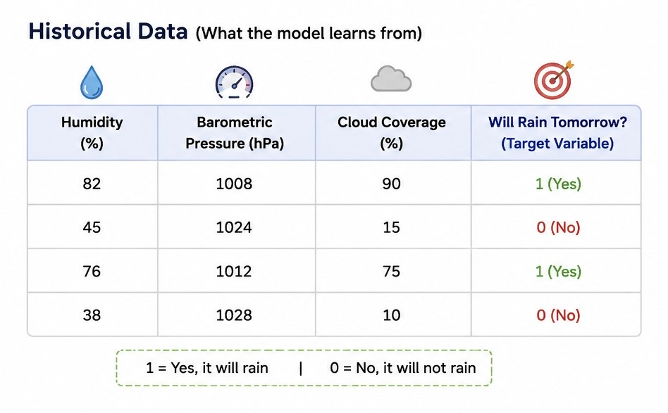
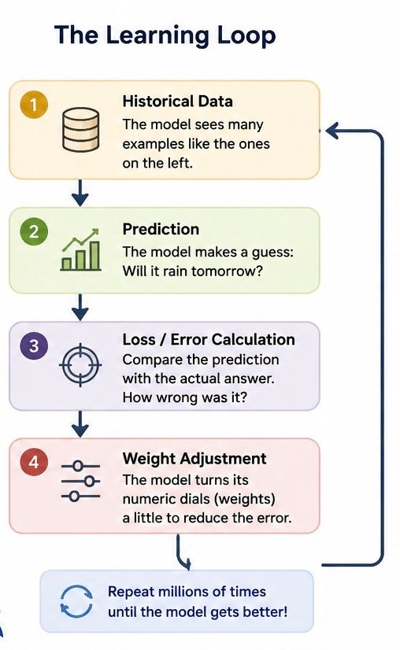
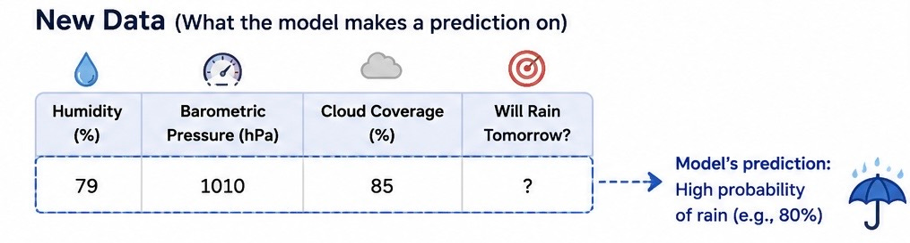

# Week 1, Day 2: How Does a Machine Actually Learn?

*August 27, 2026 · [Originally published on Substack](https://niharikabatra.substack.com/p/week-1-day-2-how-does-a-machine-actually)*

Yesterday, we talked about the difference between **giving a computer rules** and letting it **learn from data**.

But that leaves a big question:

**How does a machine actually learn?**

Let’s use something universal:

**Can we predict whether it will rain tomorrow?**

Imagine you have years of local weather data.

For every day, you know things like:

- Humidity
- Barometric pressure
- Cloud coverage

And you also know what happened the next day:

**Did it rain or not?**

Here’s what that data might look like:

Here, **1 means yes** and **0 means no**.

Now we can start teaching a machine.

**First, the machine looks for patterns**

You give the model historical data.

It might notice that certain combinations often appear before rainy days.

For example:

Higher humidity + lower pressure + heavy cloud coverage often appears before rain.

But the model doesn’t simply receive a rule saying:

**“If humidity is above 80%, it will rain.”**

It has to learn how much each piece of information matters.

And it learns through repetition.

---

**The learning loop**

At its simplest, machine learning looks like this:

**Step 1: Give it historical data**

We show the machine:

Humidity: 82%  
Pressure: 1008  
Cloud coverage: 90%

The actual answer is:

**Rain tomorrow: Yes**

**Step 2: The model makes a prediction**

At first, the model doesn’t know much.

Maybe it predicts:

**40% chance of rain**

But the actual outcome was rain.

So the model was wrong.

**Step 3: Measure the error**

Now we compare:

**What the model predicted**

with

**What actually happened**

The difference is called the **error** or **loss**.

You don’t need to worry about the mathematical formula yet.

Just remember:

**Loss tells the model how wrong it was.**

The bigger the mistake, the more the model needs to adjust.

**Step 4: Turn the numeric dials**

This is where the idea of a **black box** starts to feel less mysterious.

Imagine the model has thousands—or even millions—of tiny numeric dials.

These are called **weights**.

A weight represents how strongly the model uses a particular pattern or input when making a prediction.

For example, the model might initially give:

- Humidity → some importance
- Pressure → some importance
- Cloud coverage → some importance

But at first, those settings aren’t very good.

So after seeing how wrong its prediction was, the model adjusts its numeric dials slightly.

Something like:

**That prediction was too far off. Let’s adjust.**

Then it tries again.

**And then it repeats**

This happens over and over:

**Data → Prediction → Error → Adjust**

The goal isn’t to get everything perfect immediately.

The goal is to become **a little less wrong over time**.

After enough examples and adjustments, the model may become much better at predicting rain for weather conditions it hasn’t seen before.

That’s the basic learning process.

---

**Features: What information are we giving the machine?**

Let’s make one term simple.

**Features = the clues.**

They are the pieces of information the model uses to make a prediction.

In our weather example:

- Humidity
- Barometric pressure
- Cloud coverage

These are our **features**.

Think:

**What information can I give the model to help it make a decision?**

Those are your features.

---

**Target variable: What are we trying to predict?**

The **target variable** is simply the answer we’re trying to teach the model to predict.

In our example:

**Will it rain tomorrow?**

That’s the target.

So you can think of it like this:

**Features**

**The clues we give the machine**

↓

**Target**

**The answer we want the machine to learn to predict**

That’s it.

**The real goal: Predict something new**

Here’s an important point.

The model isn’t useful if it simply memorizes the weather from the past.

We already know what happened yesterday.

We want to know:

**What might happen tomorrow?**

So after training on historical data, we give the model new weather conditions.

For example:

The model uses the patterns it learned to make a prediction.

Maybe:

**High probability of rain tomorrow.**

That’s what we mean by a model **generalizing**.

It uses patterns from what it has seen to make a prediction about something new.

---

**But here is the cold, hard limitation**

Machines cannot predict what they do not know exists.

Read that again.

**A model can only learn from the information and patterns available to it.**

Imagine our weather model was trained only on:

- humidity
- pressure
- cloud coverage

Now imagine an unusual local event occurs.

A massive wildfire creates an unprecedented smoke plume that changes local atmospheric conditions in a way the model has never encountered or been trained to account for.

Our model doesn’t magically understand:

“Ah, this new phenomenon might affect tomorrow’s weather.”

It doesn’t know what it doesn’t know.

The same applies to something completely new.

Imagine a sci-fi weather phenomenon:

A fire-storm that has never existed in the historical data.

The model cannot simply invent an understanding of that phenomenon out of thin air. It can make predictions based on patterns it learned. But it cannot automatically reason about **unknown variables** that were never represented in its data or model.

**This is why data matters so much**

A model is not magic.

If your data is:

- incomplete
- biased
- outdated
- missing important variables

your predictions can suffer.

You can build an incredibly sophisticated model.

But if you’re teaching it with the wrong information, you’re still starting with a problem.

That’s why AI isn’t just about choosing the fanciest model.

A huge part of the work is asking:

- **Do we have the right data?**
- **Are we missing an important signal?**
- **Does this data represent the real world we’re trying to predict?**

**Tomorrow**

**What exactly is inside the data?**

We’ll look at:

**features, targets, missing data, and why the quality of your data can matter as much as the model itself.**

*One concept at a time.*
