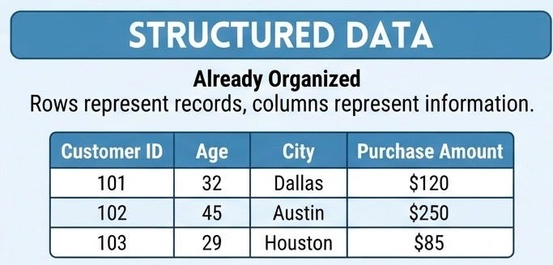
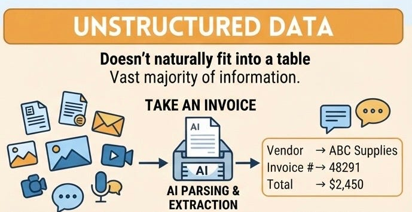

# Week 1, Day 3: What Kind of Data Can We Give AI?

*August 28, 2026 · [Originally published on Substack](https://niharikabatra.substack.com/p/week-1-day-3-what-kind-of-data-can)*

So far, we’ve talked about **how machines learn from data**. But before a machine can learn, we need to ask:

**What kind of data are we giving it?**

Because not all data looks like a neat spreadsheet.

---

**The data we’ve always been good at handling**

Imagine a company’s customer database:

Everything has a place. Rows represent records. Columns represent information. This is **structured data**.

For years, this has been the world of:

**SQL → Analysis → Dashboards → Power BI / Tableau**

We could easily ask questions like:

- Which city has the highest sales?
- Which customers spent the most?
- How did revenue change this month?

The data was already organized for us.

---

**But most information doesn’t look like this**

Now imagine your company has:

📄 invoices  
📑 contracts  
📧 emails  
🖼️ images  
🎥 videos  
🎙️ meeting recordings  
💬 customer conversations

You can’t simply put all of that into a neat table. That’s **unstructured data**. And there’s a *lot* of it.

---

**Take an invoice**

A human can open an invoice and immediately understand:

Vendor: ABC Supplies  
Invoice #: 48291  
Total: $2,450

But the original document might be a PDF containing text, tables, logos, and images.

Before a computer can use that information for analysis or an AI application, we often need to **parse the document and extract the information**.

Then we can turn it into something structured:

> Vendor → ABC Supplies
> 
> Invoice → 48291
> 
> Total → $2,450

Now we can store it, search it, analyze it, or pass it to another AI system.

---

**And this isn’t just about documents**

Think about a social media post.

It might contain:

**an image + a face + text + audio + comments + video**

Different AI techniques can help us extract useful information from each of these.

For example:

- Computer vision can analyze images.
- Speech models can turn audio into text.
- NLP can analyze text.
- LLMs can help understand and extract information from documents and conversations.

So the challenge isn’t always:

> **“How do I build a better model?”**

Sometimes it’s:

> **“How do I turn this messy information into something a machine can actually work with?”**

---

**Why this matters for modern AI**

This is one reason AI applications have expanded so much. We’re no longer limited to information that already exists neatly in databases. We can increasingly work with the information sitting inside:

**documents, images, conversations, audio, video, and other unstructured sources.**

And often the first step is:

> **Find the useful information → extract it → make it usable.**

Later, we’ll see how this connects to things like **RAG, embeddings, and LLM applications**. But don’t worry about those yet. For now, remember just this:

**Structured data - Already organized**

→ tables, databases, SQL

**Unstructured data- Information that doesn’t naturally fit into a table**

→ documents, images, audio, video, conversations

And AI is increasingly helping us **make sense of both**.

---

**Tomorrow:**

**What happens when the data itself is messy?**

Missing values. Incorrect values. Outliers.

Because even a perfectly designed AI model can’t magically fix bad information.

*One concept at a time.*
