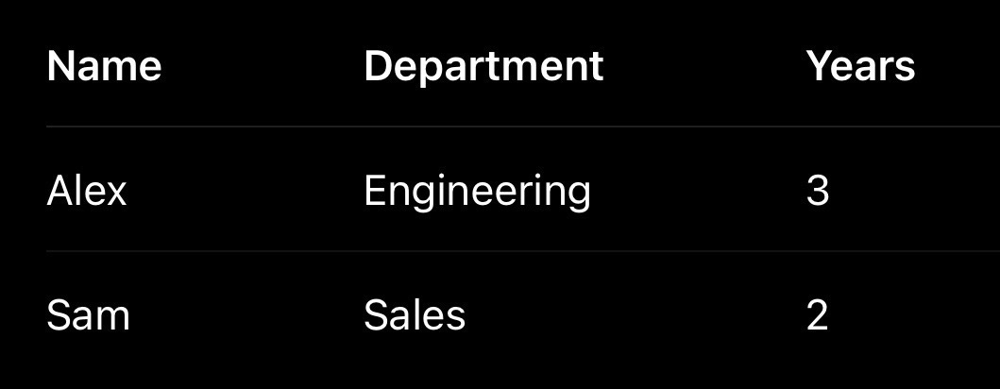
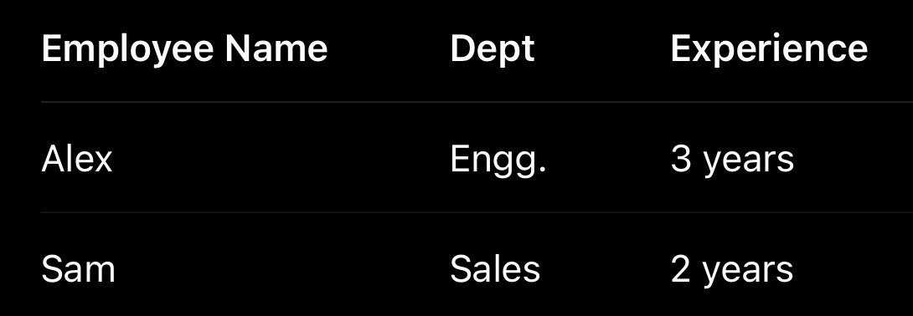
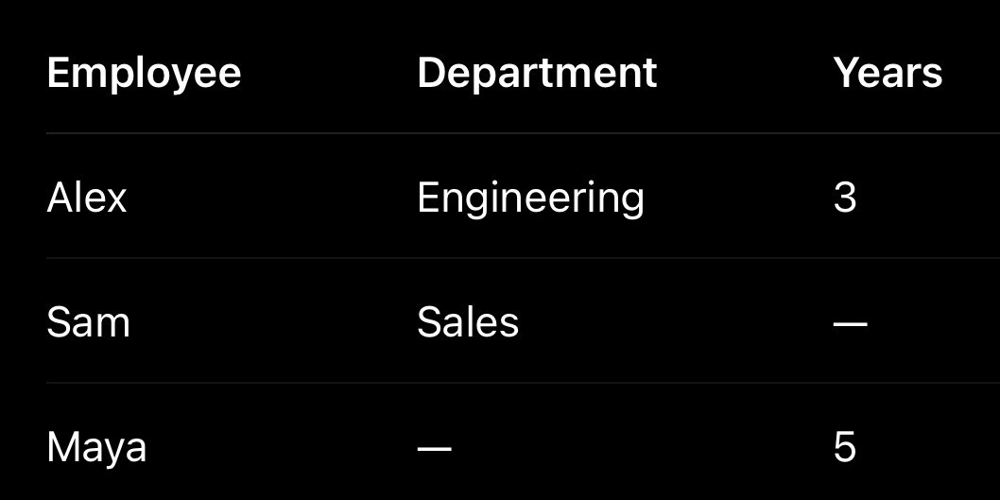
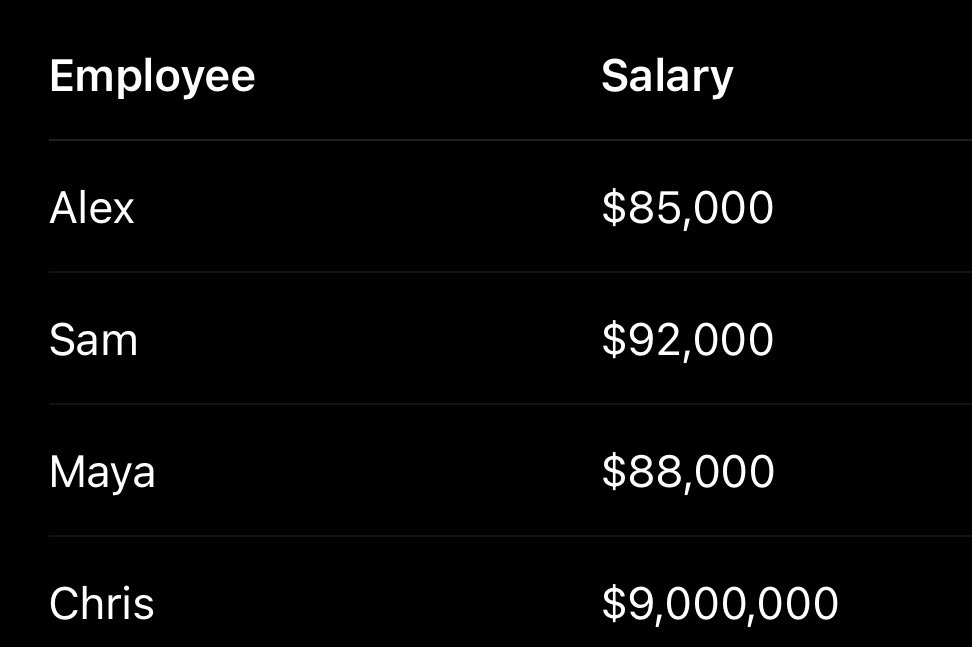

# Week 1, Day 4: Before AI Can Learn, We Have to Prepare the Data

*August 29, 2026 · [Originally published on Substack](https://niharikabatra.substack.com/p/week-1-day-4-before-ai-can-learn)*

Yesterday, we talked about the different kinds of data we can give AI.

Some data is already neat and organized. Some comes as documents, images, audio, or videos and needs to be understood first.

But here’s the part people often don’t see:

> **Getting the data is only the beginning.**

Real-world data is messy. Before we give it to a machine learning model, we first need to understand what we’re working with.

---

**Imagine getting employee data from different systems**

One system says:

Another says:

To a human, these probably mean the same thing. To a computer, they’re not automatically the same. We have:

- different column names
- different formats
- different values representing the same thing

Before using this data, we may need to make it consistent.

---

**And sometimes, information is simply missing**

You might see:

Now we have questions.

Is the information missing because:

- someone forgot to enter it?
- the system didn’t collect it?
- the information genuinely isn’t available?

Those situations might all look like an empty cell. But they can mean very different things.

- So what do we do?
- Remove the row?
- Estimate the value?
- Leave it as missing?

There isn’t one answer. First, we need to understand **why it’s missing**.

---

**Then there are outliers**

Imagine you’re looking at salaries:

Wait. 😳

That last value is very different from the rest. We call that an **outlier**.

But here’s something important:

> **An outlier isn’t automatically bad data.**

Maybe someone accidentally added an extra zero. Or maybe Chris is actually the CEO.

The value is unusual. But unusual doesn’t always mean wrong. So before removing an outlier, we need to ask:

> **Is this an error?**

Or:

> **Is this something important that really happened?**

---

**This is where a lot of real AI work begins**

When people imagine machine learning, they often picture:

> **Data → Model → Prediction**

But reality often looks more like:

> **Collect → Understand → Clean → Transform → Model → Evaluate**

Before the model even starts learning, someone has to understand the data.

And sometimes, that takes more work than training the model itself.

---

**Think about customer feedback**

Imagine you’re building a system to understand customer reviews.

Your data contains:

> Great service!
> 
> GREAT SERVICE!!!
> 
> gr8 service

And maybe one review is:

> GREEEEAAAAATTTTTT!!! 🤩🔥🔥🔥

Is that bad data?

Not necessarily.

But it may need to be handled differently depending on what we’re trying to do. This is why data preparation isn’t just about making everything look neat. It’s about understanding the information well enough to decide what should happen next.

---

**There is no “Clean Data” button ✨**

Unfortunately. 😄

Because every decision can affect what the model learns.

If we:

- fill missing values incorrectly, we might create false patterns
- remove too much data, we might lose useful information
- delete every unusual value, we might remove important real-world events

So data preparation isn’t simply:

> **Make the spreadsheet look perfect.**

It’s about asking:

> **What does this data actually represent?**
> 
> **What’s missing?**
> 
> **What’s inconsistent?**
> 
> **What’s unusual?**
> 
> **And is that unusual thing an error—or a signal?**

The model might be the part everyone talks about.

But the data determines **what the model gets the opportunity to learn.**

And a more advanced model can’t automatically fix data we don’t understand.

---

**Tomorrow:**

We’ll learn how to tackle missing values instead of simply deleting them:

> **Mean, Median, Mode, MICE**

And more importantly, we’ll learn **when to use which approach and why**.

Because handling missing data isn’t about filling empty cells.

> **It’s about making a decision without accidentally changing what the data is telling us.**

*One concept at a time.*
