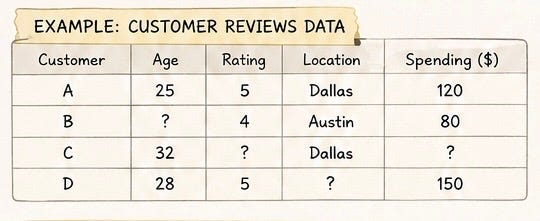
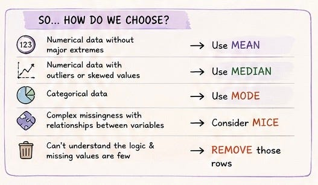

# Week 1, Day 5: What Do We Do When Information Is Missing?

*August 30, 2026 · [Originally published on Substack](https://niharikabatra.substack.com/p/week-1-day-5-what-do-we-do-when-information)*

Imagine you’re running an online store.

Hundreds of customers leave reviews about the products they bought.

Some write:

> ⭐⭐⭐⭐⭐ Loved it!

Others write detailed comments about the quality, delivery, or price.

Now imagine you’re trying to analyze this customer data to understand what people like.

But you notice something. Some customers gave a rating but didn’t mention their age. Some entered their age but skipped their location. Some left a review but didn’t provide a rating at all.

Your dataset starts looking like this:

This is called **missing data**.

And as we discussed yesterday, real-world data is rarely perfect.

But today, let’s go one step further.

**What do we actually do with those missing values?**

The answer is:

> It depends.

And that’s an important lesson in AI and machine learning.

There is no magic rule that says:

> “Whenever data is missing, always fill it with this value.”

First, we need to understand **why the information is missing**.

---

**Step one: Can we understand the reason?**

Suppose your website had a technical issue for two hours. During that time, customer ratings were not recorded.

Now you know why those ratings are missing. That’s useful information.

But imagine you see that 20% of customers are missing their age, and you have absolutely no idea why.

- Did they skip it?
- Did the system fail?
- Was the question optional?
- Was there a problem during data collection?

If we **can’t understand the logic behind why the data is missing**, we need to be careful about making assumptions.

> Sometimes, the best option is simply to **remove those data points from the model**.

For example, if only a small number of rows are missing important information, removing those rows may be safer than inventing values.

Because a wrong guess can sometimes be worse than having less data.

Of course, we can’t always do this. If 40% of our data is missing, deleting all those rows could mean losing a huge part of the dataset.

So then we look at other approaches.

---

**Option 1: Fill it with the Mean**

Let’s say we’re analyzing how much customers spend.

We have:

> $40, $50, $60, ?, $70

One simple approach is to calculate the **mean**, or average, and use it to fill the missing value. This is called **mean imputation**.

It can work reasonably well when the values are distributed fairly evenly. But there’s a catch.

Imagine these purchase amounts:

> $40, $45, $50, $55, $2,000

That one customer who spent $2,000 dramatically changes the average.

And suddenly, the mean doesn’t represent a typical customer anymore.

---

**Option 2: Use the Median**

The **median** is the middle value when numbers are arranged from smallest to largest. Unlike the mean, it is less affected by extreme values.

That’s why the median can be useful when your data contains unusual purchases, salaries, house prices, or other extreme values.

For example, one customer spending $2,000 shouldn’t necessarily convince us that the average customer spends hundreds of dollars.

Sometimes, the middle value tells a more realistic story.

---

**Option 3: Use the Mode**

Now let’s say we’re missing a customer’s most frequently purchased category.

For example:

> Skincare  
> Skincare  
> Makeup  
> ?  
> Skincare

We can’t calculate an average here. These are categories, not numbers.

Instead, we can use the **mode** - the value that appears most often.

In this case:

> **Skincare**

Mode is commonly used when working with categorical information.

---

**But what if other information can help us?**

Let’s go back to our online store. A customer’s annual spending is missing.

But we know:

- How often they shop
- How many products they buy
- Their membership type
- How long they’ve been a customer

Those pieces of information may help us make a better estimate. This is where more advanced techniques, such as **MICE**, can be useful.

> **MICE stands for Multiple Imputation by Chained Equations.**

Instead of filling every missing value with one simple average, MICE looks at relationships between different variables.

For example:

Customers who shop frequently and buy premium products may have different spending patterns than occasional shoppers.

The idea is to use the information available around a missing value to make a more informed estimate.

> **But here’s the important part. More advanced doesn’t always mean more correct.**
> 
> There is no single formula.

---

**The bigger lesson**

When a value is missing, we are often tempted to ask:

> **What should I put there?**

But the better question is:

> **Why is it missing in the first place?**

Because every time we fill in a missing value, we’re making an assumption. And those assumptions eventually become part of what our model learns.

> **Good AI doesn’t start by blindly fixing the data.**

> **It starts by understanding what the data is trying to tell us, even when some of it is missing.**

---

**Tomorrow: Outliers**

One customer spends $2,000 while everyone else spends around $50.

- Is that an error?
- Should we remove it?
- Or could that unusual data point be the most interesting thing in the entire dataset?

Tomorrow, we’ll explore outliers.

One concept at a time. One step closer to understanding AI.
