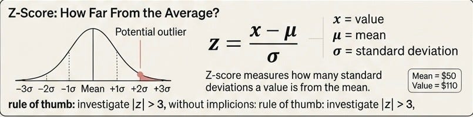
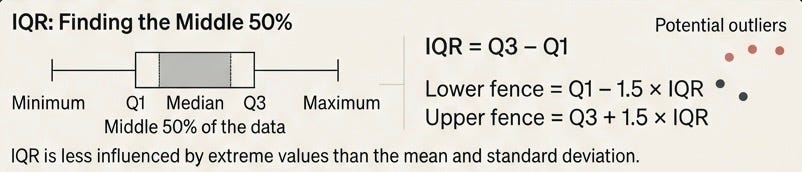
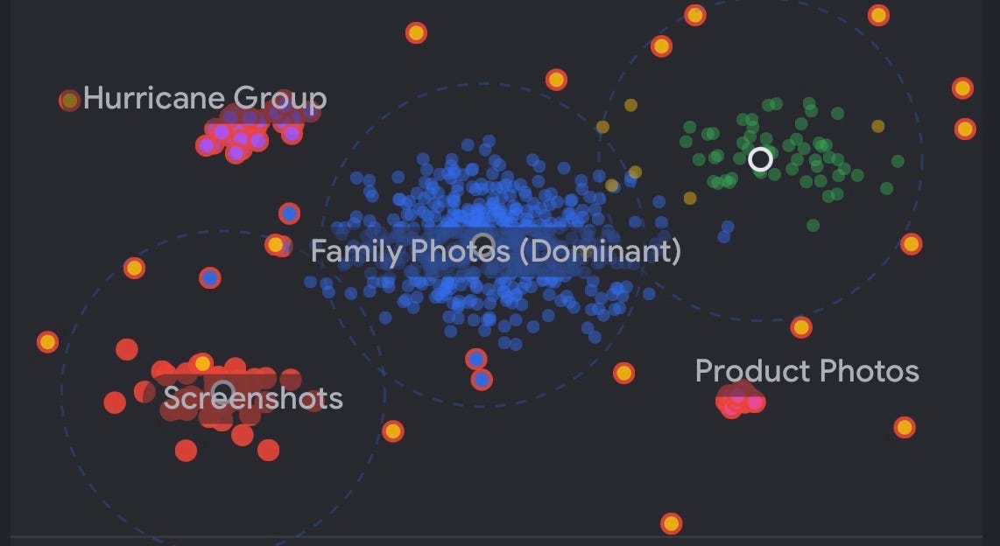

# Week 1, Day 6: Outliers — When Something Doesn’t Look Right

*August 31, 2026 · [Originally published on Substack](https://niharikabatra.substack.com/p/week-1-day-6-outliers-when-something)*

So far, we’ve talked about different types of data and what happens when information is missing.

But messy data has another problem. Sometimes, **nothing is missing.** Everything is there. And yet…

**something just doesn’t look right.**

---

Imagine you have thousands of invoices that need to be processed.

Most invoices look fairly similar.

- Invoice amounts are within a normal range.
- Dates follow expected formats.
- Each invoice contains a few line items.

Then one invoice appears with:

> **Amount: $1,000,000**

while most invoices are between **$500 and $5,000**. Or perhaps a document that usually contains **2–3 pages** suddenly has **300 pages**.

Or an employee record shows:

> **Age: 250**

Nothing is technically *missing*. But these values are unusual. In data, we call these **outliers**.

---

**But Is an Outlier Always a Mistake?**

Not necessarily.

That $1,000,000 invoice could be:

❌ A typing error.

Or it could be:

✅ A legitimate transaction from a major customer.

That 300-page document?

❌ It could be a system error where pages were duplicated.

Or:

✅ It could genuinely be a large annual report.

This is why we shouldn’t automatically delete unusual data.

**First, we need to identify it. Then, we need to understand it.**

---

**How Do We Find Something Unusual?**

For numerical data, two common methods are:

**1\. Z-Score**

Z-score asks:

> **How far is this value from what is typical?**

It considers the average and how spread out the data is. For example, if most invoices are around $2,000, an invoice worth $1,000,000 would likely have a very large Z-score.

A common rule is that values with a Z-score greater than **3 or less than -3** may deserve investigation.

> Want me to break this down further with practical examples? **Drop a comment 👇**

---

**2\. IQR (Interquartile Range)**

IQR takes a slightly different approach.

Instead of focusing on the average, it looks at the **middle 50% of the data**. It finds the typical range where most observations sit. Anything far outside that range gets flagged as potentially unusual.

Think of it like looking at a group photo. You don’t focus on the exact average height of everyone. You look at where **most people are standing** and notice if one person is standing on a ladder.

That’s essentially the intuition behind IQR.

---

**Outliers in Unstructured Data**

Outliers aren’t limited to numbers. Imagine you have **100,000 images** collected from the internet. Most images are family photos, but your dataset also contains:

- Hurricane images
- Product photos
- Screenshots
- Duplicate images
- Completely unrelated pictures

There may not be a column saying:

> **outlier = yes**

Instead, we can use techniques such as **clustering** to find groups of similar items.

> For example, **K-means clustering** can group images based on their extracted features.

You might discover clusters like:

If a small cluster is completely different from the dominant group, it deserves investigation. But again, being unusual doesn’t automatically mean it’s bad data.

A hurricane image might be:

- **Useful** if we’re building a disaster-detection model
- **Irrelevant** if we’re building a family-photo classifier

---

**What Can We Do With These Outliers?**

Once we’ve identified unusual or irrelevant data, we can:

> **Delete it**  
> → If it’s clearly unrelated to the task.

> **Domain filter it**  
> → Keep only data that belongs to the problem we’re solving.

> **Deduplicate it**  
> → Remove repeated copies of the same image, document, or record.

> **Keep it**  
> → If the unusual data represents something our model actually needs to learn.

This is especially important when building AI systems from large collections of **web data, images, documents, or other unstructured sources**.

> **An outlier isn’t defined only by being numerically extreme. Sometimes it’s simply data that doesn’t belong to the pattern or domain you’re trying to learn.**

---

**Tomorrow: Training, Validation & Test Data**

We’ve cleaned our data, handled missing values, and learned how to identify unusual data points. But now comes the big question:

> **How do we know if an AI model has actually learned?**

Think about preparing for an exam:

**Practice → Mock Test → Final Exam**

Machine learning follows a similar idea:

- **Training data** → The model learns from examples
- **Validation data** → We compare approaches and tune the model
- **Test data** → We evaluate the final model on data it has never seen

The goal isn’t to build a model that simply **remembers its training data**.

> It’s to build one that can **generalize to new data**.

**Tomorrow, we’ll see how this split works and why using the test set too early can give us a false sense of success.**

One concept at a time. One step closer to understanding AI.

If you’re enjoying the series, Restack this 🔄
