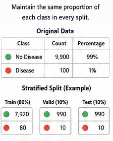
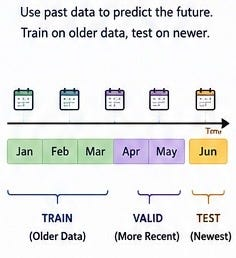
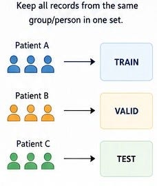

# Week 1, Day 7: How Do We Split Data for Machine Learning?

*September 1, 2026 · [Originally published on Substack](https://niharikabatra.substack.com/p/week-1-day-7-how-do-we-split-data)*

Imagine you have collected data from **10,000 customers** and want to build a model that predicts:

> **Will this customer buy our product?**

Before training the model, we need to divide the data into different groups. But here’s the important question:

> **Can we just randomly divide the data?**

Sometimes yes. Sometimes **absolutely not**.

The way we split data depends on the type of data and the problem we’re solving. Today, let’s understand the most common approaches:

- Random Split
- Stratified Split
- Time-Based Split
- Group-Based Split
- Training, Validation & Test Split

---

**1\. Random Split 🎲**

The simplest approach is to randomly distribute data into different sets. Suppose we have **100 customer records**. We might randomly split them:

- **80 records → Training**
- **10 records → Validation**
- **10 records → Test**

Each customer has a random chance of ending up in any pile.

This works well when your data is:

- Large enough
- Randomly collected
- Not dependent on time
- Fairly balanced

For example:

Predicting house prices using features like bedrooms, location, and square footage.

Randomly splitting the houses can work well.

---

**But Random Splitting Has a Problem ⚠️**

Imagine you’re building a model to detect a **rare disease**. Out of **10,000 patients**:

- 9,900 → Don’t have the disease
- 100 → Have the disease

> Only **1%** of the data belongs to the positive class.

Now imagine we randomly split the data.

By chance, one of the smaller datasets might contain very few or even no positive examples. That creates a problem. The training and test datasets may no longer represent the real distribution properly.

This is where **Stratified Splitting** helps.

---

**2\. Stratified Split 📊**

A stratified split makes sure that the important categories maintain approximately the **same proportion** across each dataset. Let’s use the disease example.

With a stratified split, each dataset maintains approximately the same distribution.

Instead of simply shuffling and hoping for the best, we intentionally preserve the proportions.

**Important point:**

> **Stratified doesn’t mean the data isn’t random.** It is still randomly selected—but **within each category**.

---

**3\. Time-Based Split ⏰**

Now let’s consider a completely different problem. Imagine we’re predicting:

> **Will a customer cancel their subscription next month?**

We have customer data from:

- January
- February
- March
- April
- May
- June

Would it make sense to randomly mix all six months together?

> Not always.

Because in the real world:

> **The past predicts the future.**

We should train using older data and test using newer data.

---

**Why Not Randomly Split Time Data?**

Imagine you’re predicting tomorrow’s stock price.

If your training data accidentally contains information from **December** while your test data contains **January**, the model is indirectly learning from the future.

That’s unrealistic. This is another form of **data leakage**.

---

**4\. Group-Based Split 👥**

Sometimes the problem isn’t about time or class distribution.

It’s about **people or groups**.

Imagine you’re building a model using medical images.

You have:

- 1,000 patients
- Each patient has 10 images

That’s **10,000 images**.

If we randomly split individual images, we might get:

> Patient A Image 1 → Training
> 
> Patient A Image 2 → Training
> 
> Patient A Image 3 → Test ❌

The model has already seen very similar images from Patient A during training.

The test isn’t truly testing something new.

**The Solution: Group-Based Split**

> We keep all records belonging to the same person in one dataset.

This is useful when data contains multiple records from:

- The same customer
- The same patient
- The same employee
- The same company
- The same household

The goal is:

> **Don’t let information from the same group leak into both training and testing.**

---

**5\. Training, Validation & Test Sets**

Regardless of how we perform the split, we usually assign different purposes to the datasets.

**🟢 Training Set -** Used to teach the model.

The model sees:

- Input
- Correct answers

And learns patterns.

---

**🟡 Validation Set -** Used while developing the model.

We might compare **Model A** vs. **Model B**

Or change settings such as:

- Number of trees
- Learning rate
- Number of layers

The validation set helps us decide **which version is better?**

---

**🔵 Test Set -** The final untouched dataset.

We use it at the end to answer:

> **How well does this model perform on genuinely unseen data?**

---

**One Important Thing: The Split Happens Before Learning 🚨**

A common mistake is allowing information from the full dataset to influence preprocessing.

For example:

Imagine you calculate the **average income** using the entire dataset before splitting. That means your training process has indirectly used information from the test data.

---

**The Big Idea 💡**

There is no universal: **“Just use 80/20 split.”**

The right way to split data depends on **how the data was created and how the model will be used in the real world**.

Loved it? Restack and share with others!

---

**🔮 What’s Coming Tomorrow: Week 2**

We start with:

What is Machine Learning? How Does a Machine Learn from Examples? Supervised and Unsupervised learning?

One concept at a time.
