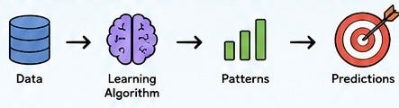
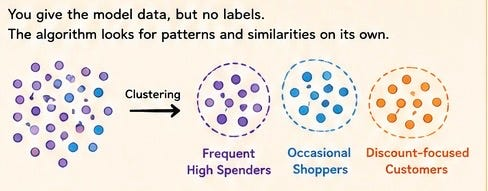

# Week 2, Day 1: Welcome to Machine Learning 🤖

*September 2, 2026 · [Originally published on Substack](https://niharikabatra.substack.com/p/week-2-day-1-welcome-to-machine-learning)*

Last week, we learned something important: **AI needs data.**

But what happens after we collect, clean, organize, and prepare that data?

This week, we finally step into one of the most exciting parts of AI:

> **Machine Learning.**

---

**The big question**

Imagine you show a computer thousands of houses along with their prices.

🏠 Size: 2,000 sq ft → $400,000  
🏠 Size: 3,000 sq ft → $550,000  
🏠 Size: 1,500 sq ft → $320,000

Now you show it a new house:

🏠 Size: 2,500 sq ft → **?**

Instead of writing a rule like:

“If the house is this big, the price should be this much…”

> we let the computer **learn patterns from previous examples**.

That is the basic idea behind **machine learning**.

---

**What is Machine Learning?**

**Machine Learning (ML)** is a way of teaching computers to learn patterns from data and use those patterns to make predictions, decisions, or discoveries.

Instead of explicitly programming every rule, we give the machine:

For example:

- 📧 Emails → Learn spam patterns → Detect spam
- 🏠 House data → Learn pricing patterns → Predict house prices
- 🖼️ Images → Learn visual patterns → Recognize objects
- 🎬 Movie preferences → Learn your taste → Recommend movies

---

**So, does the machine actually “learn”?**

Yes, but not in the same way humans learn. A machine learning model does not suddenly understand the world.

> It learns by finding **mathematical relationships and patterns** in data.

For example, after seeing thousands of houses, it may discover that:

- Larger houses often cost more.
- Location affects price.
- More bedrooms can influence value.
- Newer houses may have different pricing patterns.

> It captures these relationships in a mathematical form we call a **model**.

---

**The Two Big Types of Machine Learning**

This week, we will explore the major ways machines learn.

**1️⃣ Supervised Learning**

The model learns from data where the correct answer is already known.

We provide the **input** and the **correct output**. The model learns the relationship between them.

Later, we can ask:

> “What might this new house cost?”

Examples:

- Predicting house prices
- Detecting spam
- Predicting customer churn
- Diagnosing patterns from medical data

---

**2️⃣ Unsupervised Learning**

Here, we give the model data but **no correct answers**. For example, imagine giving an algorithm thousands of customer records.

You don’t tell it:

“These are Customer Type A.”

“These are Customer Type B.”

Instead, the algorithm looks for patterns and similarities on its own.

It might discover groups such as:

This process is often called **clustering**. One example we’ll explore is **K-Means clustering**.

---

**Where Do Vectors Fit Into All This? 👀**

You may hear terms like:

**Vectors, embeddings, features, dimensions…**

Don’t worry, we’ll get there.

> Computers cannot directly understand a cat, a sentence, or a customer in the way humans do. We need ways to represent information **numerically** so algorithms can work with it.

For example:

> House → \[2000, 4, 2, 2015\]

These numerical representations become extremely important in machine learning.

And when we start working with complex data like **text, images, and audio**, we’ll see why **vectors and embeddings** are so powerful.

The goal isn’t to memorize complicated algorithms immediately. The goal is to first understand:

> **What problem are we trying to solve, and how does a machine learn from data?**

Once that foundation is clear, the math and algorithms become much easier to understand.

---

**Tomorrow:**

Let’s start with Supervised Learning where machines learn from examples with known answers. 🤖📊

One concept at a time. One step closer to AI.
