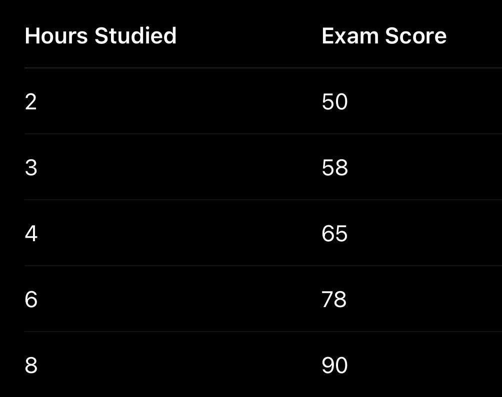
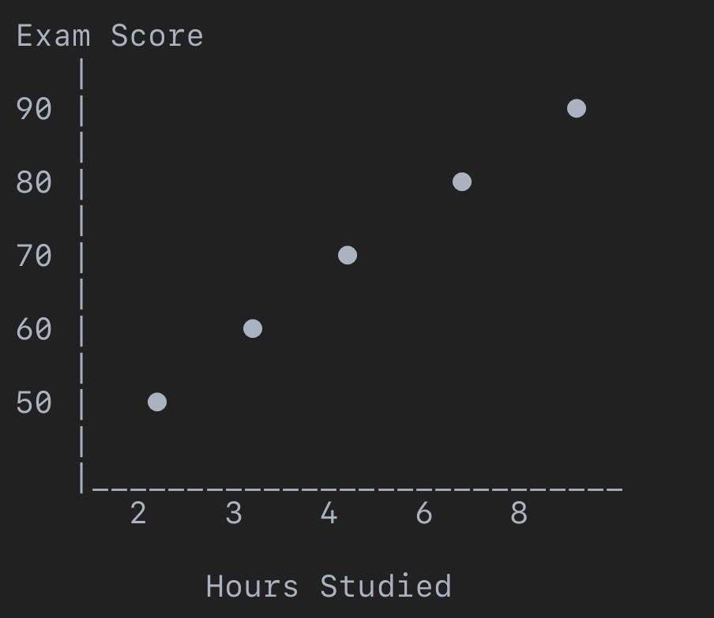
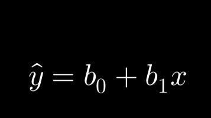
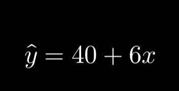
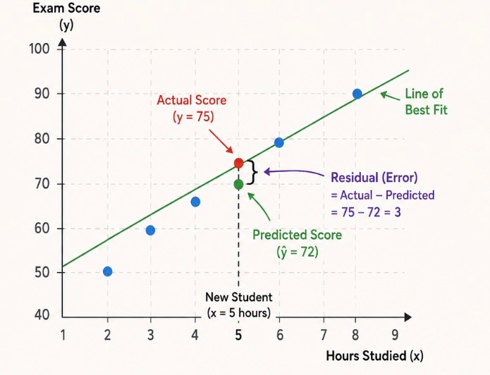

# Week 2, Day 2: Linear Regression - Your First Supervised Machine Learning Algorithm

*September 3, 2026 · [Originally published on Substack](https://niharikabatra.substack.com/p/week-2-day-2-linear-regression-your)*

So far in this series, we have talked about **machine learning**, explored **data**, understood the importance of **training and testing**, and introduced the idea of **supervised learning**.

Now, it’s time to go one step deeper. We’ve talked about *types* of machine learning.

But how does a machine actually learn?

> The answer lies in **algorithms**.

And today, we’re starting with one of the simplest and most important machine learning algorithms: **Linear Regression**

---

**From Machine Learning Concepts to Machine Learning Algorithms**

Think of supervised learning as a broad category. It tells us **how a model learns**:

> Learn from examples where we already know the answer.

But within supervised learning, there are many different algorithms. For example:

- Linear Regression
- Logistic Regression
- Decision Trees
- Random Forest
- Support Vector Machines
- Neural Networks

Each algorithm learns patterns differently. Today, we meet our first one. **Linear Regression**

---

**Let’s Start With a Problem**

Imagine you are a teacher. You have data from previous students:

Now, a new student tells you:

“I studied for 5 hours. What score might I get?”

You don’t know the exact answer. But you have historical data. You can look for a pattern.

You might notice:

> In general, students who study more tend to score higher.

Based on this relationship, you might estimate a score. This is the kind of problem **Linear Regression** helps us solve.

---

**What Is Linear Regression?**

> **Linear Regression is a supervised machine learning algorithm used to predict a numerical value.**

It looks at the relationship between input variables and an output variable.

For example:

**Input: Hours studied**

**Output: Exam score**

The model learns from existing examples and then makes predictions for new data.

In simple terms:

> **Give the model historical examples, and it learns a relationship that can help predict a number.**

---

**Why Is It Called Regression?**

In machine learning, **regression** refers to predicting a numerical value.

Examples include predicting:

- 🏠 House prices
- 💰 Sales revenue
- 🌡️ Temperature

---

**Features and Target: A Quick Recap**

Let’s return to our student dataset.

**Feature (X) -** The information we use to make a prediction. Eg: Hours studied

**Target (y) -** The value we want to predict. Eg: Exam score

Notice something important. We are giving the model examples where we already know the answer.

> That is what makes Linear Regression a **supervised machine learning algorithm**.

---

**Why Is It Called Linear ?**

Imagine plotting our student data on a graph.

- The horizontal axis represents **Hours Studied**
- The vertical axis represents **Exam Score**

You might see something like this:

There appears to be a relationship. As hours studied increase, the exam score generally increases.

> Linear Regression tries to represent this relationship using a **straight line**.

That’s where the word **linear** comes from.

---

**The Line of Best Fit**

Now imagine drawing a line through the data. Not every point will sit perfectly on that line. And that’s okay. Real-world data is messy.

Two students might study for the same number of hours but receive different scores because of:

- Previous knowledge
- Study quality
- Difficulty of the exam
- Sleep
- Stress
- Many other factors

Linear Regression does not try to perfectly explain every individual example. Instead, it tries to find a line that best represents the **overall relationship** in the data.

> We call this the: **Line of Best Fit**

You can think of the model asking:

> **Which straight line gives me predictions that are closest to the actual data overall?**

---

**The Equation Behind the Line**

You may remember the equation of a straight line from school:

> y = mx + c

In Linear Regression, we often write it as:

Don’t worry about memorizing this yet. Let’s break it down.

**ŷ (y-hat): The Prediction**

> The symbol **ŷ** means **The value predicted by the model**

**For example:**

> Actual exam score: 82

> Predicted exam score: 80

Then **ŷ = 80**

---

**x: The Input**

> It represents our feature.

In our example:

x = Hours Studied

If a student studied 5 hours:

x = 5

---

**b₀: The Starting Point**

> **b₀** is called the **intercept**.

You can think of it as where the line starts on the graph.

---

**b₁: The Relationship**

> **b₁** is called the **coefficient** or **slope**.

It represents how much the prediction changes when **x** changes.

For example, imagine our model learns:

This means:

- Start at 40
- Add 6 points for every additional hour studied

---

If: x = 5 hours

Then the model predicts:

**ŷ** \= 40 + 6(5) = 70

So the predicted exam score is: **70**

**I would recommend spending some time to understand this if you are new to algorithms, but feel free to comment or ask me questions.**

---

**Wait… Does the Model Know This Equation Already?**

No. This is an important point. We don’t usually tell the model:

“Use 40 as the starting point and 6 as the slope.”

> The model has to **learn the best values** from the data.

In other words, it needs to figure out:

What should b₀ be? and: What should b₁ be?

so that its predictions are as close as possible to the actual values. This is where the actual **learning** happens.

---

**Actual Value vs Predicted Value**

Let’s say a student studied for 5 hours.

The actual exam score was: **75**

But our model predicted: **72**

> This difference is called an **error**.

> More specifically, the vertical difference between an actual data point and the predicted line is often called a **residual**.

Our goal is not necessarily to make every single prediction perfect. Instead, we want the model to find a line that keeps the overall prediction errors as small as possible.

---

**Coming Up Tomorrow 👀**

In the next article, we’ll go deeper into one of the most important questions behind Linear Regression:

> **How Does a Machine Find the Best Line?**

We’ll explore:

- Predictions vs actual values
- Errors and residuals
- Why errors are squared
- The intuition behind **Least Squares**

We’re no longer just talking about what machine learning *is*. We’re starting to understand **how machine learning algorithms actually learn.** 🚀

One concept at a time. One step closer to AI.
