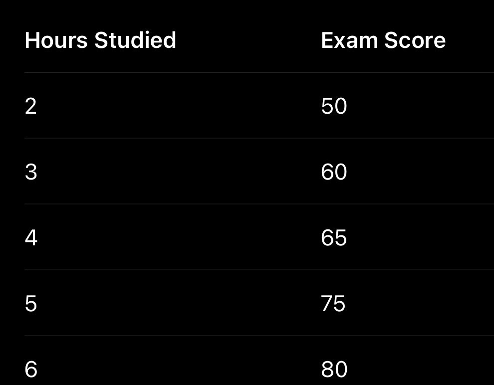
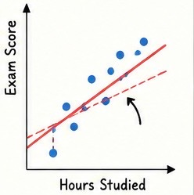
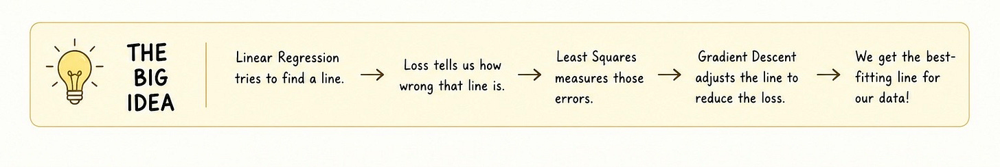

# Week 2, Day 3 - How Does Linear Regression Find the Best Line?

*September 4, 2026 · [Originally published on Substack](https://niharikabatra.substack.com/p/week-2-day-3-how-does-linear-regression)*

In the previous article, we introduced **Linear Regression** as our first supervised machine learning algorithm. We used a simple question:

> **Can we predict a student’s exam score based on how many hours they studied?**

We saw that Linear Regression tries to find a straight line that captures the relationship between **hours studied** and **exam score**.

But we left an important question unanswered:

> **How does the model know which line is the best one?**

Let’s continue with the same example.

---

**Our Data**

Suppose we have this data:

If we plot these points, we can draw many possible lines. Some lines will come close to most of the students’ scores. Others might be too high or too low.

So how does the model decide?

---

**1\. The Model Starts With a Line**

Think of Linear Regression as trying to find a line that does a good job of predicting the exam scores.

> It could start with a line that isn’t very good.

For example, for a student who studied **6 hours**, the model might predict a score of **64**. But the actual score is **70**. The prediction is off by **6 points**.

For another student, the prediction might be off by 2 points. For another, maybe 5 points.

> These differences are called **errors** or **residuals**.

The idea is simple:

> **The closer our predictions are to the actual values, the better our line is.**

But now we have another problem. There isn’t just one error. There are errors for **every student**. We need some way to summarize all of them.

---

**2\. Loss: How Bad Is Our Line?**

This is where the idea of **loss** comes in. Loss gives us a single way to describe:

> **“How wrong is my model overall?”**

Imagine we have two possible lines.

**Line A**

- Prediction error: 2
- Prediction error: 3
- Prediction error: 1
- Prediction error: 4

**Line B**

- Prediction error: 8
- Prediction error: 6
- Prediction error: 10
- Prediction error: 7

Clearly, Line A is doing a better job.

> A loss function allows the model to turn all those individual errors into a measure of overall performance.

So we can think of it as:

> **Smaller loss = better line**

> The model’s goal is therefore to find a line that gives it the **smallest possible loss**.

But how exactly should we calculate that loss?

---

**3\. Least Squares: Why Square the Errors?**

> One common approach used in Linear Regression is called **Least Squares**.

The basic idea is very simple:

> **Take each error, square it, and then combine those squared errors.**

But why square the errors?

Because errors can go in different directions.

Suppose one prediction is **5 points too high** and another is **5 points too low**.

If we simply added the errors:

**+5 + (-5) = 0**

It would look like there was no error. But that’s obviously not true. The model made two mistakes.

Squaring fixes this:

- 5 becomes 25
- \-5 also becomes 25

Now both errors count. There is another useful effect. Squaring makes **large errors much more important**.

For example:

- Error of 2 → 4
- Error of 5 → 25
- Error of 10 → 100

> So being very far away from the actual value gets penalized heavily.

That’s why least squares encourages the model to find a line that doesn’t make large mistakes.

In simple terms:

> **Least Squares tries to find the line with the smallest overall squared error.**

---

**4\. But How Does the Model Find That Line?**

We now know what the model wants:

> **Find the line with the smallest loss.**

But there could be many possible lines. How does the model actually search through them?

> This is where **Gradient Descent** comes in.

Imagine you’re standing somewhere on a mountain, and your goal is to reach the lowest point in the valley. But you can’t see. You can only feel the slope underneath your feet.

You could:

1.  Check which direction goes downhill.
2.  Take a small step in that direction.
3.  Check again.
4.  Take another step downhill.
5.  Keep repeating.

Eventually, you get closer to the bottom.

Gradient Descent works with a similar idea. The model starts with a line. It calculates its loss. Then it asks:

> **“Which direction should I move this line to reduce the loss?”**

It makes a small adjustment. Then it calculates the loss again. If the loss became smaller, the model is moving in the right direction.

It continues making adjustments until it reaches a point where the loss is as small as it can reasonably get.

---

**5\. So What Is Actually Changing?**

This is an important point. The **data doesn’t change**. Our students still studied the same number of hours and received the same scores.

> What changes is the **line**.

The model adjusts the line’s:

- **slope** - how quickly the predicted score changes as study hours increase
- **intercept** - where the line starts

Together, these determine where the line sits on the graph. Gradient Descent keeps adjusting them to improve the predictions.

You don’t need to worry about the equations behind these adjustments yet.

For now, remember the intuition:

> **The model keeps nudging the line in a direction that reduces its error.**

---

**6\. When Does It Stop?**

Eventually, the model reaches a point where making small adjustments doesn’t meaningfully reduce the loss anymore.

> It has reached a **minimum**.

Think back to our mountain example.

You started somewhere on the mountain and kept walking downhill. Eventually, you reach the bottom. For Linear Regression, we’re looking for the equivalent:

> **The line where the loss is as small as possible.** That becomes our **best-fitting line**.

It doesn’t necessarily pass through every single data point. Instead, it is the line that gives the best overall fit according to the chosen loss.

---

**The Big Idea**

You don’t need to memorize equations yet.

Just remember this story:

And this is an important shift in how we should think about machine learning.

> The model isn’t **“looking at the data and knowing the answer.”** It is **optimizing**.

> It makes a prediction, measures how wrong it is, and adjusts itself to do better.

That’s the basic idea behind how a machine learning model **learns**.

---

**Tomorrow**

We’ve now seen how Linear Regression learns its line. But we’ve been working with just **one input: hours studied**.

What happens when we have many inputs?

For example:

- Hours studied
- Attendance
- Previous exam score
- Assignments completed

How can one model use all of these to make a prediction?

That’s where we move from simple Linear Regression to multiple features and start seeing why data is often represented as vectors and matrices.

One concept at a time. One step closer to AI.
