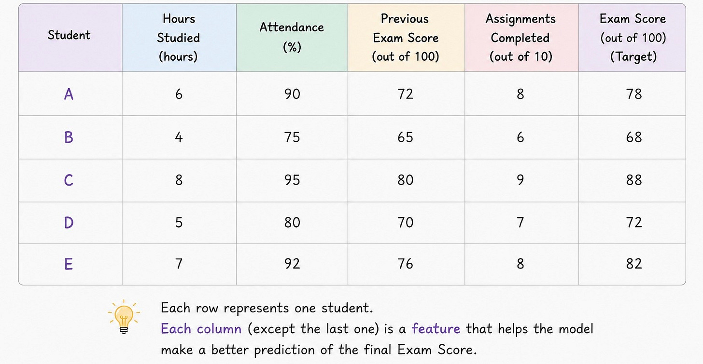

# Week 2, Day 4- What Happens When a Model Has More Than One Input? Features, Weights & Vectors

*September 5, 2026 · [Originally published on Substack](https://niharikabatra.substack.com/p/week-3-day-4-what-happens-when-a)*

Yesterday, we saw how Linear Regression learns a line that can make predictions. We used a simple example:

> **Hours studied → Exam score**

The model learned a relationship like:

> **Exam Score = 40 + 6 × Hours Studied**

But let’s be honest.

> **Can exam score really depend only on how many hours someone studied?**

Probably not. Two students might both study for 6 hours and still get very different scores.

Why?

- Maybe one had better attendance.
- Maybe one had a higher previous exam score.
- Maybe one completed all the assignments.

So now we have a more interesting question:

> **What happens when a model has more than one thing to look at?**

---

**One student, many pieces of information**

Imagine we have this data:

Previously, our model looked at only:

> **Hours Studied → Exam Score**

Now it can look at:

> **Hours Studied + Attendance + Previous Score → Exam Score**

> This is called having **multiple features**.

> A **feature** is simply a piece of information that the model uses to make a prediction.

So here:

- Hours studied = feature
- Attendance = feature
- Previous score = feature

Nothing scary yet. 🙂

---

**But here’s the interesting part: not every feature matters equally**

Suppose the model is predicting your exam score.

> Would one extra hour of studying have the same impact as a 1% change in attendance?

Probably not.

> And previous exam performance might also tell us something important.

So the model needs to figure out:

> **How much importance should I give each feature?**

This is where **weights** come in.

Think of weights as the model’s way of saying:

> “This piece of information matters this much.”

For example, the model might eventually learn something like:

- Hours studied → important
- Attendance → somewhat important
- Previous score → very important

We don’t decide these weights ourselves.

> **The model learns them from the data.**

And this is a very important idea in Machine Learning.

---

**Features + weights = prediction**

Let’s imagine the model has learned that:

- Hours studied has a strong influence
- Attendance has a smaller influence
- Previous score has a strong influence

It combines all of them to produce one prediction. Conceptually:

**Prediction =**

- contribution from hours studied
- contribution from attendance
- contribution from previous score

You don’t need to worry about the equation yet.

Just remember the idea:

> **Each feature contributes something to the final prediction, and its weight determines how much it contributes.**

If this part feels confusing, **comment below**.

This is one of those concepts that becomes much easier with a few examples, and I can explain weights separately in more detail.

---

**So what happened to our simple line?**

With one feature, we could visualize the relationship as a **line**:

> **Hours studied → Exam score**

But now we have several features. We are no longer asking:

“Where should I draw this line?”

We are asking:

> **“How should I combine all these pieces of information to make the best prediction?”**

The mathematics becomes more complicated, but the basic idea hasn’t changed.

The model still wants to find the combination that produces predictions as close as possible to the actual exam scores.

---

**And this is where vectors enter the story**

You’ve probably heard the word **vector** thrown around in Machine Learning.

It sounds complicated, but the basic idea is surprisingly simple.

For one student, instead of writing:

> 6 hours, 90% attendance, 72 previous score we can represent all of that information as a list: **\[6, 90, 72\]**

> That’s a **vector**.
> 
> **A vector is simply a numerical representation of the features for one data point.**

- Student A → \[6, 90, 72\]
- Student B → \[4, 75, 65\]
- Student C → \[8, 95, 80\]

When we have thousands of students, we have thousands of these rows.

Together, they form a **matrix** - essentially a structured table of our data.

You don’t need to memorize the mathematical definition right now.

Just remember:

> **One student’s features → vector**  
> **Many students’ feature vectors → matrix**

---

**One important thing to notice**

Even though we’ve added more features, the fundamental idea of learning hasn’t changed.

The model still:

> **Looks at data → makes predictions → compares predictions with reality → learns from the error.**

We’re simply giving it **more information to learn from**.

And that is one of the big transitions in Machine Learning:

> **From a simple relationship between one input and one output → to models that learn from many pieces of information at once.**

---

**What’s next?**

We’ve now introduced **features, weights, vectors, and matrices**.

Tomorrow, we’ll look at something important:

> **How does the model actually learn all those weights?**

That’s where the idea of **parameters and optimization** becomes much more interesting.

I am deliberately keeping it simple and short. Comment if the pace feels right.

One concept at a time. One step closer to AI

Restack if you loved it!
