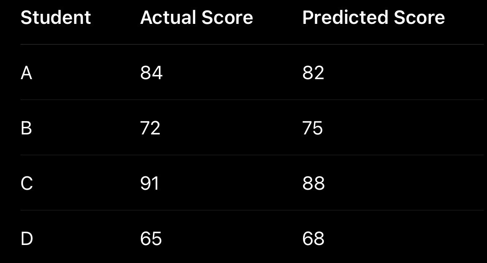
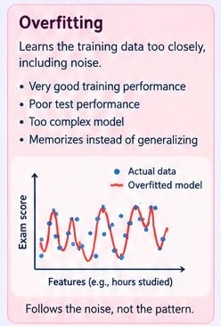
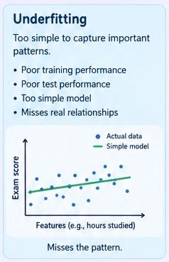
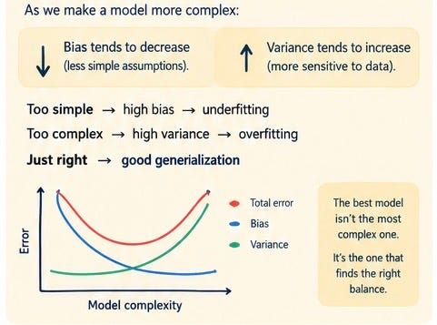

# Week 2, Day 5 - Model Evaluation, Overfitting, Underfitting & Bias-Variance

*September 6, 2026 · [Originally published on Substack](https://niharikabatra.substack.com/p/week-2-day-5-your-model-got-100-so)*

Yesterday, we gave our model something more realistic to work with.

Instead of predicting an exam score using just **hours studied**, we gave it multiple features:

> **Hours studied + Attendance + Previous score → Exam score**

We also saw how features can be represented as **vectors**, how multiple pieces of information can be handled using **matrices**, and how the model uses **weights** to make predictions.

But now comes a very important question:

> **How do we know whether our model is actually good?**

Because a model making predictions isn’t enough.

> It needs to make **good predictions on data it hasn’t seen before.**

And this is where things get interesting. So today, let’s talk about **evaluation, overfitting, underfitting, bias, and variance**

---

**First: How wrong is our model?**

Let’s go back to our exam-score example.

Suppose our model makes these predictions:

We can look at these individually and say:

“The predictions look pretty close.”

> But when we have thousands or millions of predictions, we need a **number that summarizes how well our model is performing.**

That’s where **evaluation metrics** come in.

---

**MAE - How far off are we on average?**

One of the easiest metrics to understand is **Mean Absolute Error**, or **MAE**.

Imagine our model makes four predictions:

Actual: 84 → Predicted: 82 → Error: 2  
Actual: 72 → Predicted: 75 → Error: 3  
Actual: 91 → Predicted: 88 → Error: 3  
Actual: 65 → Predicted: 68 → Error: 3

The absolute errors are:

> 2, 3, 3, 3

MAE simply asks:

> **“On average, how far away were my predictions?”**

Here, the average error is:

> **2.75 points**

So we can say:

> **Our model is off by about 2.75 points on average.**

That’s very intuitive and generally:

> **Lower MAE = better predictions**

---

**MSE - What if large mistakes matter more?**

Now imagine two models.

- **Model A -** Most predictions are only a few points off.
- **Model B -** Most predictions are close, but occasionally it makes a **huge mistake**.

Sometimes that large mistake matters much more than several small ones.

> That’s where **Mean Squared Error (MSE)** becomes useful. Instead of simply looking at the size of the error, we **square the error**.

So:

Error = 2 → 4  
Error = 5 → 25  
Error = 10 → 100

Notice what happened?

A large error becomes much more significant.

That’s the key idea behind MSE:

> **Large mistakes are penalized more heavily.**

Again, you don’t need to memorize the formula yet.

---

**RMSE - Bring the error back to the original scale**

There’s a small problem with MSE.

If our target is **exam score in points**, squaring the errors means the resulting number isn’t in the same unit anymore.

> That’s why we often use **Root Mean Squared Error (RMSE)**. RMSE essentially takes the square root of MSE, bringing the result back to the original scale.

So if RMSE is:

> **4.2**

we can roughly interpret that as:

> **Our predictions are typically off by around 4.2 points.**

This makes RMSE easier to interpret than MSE.

---

**R² — How much of the pattern are we explaining?**

Another popular metric for regression is **R-squared (R²)**.

Instead of asking:

> “How many points off am I?”

R² asks something closer to:

> **“How much of the variation in the target can my model explain?”**

- An R² closer to **1** generally indicates that the model explains the observed variation well.
- An R² around **0** means the model isn’t explaining much more than a simple baseline.
- And R² can even be **negative** when the model performs worse than that baseline.

We don’t need to dive into the mathematics yet.

The important thing is that **different metrics answer different questions.**

> **Choosing an evaluation metric is part of understanding the problem you’re solving.**

---

**But here’s where things get interesting…**

Imagine we build two models.

**Model A**

> Training performance: **Good**

> New-data performance: **Good**

**Model B**

> Training performance: **Almost perfect**

> New-data performance: **Terrible**

At first, Model B looks amazing.

So what happened?

---

**The model learned TOO much.**

Suppose our model sees thousands of students. It might start learning genuine relationships such as:

> More preparation generally helps performance.

But it might also start picking up random quirks in the training data. For example:

> Students who studied exactly 6.5 hours on Tuesdays tend to score higher.

Maybe that’s true in our training data. But it might be completely meaningless in the real world.

The model has started learning **noise** rather than just useful patterns.

> So we get very **good training performance** but **Poor performance on new data.** This is called **overfitting**.

---

**Now let’s go in the opposite direction.**

What if our model is **too simple**?

Suppose we try to predict everyone’s exam score with:

> **Prediction = 70**

That’s it.

It doesn’t care about:

- Hours studied
- Attendance
- Previous score
- Anything else

It’s clearly missing important patterns.

> This is called **underfitting**. The model hasn’t learned enough. So we get **poor training performance** and usually poor **performance on new data**

---

**Think of it like this**

Imagine trying to fit a line through our exam-score data.

**Underfitting**

- The model is too simple.
- It misses important patterns.

**Good fit**

- The model captures the meaningful pattern.

**Overfitting**

- The model tries to follow every little fluctuation in the data.
- It starts fitting the **noise**.

> The goal isn’t to create the most complicated model. It’s to create a model that captures the **right patterns**.

---

**And this brings us to Bias and Variance**

These two words sound much scarier than they really are. Let’s keep them intuitive.

**Bias:**

**“Is my model making assumptions that are too simple?”**

> A high-bias model tends to be too simple and misses important relationships. That’s closely related to **underfitting**.

---

**Variance:**

**“Is my model too sensitive to the particular data it was trained on?”**

A high-variance model can change significantly depending on the training data.

> It may fit the training examples extremely well but struggle with new data.That’s closely related to **overfitting**.

---

**A simple way to remember it**

**High Bias - “I’m too simple. I can’t capture the pattern.”** → Underfitting

**High Variance - “I’m paying too much attention to the training data.”** → Overfitting

And somewhere in between, we want:

> **Enough complexity to learn the real pattern, but not so much that we memorize the noise.**

That’s the **bias-variance tradeoff**.

This is one of the fundamental ideas in Machine Learning.

---

**And this is why “100% accuracy” isn’t automatically impressive**

Imagine someone tells you:

> **“Our model has 99.9% accuracy!”**

Your next question shouldn’t necessarily be:

> “Wow! How did you do that?”

It should be:

> **“On what data?”**

And then:

> **“Which metric are you using?”**
> 
> **“What happens on new data?”**
> 
> **“What is the baseline?”**
> 
> **“Are we overfitting?”**

This is the mindset we need when working with Machine Learning.

---

**Tomorrow:**

We’ve now seen that **not all errors are equal**, and that a model can fail because it’s either too simple or too complex.

- But how do we actually **fix** overfitting?
- How does regularization work?

Why would we deliberately tell a model:

> **“Don’t become too complicated.”**

And how do techniques like **cross-validation** help us choose the right model?

We’ll get into those next.

**One concept at a time. One step closer to AI.**
