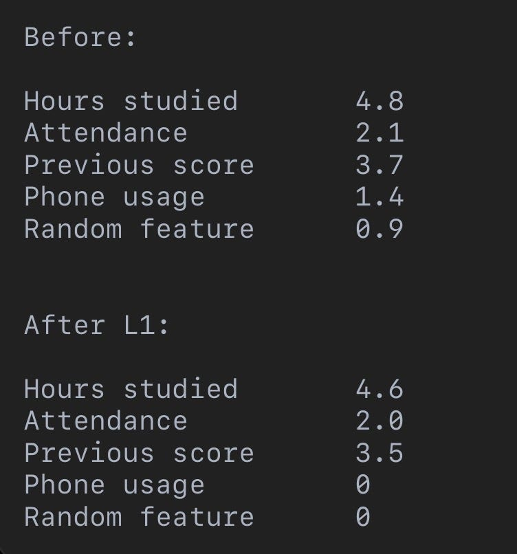
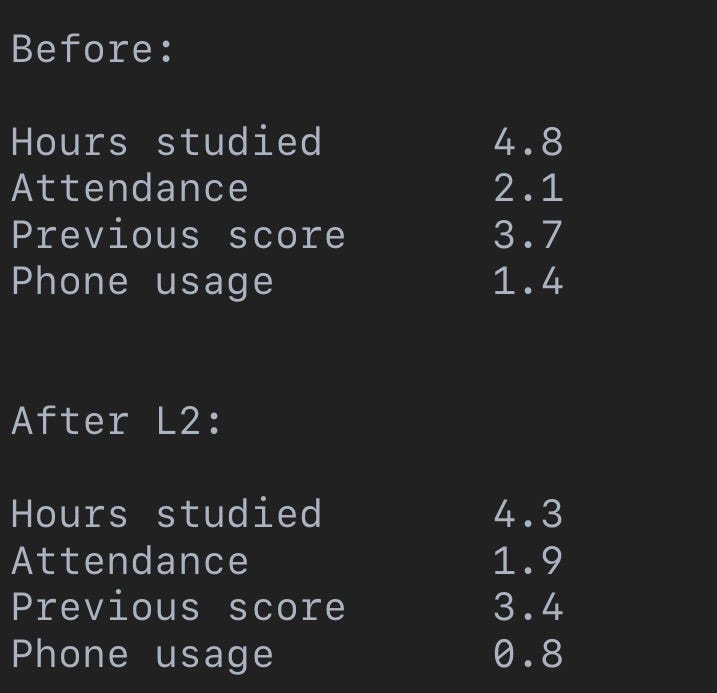
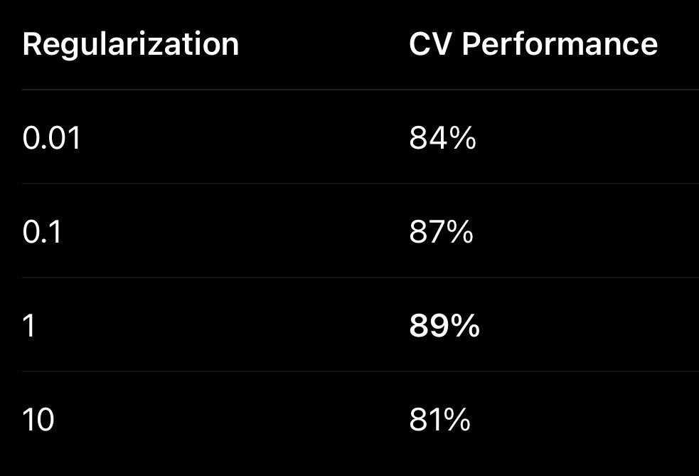

# Week 2, Day 6 - How Do We Stop a Model From Overfitting?

*September 7, 2026 · [Originally published on Substack](https://niharikabatra.substack.com/p/week-2-day-6-how-do-we-stop-a-model)*

In Day 5, we saw something important:

> A model can get **100% on the training data and still be a bad model.**

Why?

> Because sometimes the model doesn’t really learn the underlying pattern. It learns the training data **too well** including its noise and quirks. That’s **overfitting**.

So today’s question is:

> **If we know our model is overfitting, what can we actually do about it?**

Two important ideas help us here:

> **Regularization** and **Cross-Validation.**

---

**1\. First, let’s go back to our exam example 🎓**

Imagine we’re trying to predict a student’s exam score. Our model looks at 2-3 features and learns how they relate to the exam score. But imagine we give the model **20 different features**.

Now we have:

- Hours studied
- Attendance
- Previous score
- Sleep hours
- Number of breaks
- Phone usage
- Favorite subject
- Day of the week
- And many more…

Some of these might actually help. But some might just be **noise**.

A complex model might start assigning importance to almost everything.

It could basically say:

> “This tiny detail helped me predict these training examples, so I am going to use it!”

And that’s where things can go wrong.

---

**2\. Regularization: Don’t Make the Model More Complicated Than Necessary**

Regularization gives the model an additional instruction:

> **“Fit the data, but don’t become unnecessarily complicated.”**

Remember that our model has **weights** for its features. A weight tells us how strongly a feature influences the prediction.

For example:

> Hours studied → weight = 5.2
> 
> Attendance → weight = 2.1
> 
> Previous score → weight = 3.8
> 
> Random feature → weight = 15.7

That last weight should make us suspicious.

Why would a random feature have such a huge influence?

It might be helping the model fit the training data but not because it represents a real pattern.

> Regularization adds a **penalty for large/complex weights**.

So now the model isn’t simply trying to:

“Make my predictions as accurate as possible.”

It’s trying to:

> **“Make accurate predictions while keeping the model simpler.”**

That’s the basic idea behind regularization.

---

**3\. L1 vs L2 Regularization**

You may hear two names quite often:

**L1 Regularization -** It encourages some weights to become **exactly zero**.

The model is effectively saying:

“These features aren’t helping enough. I can ignore them.” That’s why L1 regularization can also help with **feature selection**.

---

**L2 Regularization**

L2 usually doesn’t make weights exactly zero.

Instead, it **shrinks them**.

The features are still there, but their influence is controlled.

---

**4\. But How Much Regularization Should We Use?**

Here’s another problem.

> What if we regularize too little?

The model might still overfit.

> What if we regularize too much?

Now the model might become **too simple** and fail to capture useful patterns.

Remember the bias–variance discussion from Day 5?

This connects directly to it. So we need to find a reasonable balance. And that’s where **cross-validation** becomes useful.

---

**5\. Cross-Validation: Don’t Trust One Data Split**

Earlier, we talked about training, validation, and test data. But there’s a problem with a single validation set.

What if we simply got a **lucky split**?

> Maybe the validation data happened to contain examples that were particularly easy for our model. Then our model could look better than it really is.

Cross-validation gives us a better way to evaluate this.

---

**6\. K-Fold Cross-Validation**

Let’s say we have 100 training examples.

Instead of creating one fixed validation set, we divide the data into **5 groups**, or folds. Then we train and validate multiple times.

And we continue until every fold has been used for validation. So each example gets a chance to be part of the validation data. Finally, we look at the performance across all 5 rounds.

Instead of asking:

“How did my model perform on this one validation split?”

we ask:

> **“How consistently does my model perform across different subsets of the data?”**

That’s a much more useful question.

---

**7\. Where Do Hyperparameters Come In?**

Now we have another term to introduce:

**Hyperparameters.** Don’t let the name scare you.

Remember:

> **Parameters -** These are **learned by the model** from the data. For example: weights

> **Hyperparameters -** These are **settings we choose before/during model training**.

For example: How much regularization should we use?

We can use cross-validation to compare these choices. Maybe our results look like:

We might choose **λ = 1** because it performed best during cross-validation.

> The process of finding good hyperparameter values is called **hyperparameter tuning**.

---

**The Big Idea 🧠**

> A good machine learning model isn’t the one that **memorizes the training data**.It’s the one that learns patterns that are useful **beyond the training data**.

That’s why we have tools like:

- **Regularization → control model complexity**
- **Cross-validation → test consistency across different splits**
- **Hyperparameter tuning → find settings that generalize well**

And ultimately:

> **The goal is to build a model that performs well on data it hasn’t seen yet.**

---

Tomorrow:

So far, we’ve mostly talked about predicting a **number**:

> “What exam score will this student get?”

But what if our answer isn’t a number?

What if we want to predict:

> **Will the student PASS or FAIL?**

That’s where we move from **regression → classification**.

One concept at a time. One step closer to AI.
