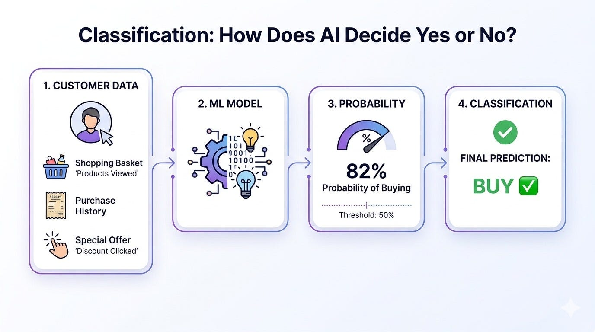

# Week 2, Day 7 - How Does AI Decide: Yes or No? | Classification Explained Simply

*September 8, 2026 · [Originally published on Substack](https://niharikabatra.substack.com/p/week-2-day-7-how-does-ai-decide-yes)*

Today we’re moving from **predicting numbers** to **predicting categories**.

So far, we’ve looked at how machine learning learns patterns from data, how models make predictions, and how we evaluate whether those predictions are actually useful.

Now let’s look at a very common type of machine learning problem:

> **Classification.**

And don’t worry, we’ll keep it simple and build on what we already know.

---

**So, what is Classification?**

Imagine Walmart wants to predict:

> **Will this customer buy the product or not?**

The answer isn’t a number like $25 or 72%.

It’s a **category**:

> **Buy** ✅  
> **Don’t Buy** ❌

That’s classification.

In simple terms:

> **Classification is when a machine learning model predicts which category something belongs to.**

---

**But how does the model actually decide?**

We might think the model simply says:

“This customer will buy.”

> But internally, many classification models work with **probabilities**.

For example, the model might look at information about a customer:

- Previous purchases
- Products viewed
- Time spent on the website
- Discounts clicked
- Number of previous orders

And produce something like:

> **Probability of buying = 0.82**

In other words:

> **82% likely to buy.**

But we still need to turn that probability into an actual decision. That’s where a **threshold** comes in.

---

**What is a threshold?**

Suppose we set our threshold at **0.5**.

We can say:

If probability ≥ 0.5 → **Buy**  
If probability < 0.5 → **Don’t Buy**

The model gives us a probability.

> **The threshold helps turn that probability into a decision.**

And this threshold doesn’t always have to be 0.5. Depending on the problem, we might choose a different threshold.

---

**Why does the threshold matter?**

Imagine we’re building a model to detect **fraudulent transactions**.

- Would we rather accidentally flag a legitimate transaction as fraud?
- Or would we rather miss an actual fraudulent transaction?

The answer depends on the cost of each mistake.

- For some problems, catching as many positive cases as possible is extremely important.
- For others, we may want to be more careful before labeling something as positive.

> This is why classification isn’t simply:
> 
> **“The model got 90% accuracy, so we’re done.”**

We need to understand **what kind of mistakes the model is making.**

---

**A quick look at classification algorithms**

There are many ways to build a classification model. Some common ones are:

🌳 **Decision Trees**  
Think of them as a series of questions:

> Is the customer a repeat buyer?  
> ↓  
> Did they view the product?  
> ↓  
> Did they use a discount?
> 
> Eventually, the tree reaches a decision.

🌲 **Random Forest**

Instead of relying on one decision tree, it combines predictions from many trees.

📈 **Logistic Regression**

Despite having “regression” in its name, logistic regression is commonly used for classification. It estimates the probability of belonging to a class.

🤖 **Neural Networks**

These can learn much more complex patterns and are widely used for tasks such as image, text, and speech classification.

We don’t need to understand all of these algorithms today.

> The important thing is to understand **the problem they’re trying to solve.**

---

**And now, a problem with Accuracy**

Let’s go back to our Walmart example. Suppose we have **100 customers**. 95 customers don’t buy anything. Only 5 customers make a purchase.

Now imagine our model simply predicts:

> **“Don’t Buy” for everyone.**

What happens?

> It correctly predicts 95 customers.

So:

> **Accuracy = 95%**

Sounds impressive, right? But think about it.

The model identified **zero** of the 5 customers who actually bought something.

> So while the accuracy is 95%, the model isn’t useful for our actual goal.

This is why, for classification problems, we often need metrics beyond accuracy.

---

**Tomorrow:**

We’ve learned how classification works. But

> **How do we know if our classification model is actually good?**

We’ll dive deeper into **evaluation metrics**, including:

📊 Confusion Matrix  
🎯 Precision  
🔍 Recall  
⚖️ F1-Score  
📈 ROC-AUC  
🎚️ Classification Thresholds

Because **accuracy alone doesn’t tell the whole story.**

See you in **Week 3!** 🚀

Read it, share it with someone learning AI, and **follow along for the next concept.** 🚀

One concept at a time. One step closer to AI.
