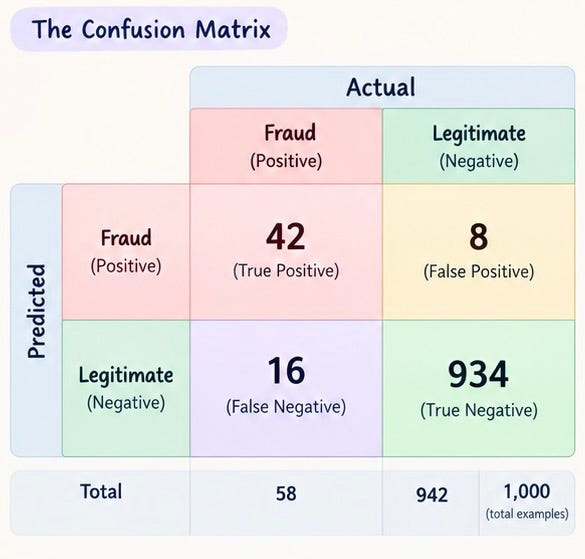

# Week 3, Day 1 - Evaluation Metrics in Machine Learning: Confusion Matrix

*September 9, 2026 · [Originally published on Substack](https://niharikabatra.substack.com/p/week-3-day-1-evaluation-metrics-in)*

Last week, we learned how classification models make predictions.

Now comes the next important question:

> **How do we know if our model is actually doing a good job?**

A model can make predictions all day long. But predictions alone don’t tell us whether those predictions are useful.

This is where **evaluation metrics** come in.

And before we jump into accuracy, precision, recall, and F1 score, we need to understand the foundation behind many of these metrics:

> **The Confusion Matrix.**

---

**Let’s start**

Imagine we built a machine learning model that predicts whether a bank transaction is **fraudulent or legitimate**.

The model looks at a transaction and makes a prediction:

> “This transaction is fraud.”

But was it actually fraud?

To evaluate the model, we compare:

> **What the model predicted**  
> with  
> **What actually happened.**

We can organize this into a table called **confusion matrix**.

And it gives us four possible outcomes.

---

**1\. True Positive: We caught the fraud**

The model predicted:

> **“This transaction is fraud.”**

And it actually was fraud.

> That’s a **True Positive (TP)**.

The model correctly identified the positive case.

---

**2\. True Negative: We correctly identified a legitimate transaction**

The model predicted:

> **“This transaction is legitimate.”**

And it actually was legitimate.

> That’s a **True Negative (TN)**.

The model correctly identified the negative case.

---

**3\. False Positive: A false alarm**

The model predicted:

> **“This transaction is fraud.”**

But it was actually legitimate.

> That’s a **False Positive (FP)**.

The model raised an alarm when there wasn’t really a problem.

Think of it like a smoke alarm going off when you’re just making toast.

---

**4\. False Negative: We missed the fraud**

The model predicted:

> **“This transaction is legitimate.”**

But it was actually fraud.

> That’s a **False Negative (FN)**.

The model missed something we wanted it to catch.

---

**Putting all four together**

Now our confusion matrix looks like this:

So there are essentially two broad categories of outcomes:

> **Correct predictions:**  
> True Positive + True Negative

> **Incorrect predictions:**  
> False Positive + False Negative

But here’s where things get interesting.

---

Now let’s look at the numbers in our confusion matrix.

We have **1,000 transactions** in total.

Our model correctly classified:

- **42 fraudulent transactions** → True Positives
- **934 legitimate transactions** → True Negatives

So the model got **976 out of 1,000 predictions correct**. That gives us:

> **Accuracy = 976 / 1,000 = 97.6%**

Sounds pretty impressive, right?

But let’s look a little closer.

There were **58 actual fraudulent transactions**.

The model caught **42** of them.

But it **missed 16 fraudulent transactions**.

Those 16 are our **False Negatives**.

So even with **97.6% accuracy**, the model still failed to detect some of the fraud.

For a fraud detection system, those missed cases can matter a lot.

**This is why accuracy alone doesn’t tell us the full story.**

We need other evaluation metrics to understand *what kind of predictions our model is getting right and where it is making mistakes.*

---

**One small detail that makes everything easier**

When we use the words **positive** and **negative**, “positive” doesn’t necessarily mean *good*.

It simply refers to the class we’re treating as the positive class.

For our fraud example:

> **Positive = Fraud**

For a spam detector:

> **Positive = Spam**

For a medical screening model:

> **Positive = Condition detected**

So whenever you see TP, TN, FP, and FN, first ask:

> **What are we calling the positive class?**

Once you know that, the terminology becomes much easier to follow.

---

The **confusion matrix** is the foundation for understanding many classification evaluation metrics.

It helps us see:

- **TP → correctly predicted positive**
- **TN → correctly predicted negative**
- **FP → predicted positive, but actually negative**
- **FN → predicted negative, but actually positive**

From these four outcomes, we can calculate metrics such as **accuracy, precision, recall, and F1 score**.

And tomorrow, we will break those metrics down so you can see **why each one tells us something different about our model.**

**One concept at a time. One step closer to understanding AI.**
