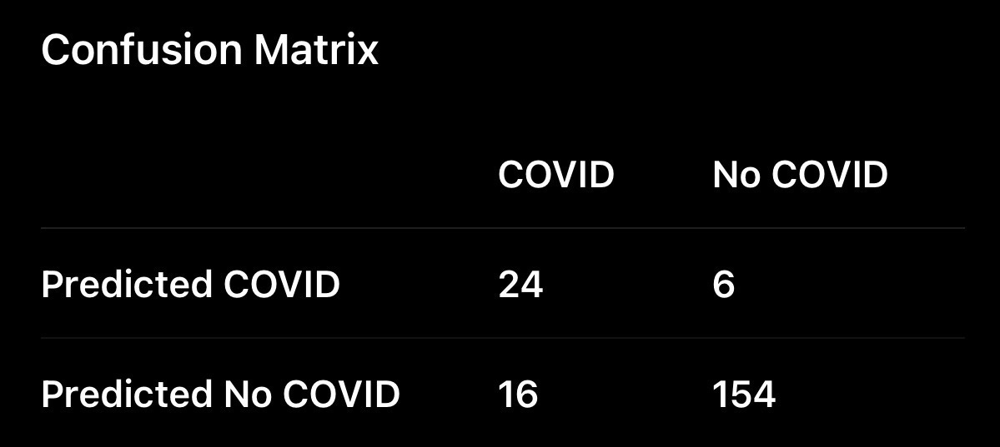

# Week 3, Day 2 - Accuracy, Precision & Recall

*September 10, 2026 · [Originally published on Substack](https://niharikabatra.substack.com/p/week-3-day-2-accuracy-precision-and)*

Yesterday, we learned about the **confusion matrix** and how it helps us understand the different ways a classification model can be right or wrong.

Today, let’s turn that confusion matrix into something we can actually **measure**.

We’ll use a simple example throughout this article: a model that predicts whether a person has **COVID or not**.

---

**Let’s start with the confusion matrix**

Imagine we tested **200 people**. Among them, **40 actually had COVID**, while **160 did not**.

Our model made the following predictions:

Let’s understand what these numbers actually mean.

- **24 people -** The model predicted **COVID**, and those people actually had COVID. These are **correct positive predictions**.
- **6 people -** The model predicted **COVID**, but they actually did **not** have COVID. These are **false alarms**.
- **16 people -** The model predicted **Not COVID**, but they actually had COVID. The model **missed these cases**.
- **154 people -** The model predicted **Not COVID**, and they actually did not have COVID. These are **correct negative predictions**.

So we have:

**24 + 6 + 16 + 154 = 200 people**

Now let’s use this table to answer three different questions.

---

**1\. Accuracy: How often was the model correct?**

Accuracy looks at the **entire set of predictions**. Out of 200 people, the model was correct for:

- 24 people who had COVID

- 154 people who did not have COVID

That’s **178 correct predictions**.

So:

> **Accuracy = Correct Predictions / Total Predictions**

Or, using the confusion matrix:

**Accuracy = (24 + 154) / (24 + 6 + 16 + 154)**

> **Accuracy = 178 / 200 = 89%**

So the model was correct **89% of the time**. Accuracy gives us a useful overall picture. But it doesn’t tell us **what kind of mistakes** the model made. And that’s where things get more interesting.

---

**2\. Precision: Can we trust the model when it says “COVID”?**

Let’s forget about everyone else for a moment. Look only at the people the model **predicted as COVID-positive**.

There were:

**24 + 6 = 30 people**

But only **24 actually had COVID**.

So we can ask:

> **“Of everyone the model said had COVID, how many actually had COVID?”**

That’s precision.

> **Precision = Correct COVID Predictions / All COVID Predictions**

**Precision = 24 / (24 + 6) = 80%**

So when our model says:

**“This person has COVID.”** it’s correct **80% of the time**.

**Think of precision as:**

> **“How trustworthy are my positive predictions?”**

If precision is low, the model is creating lots of **false alarms**.

---

**3\. Recall: Did we find most of the people who actually had COVID?**

Now let’s look at the problem from the other direction. We know that **40 people actually had COVID**.

How many did our model find? It correctly identified **24**. But it missed **16**.

So we ask:

> **“Of everyone who actually had COVID, how many did our model successfully identify?”**

That’s recall.

> **Recall = Correctly Identified COVID Cases / All Actual COVID Cases**

**Recall = 24 / (24 + 16) = 60%**

So our model found **60% of the people who actually had COVID**.

**Think of recall as:**

> **“How many of the actual positive cases did my model manage to find?”**

If recall is low, the model is **missing too many positive cases**.

---

**Why does this matter?**

Imagine we make the model very cautious. It only predicts COVID when it’s extremely confident.

- We might reduce the number of false alarms. That could improve **precision**.
- But because the model is being so cautious, it might miss many people who actually have COVID. That could hurt **recall**.

On the other hand, we could make the model much more sensitive and flag more people:

- We might catch more actual COVID cases. That could improve **recall**.
- But we’d also create more false alarms, which could reduce **precision**.

So there is often a trade-off between the two.

---

**So which metric should we care about?**

There’s no universal answer.

> It depends on the **problem and the consequences of getting it wrong**.

For example:

- **If false alarms are expensive or disruptive**, precision may matter more.
- **If missing a real positive case is dangerous**, recall may matter more.

And sometimes, we want a balance between both. That’s where our next metric comes in.

**Tomorrow: F1 Score**

What if we don’t want to choose between precision and recall?

Can we combine them into **one score**?

That’s what we’ll explore tomorrow.

**Read, share it with someone learning AI, and follow along for the next concept.**

**One concept at a time. One step closer to AI.**
