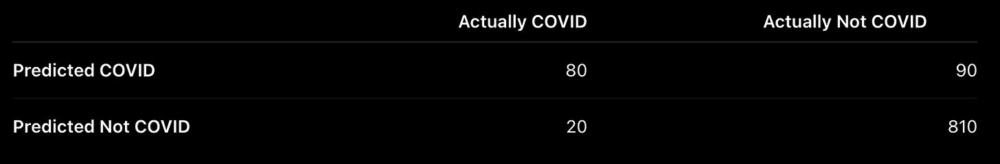
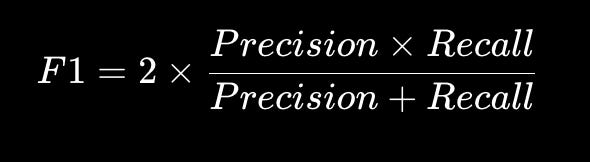
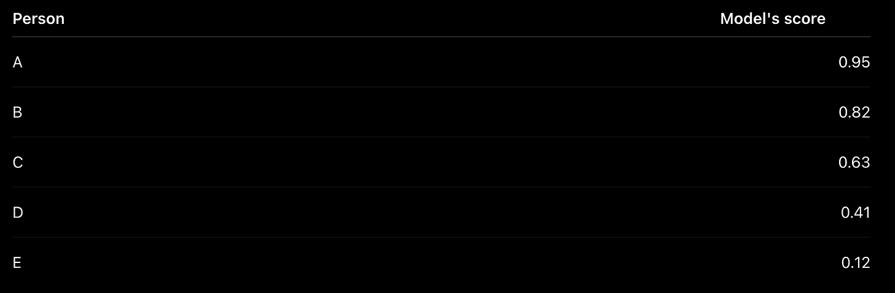
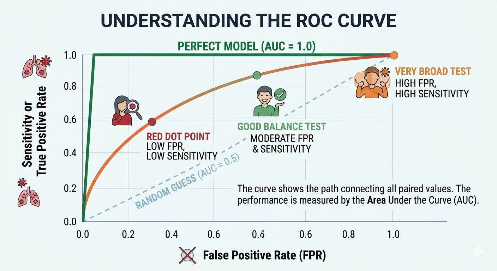
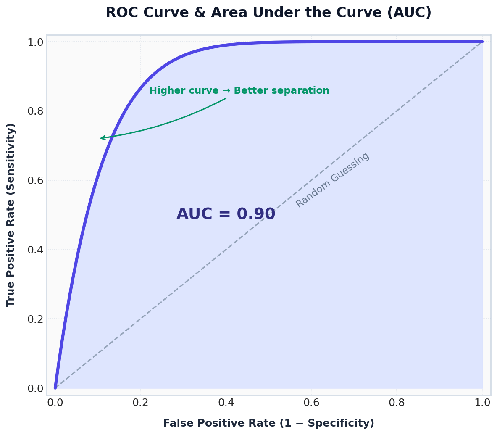
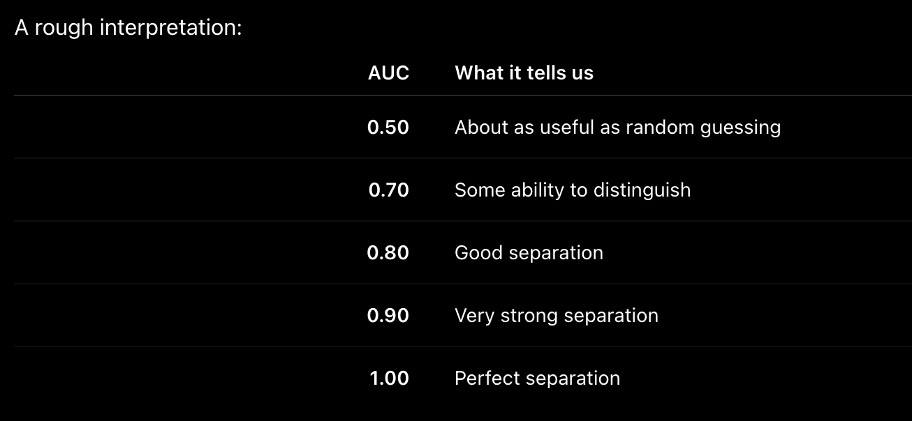

# Week 3, Day 3 - F1 Score, Sensitivity, Specificity, ROC & AUC 

*September 11, 2026 · [Originally published on Substack](https://niharikabatra.substack.com/p/week-3-day-3-f1-score-sensitivity)*

Imagine you’re at a hospital. A new patient walks in, and the hospital has a machine that predicts:

> **COVID or Not COVID**

The machine gives its prediction. But now the doctor has a bigger question:

> **How good is this machine actually?**

That’s where evaluation metrics come in. We’ve already learned about **precision and recall**. Read here → [Accuracy, Precision and Recall](03-week-3/day-2-accuracy-precision-and.md)

Today, let’s connect those ideas to a few more concepts: **Sensitivity, Specificity, F1 Score, ROC Curve and AUC.**

---

Let’s Start With 1,000 Patients. Suppose the hospital tests **1,000 people**. After their actual test results are known, we discover:

- **100 actually had COVID**
- **900 did not have COVID**

Our model made the following predictions:

Let’s pause here. Don’t worry about memorizing the terms yet.

**Among the 100 people who actually had COVID:**

The model found **80**. It missed **20**.

**Among the 900 people who did not have COVID:**

The model correctly identified **810**. But it incorrectly flagged **90** people as having COVID.

Now we can start asking different questions. And each question gives us a different metric.

---

**Question 1: “Of the people who actually had COVID, how many did we find?”**

This is **Recall**. But in healthcare, you will often hear another word for the same idea:

Sensitivity

> **Out of everyone who actually had COVID, how many did our model catch?**

We had:

- 100 actual COVID cases
- Model correctly found 80

So: Sensitivity = 80/100 ​= 80%

That’s it. Think of sensitivity as:

> **“How good are we at finding the sick people?”**

High sensitivity means we’re missing fewer actual COVID cases.

And that’s why you may hear:

> **Sensitivity = Recall**

They are measuring the same thing.

---

**Question 2: “Of the people who did NOT have COVID, how many did we correctly identify?”**

Now we’re asking a different question. Specificity

> **Out of everyone who was actually healthy, how many did our model correctly recognize as healthy?**

We had:

- 900 people who did not have COVID
- Model correctly identified 810

So: Specificity = 810/ 900 = 90%

Think of specificity as:

> **“How good are we at recognizing the healthy people?”**

So now we have:

**Sensitivity → How well do we find the positive cases?**

**Specificity → How well do we recognize the negative cases?**

---

Now Let’s Come Back to Precision. We learned about precision in the previous article.

Precision asks:

> **When our model says someone has COVID, how often is it right?**

Our model predicted COVID for:

**80 + 90 = 170 people**

But only **80 actually had COVID**.

So:

Precision = 80/170 ≈ 47%Precision

That means:

> When this model says “COVID,” it’s correct about 47% of the time.

Now notice something interesting.

Our model has:

**Sensitivity = 80%**

**Specificity = 90%**

But:

**Precision = 47%**

Three different numbers.

And that’s okay.

They’re answering **different questions**.

---
## So Where Does F1 Score Come In?

Now imagine someone asks:

> **“Can you give me ONE number that tells me how well we’re balancing precision and recall?”**

That’s where **F1 Score** comes in. Remember:

**Precision = 47%**

**Recall = 80%**

F1 combines these two numbers.

So our F1 Score is about **0.60**. But don’t get too caught up in the calculation.

The important idea is:

> **F1 gives us one number that reflects the balance between precision and recall.**

If one is extremely low, the F1 Score will also be pulled down.

#### A simple way to remember F1:

> **Precision asks: “When I say COVID, am I usually right?”**
> 
> **Recall asks: “Did I find most of the COVID cases?”**
> 
> **F1 asks: “Can I do reasonably well at both?”**

---

Now We Have One More Question. So far, we’ve looked at the predictions our model made.

> But classification models can actually give us **more information than just “COVID” or “Not COVID.”**

Imagine the model gives each person a **score showing how strongly it leans toward COVID**.

For example:

Someone with a score of **0.95** looks much more likely to be positive than someone with **0.12**.

We’ve already discussed how changing the model’s decision point changes its predictions. So instead of focusing on one particular decision point, we can ask a bigger question:

> **Across all these possible decisions, how well can the model separate people who have COVID from people who don’t?**

And this brings us to the **ROC Curve**.

---

**What Is the ROC Curve?**

ROC stands for **Receiver Operating Characteristic**.

The name sounds complicated. The idea isn’t. The ROC curve shows us the relationship between **Sensitivity (True Positive Rate)** and **False Positive Rate** as the model’s classification behavior changes.

Remember:

- True Positive Rate. That’s just another name for:

**Sensitivity / Recall**

It asks:

> **How many of the actual COVID cases are we catching?**

- False Positive Rate. This asks:

> **Of the people who don’t have COVID, how many are we incorrectly calling COVID?**

And notice something important:

> **False Positive Rate = 1 − Specificity**

Remember, specificity tells us how many healthy people we correctly leave alone. So if specificity is **90%**, we’re correctly recognizing 90% of the healthy people. That means **10% are being incorrectly flagged**. That’s our **false positive rate**.

So now our pieces start fitting together:

**Sensitivity → catches the sick**

**Specificity → correctly recognizes the healthy**

**False Positive Rate → incorrectly flags the healthy**

---

**So What Does the ROC Curve Actually Tell Us?**

Imagine drawing a graph. On the **Y-axis**, we put:

> **Sensitivity**
> 
> How many actual COVID cases are we catching?

On the **X-axis**, we put:

> **False Positive Rate**
> 
> How many healthy people are we incorrectly flagging?

Each point on the ROC curve represents a different balance between catching actual COVID cases and accidentally flagging healthy people.

Connecting those points gives us the **ROC curve**. So you can think of the ROC curve as telling us:

> **“As we try to catch more of the actual COVID cases, how many healthy people are we also incorrectly flagging?”**

That’s the story behind the curve.

---

**What Does a Good ROC Curve Look Like?**

We want: **High sensitivity**

while keeping

**false positive rate low.**

In other words:

> **Catch as many sick people as possible without unnecessarily flagging healthy people.**

That’s why a curve that moves toward the **top-left corner** is generally better.

The diagonal line represents performance that is roughly equivalent to random guessing.

---

**And Finally: AUC**

Now we have a curve. But looking at a whole curve isn’t always convenient.

So we summarize it with one number:

**AUC = Area Under the Curve**

You can think of AUC as answering:

> **“Overall, how well does this model distinguish the two groups?”**

**The closer the AUC is to 1, the better the model generally is at distinguishing the two classes.**

> AUC is not accuracy. An AUC of 0.90 does not mean the model is 90% accurate.

---

**One Easy Way to Remember Everything**

Imagine you’re the doctor. You don’t just ask:

> **“Is my model accurate?”**

You ask:

**Precision:**  
*“When my model says COVID, can I trust it?”*

**Sensitivity:**  
*“Did my model find the people who actually have COVID?”*

**Specificity:**  
*“Did my model correctly recognize the people who don’t have COVID?”*

**F1:**  
*“Can my model balance finding COVID cases with making reliable positive predictions?”*

**ROC-AUC:**  
*“Overall, how well can my model separate the two groups?”*

Now the formulas have a story behind them. And that’s the goal of evaluation metrics:

**Don't memorize the metrics. Remember the question each metric answers.**

---

**Don't confuse these**

> **Recall = Sensitivity**  
> Same concept, different name.

> **Specificity ≠ Precision**  
> Specificity starts from the people who are actually negative.  
> Precision starts from the people the model predicted as positive.

> **F1 ≠ AUC**  
> F1 summarizes the balance between precision and recall.  
> AUC summarizes the ROC curve and tells us how well the model separates the classes.

---
#### What’s Next?

So far, we have spent a lot of time asking:

> **“How good is our classification model?”**

Next, let’s open the model itself.

**How does a classification model actually make a decision?**

That’s where we’ll meet our next algorithm:

🌳 **Decision Trees**.
