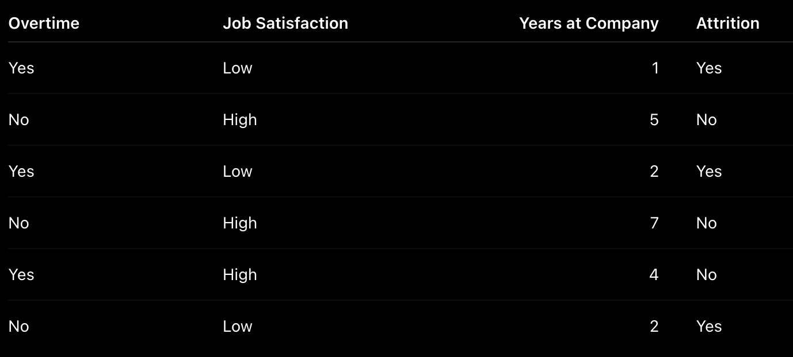
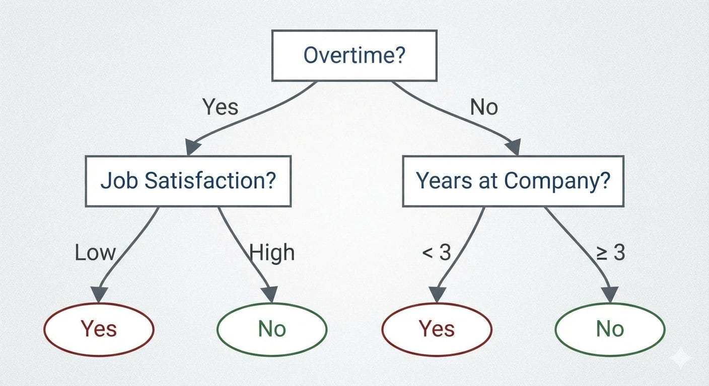

# Week 3, Day 4 - Decision Trees 🌳

*September 12, 2026 · [Originally published on Substack](https://niharikabatra.substack.com/p/week-3-day-4-decision-trees)*

So far, we have learned how classification models make predictions and how we can evaluate those predictions. But there’s another important question:

> **How does a classification model actually decide which class something belongs to?**

One way to make these decisions is with a **Decision Tree**.

And honestly, the easiest way to understand a Decision Tree is to think about how **we make decisions ourselves.**

---

**Imagine a company wants to predict employee attrition**

Suppose a company wants to predict:

> **Will this employee leave the company?**

This is a **classification problem** because there are two possible classes:

**Yes → Employee may leave**

**No → Employee may stay**

The company has historical employee data containing information such as:

- Overtime
- Job satisfaction
- Years at the company
- Monthly income
- Job level

Along with the final outcome: whether the employee actually left.

The model looks at this historical data and tries to learn patterns that can help predict attrition for **new employees**.

---
### Think of a Decision Tree as a series of questions

Imagine you were trying to make this prediction yourself. You might start by asking:

> **Does the employee work overtime?**

If the answer is **Yes**, you might ask:

> **Is their job satisfaction low?**

If that’s also **Yes**, you might ask another question:

> **Have they been with the company for less than 3 years?**

Eventually, your questions lead to a decision:

> **Employee may leave**

If the employee doesn’t work overtime, you might follow a completely different path and ask different questions. That’s the basic idea behind a **Decision Tree**.

---

> **A Decision Tree is like a flowchart**

A Decision Tree is a machine learning model that makes predictions by asking a series of questions about the data. Each question **splits the data into smaller groups**.

It might look something like this:

You can think of it as a **flowchart that learns its questions from historical data.**

---

**Why do we call it a “tree”? 🌳**

Because the model branches out as it asks questions. There are a few terms you’ll often see:

- **Root node -** The first question at the top of the tree.
- **Branches -** The different possible outcomes of a question.
- **Decision nodes -** Places where the tree asks another question.
- **Leaf nodes -** The final outcomes or predictions.

So the basic journey is:

> **Question → Question → Question → Prediction**

And because this structure looks like a tree, we call it a **Decision Tree**.

---

**But who decides which question comes first?**

We didn’t tell the model:

> “Start with overtime.”

The model has many features it could use. It could start with:

- Overtime
- Job satisfaction
- Years at company

So how does it decide which question is the **best first question**?

The goal is to find a question that does the best job of **separating employees into groups where the outcomes are as similar as possible.**

For example, imagine that after asking:

> **Does the employee work overtime?**

we get two groups.

**Employees who work overtime - Most of them left the company.**

**Employees who don’t work overtime - Most of them stayed.**

That’s a useful split because the two groups are now quite different. The model can then continue asking questions within those groups.

---

**This is where Gini Impurity comes in**

A Decision Tree needs a way to measure:

> **How mixed are the groups?**

Imagine one group contains:

**9 employees who stayed**  
**1 employee who left**

Most employees belong to the same class. In other words, **one class dominates the group**, so we call it **fairly pure.**

But another group contains:

**5 employees who stayed**  
**5 employees who left**

This group is much more **mixed** because both classes are equally represented.

**Gini Impurity** is one way a Decision Tree measures how mixed a group is. You don’t need to memorize the formula yet.

> **Lower Gini Impurity → purer group**  
> **Higher Gini Impurity → more mixed group**

The intuition is enough:

> **A good split creates groups that are as pure as possible.**

The tree repeats this process, creating smaller and smaller groups until it reaches a prediction.

---

**But Decision Trees have a problem ⚠️**

What happens if we allow the tree to keep asking questions forever?

It could become extremely complicated.

For example:

> Overtime = Yes  
> → Job Satisfaction = Low  
> → Years at Company < 3  
> → ...

Eventually, the tree could become so specific that it **memorizes the training data** instead of learning patterns that generalize to new employees. That’s called **overfitting**.

So, just like we discussed earlier with classification models, we need to make sure our model isn’t simply performing well on the data it has already seen.

With Decision Trees, we can control how much the tree grows using techniques such as **limiting its depth or pruning unnecessary branches**.

---

**Tomorrow:**

We will go one level deeper and understand **how the tree decides which question to ask next**.

We’ll explore:

- **Gini Impurity** - how mixed is a group?
- **Entropy** - another way to measure impurity
- **Information Gain** - how much does a split improve the groups?
- How these concepts help a tree choose the **best split**
- Important **Decision Tree hyperparameters**
- Why trees overfit and how **pruning** helps

By the end, the goal is to not just understand *what* a Decision Tree does, but also **how it makes its decisions.**
