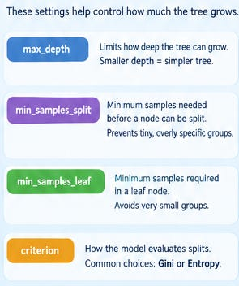
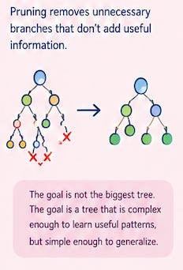

# Week 3, Day 5 - How Does a Decision Tree Choose the Best Split? 🌳

*September 13, 2026 · [Originally published on Substack](https://niharikabatra.substack.com/p/week-3-day-5-how-does-a-decision)*

Yesterday, we learned how a Decision Tree makes predictions by asking a series of questions and splitting the data into smaller groups.

But one important question remained:

> **How does the tree decide which question to ask first?**

Imagine we are predicting **employee attrition**.

The model could start with:

- Does the employee work overtime?
- Is their job satisfaction low?
- How many years have they been with the company?
- What is their monthly income?
- What is their job level?

There are many possible questions. So how does the tree decide which one is the **best split**?

Let’s go one step deeper.

---

**What makes a split “good”?**

Remember our goal from yesterday:

> **We want to separate employees into groups that are as pure as possible.**

Suppose we have 10 employees:

**5 stayed**  
**5 left**

Right now, the group is quite mixed. Now imagine we split them based on **overtime**.

**Overtime = Yes**

**1 stayed**  
**4 left**

**Overtime = No**

**4 stayed**  
**1 left**

Now the two groups are much more clearly separated. Most employees in one group left, while most employees in the other group stayed. That’s a **useful split**.

But we need a way to measure how good that split actually is. That’s where **Gini Impurity, Entropy, and Information Gain** come in.

---

**1\. Gini Impurity**

#### 1\. Gini Impurity

We introduced Gini Impurity yesterday as a way to measure how mixed a group is.

Today, the important connection is this:

> **The tree uses impurity to decide which split creates the cleanest groups.**

For example:

**10 stayed, 0 left → very pure**

**5 stayed, 5 left → very mixed**

So:

**Lower Gini → purer groups**  
**Higher Gini → more mixed groups**

The tree looks for splits that create **purer groups overall**.

---

**2\. Entropy**

**Entropy** gives us another way to measure how mixed or uncertain a group is.

Think of it as asking:

> **“How uncertain am I about the class of an employee in this group?”**

If we have:

**10 stayed, 0 left**

there is almost no uncertainty. We know exactly which class dominates the group.

But if we have:

**5 stayed, 5 left**

there is much more uncertainty.

So:

**Pure group → Low entropy**

**Mixed group → High entropy**

Gini Impurity and Entropy are different mathematical measures, but they are trying to capture a similar idea:

> **How mixed or uncertain is this group?**

---

**3\. Information Gain**

Now comes the really important question. Suppose the employees are very mixed **before** we ask a question.

Then we ask:

> **Does the employee work overtime?**

And after the split, we get two much cleaner groups. We have reduced the uncertainty.

**How much did we improve the situation?**

That’s what **Information Gain** measures.

In simple terms:

> **Information Gain tells us how much a split helps us separate the classes.**

A split that creates much purer groups gives us **higher Information Gain**.

Just remember this:

> **Entropy → How uncertain are we?**
> 
> **Information Gain → How much did our question reduce that uncertainty?**

So when deciding between possible questions, the tree can compare them and choose the split that provides the most useful separation.

---

**So what happens next?**

Once the tree chooses its first split, it doesn’t stop. It repeats the same process.

For example:

**Overtime?**

↓

**Yes →**

Now the tree looks only at employees who work overtime.

It asks:

> **Which question would best separate these employees?**

Maybe the answer is:

**Job Satisfaction?**

Then:

**Job Satisfaction = Low**

↓

**Years at Company < 3?**

↓

**Prediction: Likely to leave**

The tree keeps doing this until it reaches a stopping point.

---

**But here’s the problem ⚠️**

What if we tell the tree:

> **“Keep splitting as much as possible.”**

The tree could become extremely complicated.

It might learn rules such as:

> Overtime = Yes  
> → Job Satisfaction = Low  
> → Years at Company < 3  
> → Age < 31  
> → Monthly Income < $4,200  
> → Job Level = 1  
> → ...

These rules might describe the **training employees extremely well**, but they may not work as well for employees the model has never seen.

---

There are two broad ways we can control how much a tree grows:

**1\. Set rules while building the tree → hyperparameters**

**2\. Build a tree and remove unnecessary branches → pruning**

---

**Decision Tree Hyperparameters ⚙️**

Hyperparameters are settings we choose to control how the model is trained.

Some important Decision Tree hyperparameters are:

- `max_depth` \- Controls how deep the tree can grow.

> A smaller max\_depth creates a simpler tree. A very large depth can create a very complicated tree and increase the risk of overfitting.

- `min_samples_split` \- Defines the minimum number of observations needed in a node before the model is allowed to split it.

> This helps prevent the tree from creating splits based on very small groups.

- `min_samples_leaf` \- Defines the minimum number of observations that must be present in a final leaf.

> Again, the idea is to avoid creating tiny, overly specific groups.

- `criterion` - tells the tree **which measure to use when evaluating splits**.

> For example, a classification tree can use **Gini impurity or entropy**.

So the concepts we’ve learned today are actually connected directly to how we train a Decision Tree.

---

**And then comes pruning ✂️🌳**

Another way to control an overly complicated tree is **pruning**. Think about a real tree.

If it grows too many unnecessary branches, we can trim some of them.

The same idea applies here.

**Pruning removes branches that aren’t providing enough useful information.**

The goal isn’t:

> **Build the biggest tree possible.**

The goal is:

> **Build a tree that is complex enough to learn useful patterns, but simple enough to generalize to new data.**

---

**🌲 Tomorrow: From One Tree to a Forest**

We’ve now understood how a **Decision Tree chooses its questions, evaluates splits, and controls its growth**.

But what if one tree isn’t enough?

Tomorrow, we'll take the next step and see what happens when we **combine multiple models instead of relying on just one**.

We’ll keep it simple and understand:

🌳 Why use **multiple Decision Trees**?

👜 What is **Bagging**?

🌲 How does **Random Forest** work?

🚀 What is **Boosting**?

And most importantly, we’ll understand the difference between **Bagging and Boosting** through relatable examples.

> **One tree can make a mistake. What happens when we ask a whole forest?** 🌳🌳🌳

If you'd like to go one level deeper, I can also write a separate article breaking down the mathematical formulas behind Gini Impurity and Entropy, step by step.
