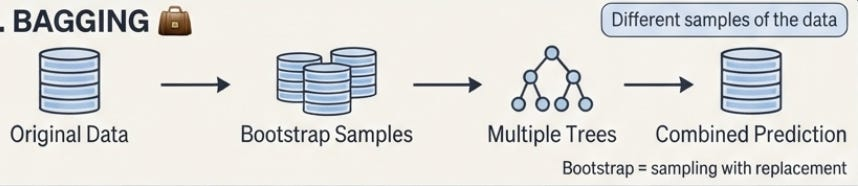
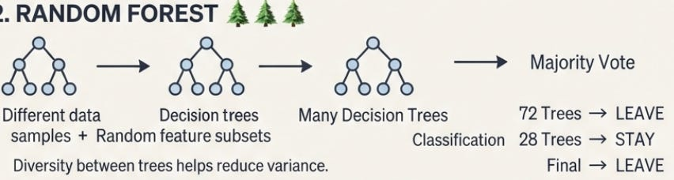
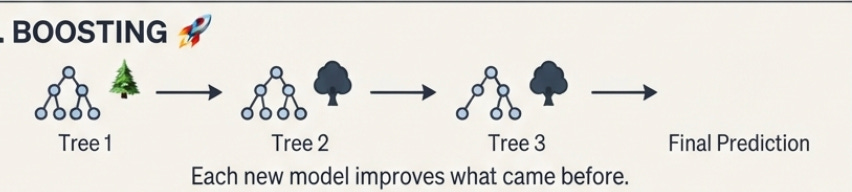

# Week 3, Day 6 - Ensemble Learning Explained: Bagging, Random Forest & Boosting

*September 14, 2026 · [Originally published on Substack](https://niharikabatra.substack.com/p/week-3-day-6-ensemble-learning-explained)*

Yesterday, we went one level deeper into **Decision Trees**.

We learned how a tree chooses the best question to ask using **Gini Impurity, Entropy, and Information Gain**.

We also saw why controlling the depth of a tree matters because a tree that becomes too specific can **overfit** the training data. But this raises an interesting question:

> **What if one Decision Tree simply isn’t enough?**

Instead of asking one tree to make the final decision, what if we asked **multiple trees to work together?**

That’s the idea behind **ensemble learning**.

And today, we’re going from **one tree → many trees.**

---

**What is Ensemble Learning?**

An **ensemble** is simply a group.

In machine learning, **ensemble learning** means combining multiple models to make a stronger prediction.

Think about making an important decision.

You could ask one person for their opinion. Or you could ask several people, compare their opinions, and make a decision based on the group.

The same basic idea can be applied to machine learning.

Instead of:

> **One model → One prediction**

we can have:

> **Multiple models → Combined prediction**

Why might this help?

Because individual models can make mistakes.

If we combine models that make **different mistakes**, the overall prediction can become more reliable. Decision Trees are particularly useful for building these kinds of ensembles.

---

**1\. Bagging: Let Many Models Vote**

One of the first ensemble ideas to understand is **Bagging**. Bagging stands for:

> **Bootstrap Aggregating**

Don’t let the name make it sound more complicated than it is.

The basic idea is:

> **Create different training datasets → train multiple models → combine their predictions.**

Let’s say we have one dataset containing information about 1,000 employees.

Instead of giving the exact same dataset to every tree, we create different samples from the original data.

Each tree gets a slightly different view of the data.

Then we combine their predictions.

For a classification problem, this can be done using **majority voting**.

Suppose five trees predict whether an employee will leave:

Three trees predict **Leave**.

Two predict **Stay**.

So the ensemble’s final prediction is:

> **Leave**

Instead of trusting one tree, we’re letting several trees contribute to the final decision.

---

**What does “Bootstrap” mean?**

There is one important detail here. When we create a bootstrap sample, we sample observations **with replacement**.

That means an observation can appear more than once in a particular sample.

For example, our original data might contain:

> A, B, C, D, E

One bootstrap sample could look like:

> A, C, C, D, E

Another could be:

> B, B, C, D, A

Notice that some observations appear more than once, while others might not appear at all. This creates slightly different datasets for our models.

And that’s exactly what we want.

We want the models to be **different enough** that they don’t all make exactly the same mistakes.

---

**2\. Random Forest: Many Decision Trees Working Together**

Now we can take this idea specifically to Decision Trees.

This gives us:

> **Random Forest**

The name is actually a useful way to remember the concept.

A **Decision Tree** is one tree.

A **Random Forest** is a collection of many Decision Trees.

But Random Forest adds another important source of randomness. It doesn’t just use different samples of the data. It also considers a **random subset of features** when building each tree.

---

**Why randomly select features?**

Let’s imagine we have these features:

- Age
- Monthly Income
- Job Level
- Overtime
- Job Satisfaction
- Years at Company
- Distance From Home

If every tree always considered every feature in exactly the same way, many trees could end up looking very similar. And if the trees are too similar, they may make similar mistakes.

**Random Forest introduces randomness.**

One tree might consider:

> Overtime, Age, Job Level

Another might consider:

> Job Satisfaction, Income, Years at Company

Another might consider:

> Distance From Home, Overtime, Age

This helps create **diversity among the trees**. And diversity is important in an ensemble.

---

**So how does Random Forest make a prediction?**

Imagine we have 100 Decision Trees. We give a new employee’s information to all 100 trees. Each tree makes a prediction.

Suppose:

**72 trees → Leave**

**28 trees → Stay**

The forest takes the majority vote:

> **Final prediction → Leave**

For classification, this is essentially **majority voting**.

For regression, the predictions can instead be **averaged**.

So the overall idea is:

> **Many Decision Trees → Individual predictions → Combine them → Final prediction**

---

**Why does this help?**

Here’s the key intuition.

A single Decision Tree can be sensitive to the training data.

A small change in the data can sometimes result in a different tree.

This means a single tree can have relatively high **variance**.

Bagging and Random Forest help address this by combining multiple trees.

Instead of relying heavily on the behavior of one tree, we’re averaging or voting across many trees.

So one important idea to remember is:

> **Bagging primarily helps reduce variance.**

And Random Forest builds on this idea by adding randomness in feature selection as well.

---

**3\. What is Boosting?**

So far, we have looked at an approach where multiple models can be trained independently and then combined. But there is another powerful idea:

> **Boosting**

Boosting works differently.

Instead of building many trees independently, boosting builds models **sequentially**.

That means:

**Model 1**

↓

Look at what it got wrong

↓

**Model 2**

↓

Focus on improving those mistakes

↓

**Model 3**

↓

Improve what is still difficult

↓

**Final prediction**

The important idea is:

> **Each new model tries to improve what came before it.**

---

Let’s say we’re predicting whether a customer will cancel their subscription.

Our first model gets most customers right.

But it struggles with customers who:

- recently contacted support
- don’t use the product very often
- have only been customers for a short time

The next model is built to focus more on what the previous model struggled with.

Then another model is added.

It focuses on what the combined model is still getting wrong.

This process continues.

Eventually, we combine the contribution of all these models to produce the final prediction.

So while Bagging is about building multiple models and combining them, Boosting is about **building models sequentially to improve the overall prediction**.

---

**Does More Models Always Mean Better?**

Not necessarily. It’s tempting to think:

> “If one tree is good, 100 trees must be better.”

But machine learning isn’t quite that simple. More models can mean:

- More computation
- More complexity
- Less interpretability
- Longer training or prediction times

And different datasets respond differently to different algorithms.

That’s why in real-world machine learning, we don’t simply choose the most complicated model.

We ask:

> **Which model gives us the right balance of performance, complexity, interpretability, and generalization?**

That’s an important mindset to carry forward.

---

We’ve covered a lot this week from understanding whether a model is making good predictions to understanding how multiple Decision Trees can work together.

Tomorrow, we’ll take a step back and **connect all the pieces from Week 3**.

We’ll revisit:

📊 **Confusion Matrix, Accuracy, Precision & Recall**

🎯 **F1 Score, Sensitivity, Specificity, ROC & AUC**

🌳 **Decision Trees & how they choose the best split**

📐 **Gini Impurity, Entropy & Information Gain**

✂️ **Overfitting, Hyperparameters & Pruning**

🌲 **Ensemble Learning, Bagging & Random Forest**

🚀 **Boosting**

Rather than introducing another new algorithm, we’ll look at the **bigger picture**, how all these concepts fit together and when we might use them.

And then...

> **Week 4, we move from trees to neurons. 🧠**

We’ll start exploring **Neural Networks and Deep Learning**.
