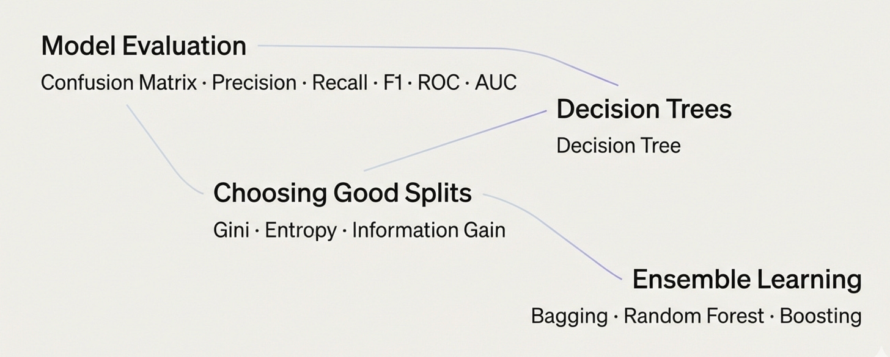

# Week 3, Day 7 - Recap: Putting the Pieces Together 🧩

*September 15, 2026 · [Originally published on Substack](https://niharikabatra.substack.com/p/week-3-day-7-recap-putting-the-pieces)*

**Week 3 is officially complete! 🎉**

And if you look back at everything we covered this week, there are quite a few new terms:

Confusion Matrix.  
Precision.  
Recall.  
F1 Score.  
ROC.  
AUC.  
Decision Trees.  
Gini Impurity.  
Entropy.  
Information Gain.  
Pruning.  
Random Forest.  
Bagging.  
Boosting.

If you’re thinking:

> *“Wait… am I supposed to remember all of that?”* 😅

**No.**

At least, not as a list of definitions.

The goal of this week wasn’t to memorize terminology.

It was to start building a mental map of some of the questions we ask when building and evaluating machine learning models.

So today, let’s step back and look at the bigger picture.

---

**1\. First question: Is my model making good predictions?**

We started Week 3 with **classification evaluation**.

A model can make predictions. But how do we know whether those predictions are actually useful? That’s where the **Confusion Matrix** came in.

> 📄 **Week 3, Day 1 - Evaluation Metrics in Machine Learning: Confusion Matrix**
> September 9, 2026 · [Read the original on Substack](../03-week-3/day-1-evaluation-metrics-in.md)

Instead of looking at only:

> “Right or wrong?”

we looked at **what kind of mistake** the model made.

From there, we introduced:

**Accuracy**  
**Precision**  
**Recall**

> 📄 **Week 3, Day 2 - Accuracy, Precision & Recall**
> September 10, 2026 · [Read the original on Substack](../03-week-3/day-2-accuracy-precision-and.md)

And then went further with:

**Sensitivity**  
**Specificity**  
**F1 Score**

We also looked at **ROC curves and AUC** to understand model performance across different classification thresholds.

> 📄 **Week 3, Day 3 - F1 Score, Sensitivity, Specificity, ROC & AUC**
> September 11, 2026 · [Read the original on Substack](../03-week-3/day-3-f1-score-sensitivity.md)

The important takeaway:

Different metrics answer **different questions**.

You don’t need to memorize which metric belongs to which formula today.

Just remember:

> **A model’s performance can’t always be described by one number.**

The right evaluation depends on the problem and the kind of mistakes that matter.

---

**Next question: How is the model making its decision?**

Once we understood how to evaluate a model, we moved inside the model itself.

That’s where **Decision Trees** came in.

A Decision Tree makes predictions by asking a series of questions about the data.

Something like:

> Is this value greater than X?

If yes → go this way.

If no → go that way.

Eventually, the tree reaches a prediction. It looks simple.

> 📄 **Week 3, Day 4 - Decision Trees 🌳**
> September 12, 2026 · [Read the original on Substack](../03-week-3/day-4-decision-trees.md)

But then we asked an important question:

> **How does the tree decide which question to ask first?**

And that’s where things got a little more interesting.

---

**How does a Decision Tree choose a good split?**

A tree can potentially split the data in many different ways. So it needs a way to determine:

> **“Which split separates my data better?”**

This is where we introduced:

- **Gini Impurity** - A way to measure how mixed the classes are.
- **Entropy -** Another way to measure uncertainty or disorder.
- **Information Gain** - A way to measure how much a split reduces that uncertainty.

You don’t need to treat these as three completely separate things.

> 📄 **Week 3, Day 5 - How Does a Decision Tree Choose the Best Split? 🌳**
> September 13, 2026 · [Read the original on Substack](../03-week-3/day-5-how-does-a-decision.md)

The bigger idea is:

> **A Decision Tree is looking for useful questions that create better-separated groups.**

That’s the concept I want you to take away from this part.

The formulas can come later.

---

**What can go wrong and how can we improve it?**

We then ran into an important problem:

**Overfitting**.

A Decision Tree can keep growing and become extremely specific to the training data. It may start fitting the training data too closely instead of learning patterns that generalize well to new data.

That’s why we talked about:

**Hyperparameters** and **Pruning**

These give us ways to control how complicated the tree becomes.

Again, you don’t need to memorize every parameter.

The bigger idea is simply:

> **More complexity doesn’t automatically mean a better model.**

Sometimes, a simpler model can generalize better.

---

**What if one tree isn’t enough?**

And this is where Week 3 ended.

We moved from:

**One Decision Tree** to **Multiple Decision Trees.**

This introduced us to **Ensemble Learning**.

The basic idea is surprisingly simple:

> **Instead of relying on one model, we can combine multiple models.**

Then we looked at two important approaches.

- **Bagging -** Build multiple models independently and combine their predictions.**Random Forest** - essentially a **bagging-based ensemble of decision trees with additional randomness in feature selection**.
- **Boosting -** Build models sequentially, with later models paying more attention to the mistakes or weaknesses of earlier models.

You don’t need to memorize the mechanics of each technique yet.

For now, remember the bigger shift:

> **One model → multiple models working together.**

> 📄 **Week 3, Day 6 - Ensemble Learning Explained: Bagging, Random Forest & Boosting**
> September 14, 2026 · [Read the original on Substack](../03-week-3/day-6-ensemble-learning-explained.md)
---

**One More Thing Before We Move On…**

If some of the concepts from this week still feel fuzzy, **that’s completely okay.**

You don’t need to calculate entropy from memory or explain boosting perfectly after one article.

The goal of this series isn’t to make you memorize AI vocabulary.

It’s to help you slowly build an **intuition for how these ideas work and why they exist.**

> **Understanding comes before memorization.**

That’s especially important when you’re learning AI as a beginner.

---

So far, we've explored several foundational ideas in machine learning from evaluating classification models to understanding Decision Trees and ensemble methods. Next week, we’re going in a completely different direction.

**Week 4: Neural Networks & Deep Learning. 🧠**

We’ll start exploring:

- What is a **neural network**?
- What is a **neuron**?
- What are **weights and biases**?
- How does a neural network **learn**?
- What is an **activation function**?
- What is **backpropagation**?

And eventually, we’ll connect these ideas to the deep learning systems behind many modern AI applications.

**See you in Week 4. 🚀**
