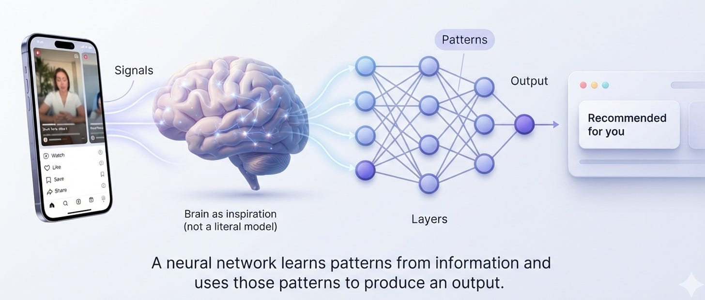

# Week 4, Day 1 - Neural Networks: What Are They and How Do They Work?

*September 16, 2026 · [Originally published on Substack](https://niharikabatra.substack.com/p/week-4-day-1-neural-networks-what)*

So far, we’ve learned how machines can **predict numbers, classify things, make decisions using Decision Trees, and combine multiple models.**

Today, we’re moving into one of the most important ideas behind modern AI:

**Neural Networks.**

You’ve probably heard the term before. Maybe in conversations about:

**ChatGPT. Recommendation systems. Image generation. Voice assistants. Self-driving cars.**

But what exactly is a neural network?

Let’s forget the complicated diagrams for a moment.

Let’s start with something you already know.

---

**Think About Your Own Brain**

Imagine you’re scrolling through Instagram. You come across a Reel of someone making a chocolate cake.

You don’t consciously stop and calculate all of these things::

- the shape of the cake
- the colors
- the movement
- the person’s hands
- the sounds
- the objects in the frame

and then run a mathematical formula to decide:

> “This appears to be a cake-making video.”

Your brain takes in all of that information and **recognizes patterns**. That’s the connection behind the name **neural network**.

Our brains contain billions of interconnected neurons. Artificial neural networks were inspired, in part, by this idea of interconnected units processing information.

**But an artificial neural network is not a copy of the human brain.**

It is a mathematical model designed to learn patterns from data. That’s the part we care about.

---

**So What Does a Neural Network Actually Learn?**

Let’s go back to that Instagram Reel. Imagine Instagram wants to decide:

> **“Will this person enjoy this Reel?”**

It has lots of information available.

For example:

- Did you watch the Reel until the end?
- Did you scroll away immediately?
- Did you like it?
- Have you watched similar Reels before?

Instagram doesn’t need us to write a rule saying:

> “If someone watches 90% of a cooking Reel and has watched five cooking Reels before, recommend another one.”

There could be millions of possible combinations. Instead, a machine learning model can **learn patterns from lots of examples.**

A neural network is one type of machine learning model that can learn these complex relationships.

---

**The Simplest Way to Think About a Neural Network**

At its core:

> **A neural network takes information in, processes it through connected units, and produces an output.**

That’s it.

You can picture it like this:

**Information → Processing → Prediction**

For example:

**Your activity → Neural Network → Which Reel might interest you?**

Or:

**A photo → Neural Network → What’s in this image?**

The applications can be very different.

But the underlying idea is similar:

**Learn patterns from examples and use those patterns to produce an output.**

---

**Where Do the “Neurons” Come In?**

This is where the name starts making sense.

> A neural network is made up of many small mathematical units called **neurons**. A neuron receives information and processes it.

Think about your brain again.

One neuron by itself doesn’t give you the ability to recognize a face, understand a sentence, or remember a song. It’s the **connections between many neurons** that allow much more complicated things to happen.

**The idea is similar at a very high level in artificial neural networks**:

**many simple units → connected together → more complex pattern recognition**

That’s why we call it a **network**.

---

**And These Neurons Are Organized Into Layers**

Here’s another term you’re going to hear a lot:

**Layers**.

Neurons are organized into layers.

Very simply:

**Input → Layers of processing → Output**

Think of the layers as different stages of processing. You don’t need to understand what every neuron is doing yet.

For today, just remember:

> **A neural network doesn’t usually take an input and jump directly to the final answer. It processes information through layers.**

Having more layers allows a neural network to build increasingly complex representations of the information it receives.

This brings us to a term you’ve probably heard even more:

**Deep Learning.**

“Deep” doesn’t mean the model is thinking deeply. 😄

It refers to having **multiple layers** in a neural network.

So:

**Neural Network → multiple layers → Deep Neural Network → Deep Learning**

We’ll unpack this properly as we go.

---

**But How Does It Know What to Learn?**

This is where neural networks become really interesting. Imagine we show the model thousands or millions of examples.

It makes a prediction. Sometimes it’s wrong.

The model then uses that error to adjust some of the **numbers inside the network that control how strongly different pieces of information influence the result.**

Then it tries again.

And again.

And again.

Over time, those adjustments allow the network to become better at recognizing patterns in the data.

So the basic learning loop is:

**Example → Prediction → Error → Adjustment → Better prediction**

You don’t need to memorize that yet.

Just remember the idea:

> **A neural network learns by repeatedly making predictions and adjusting itself based on how wrong it was.**

We’ll open up exactly how that happens later this week.

---

**Why Do We Keep Hearing About Neural Networks in Modern AI?**

Because a lot of today’s AI involves **very large and very deep neural networks**.

When you use:

- ChatGPT
- voice assistants
- recommendation systems
- image generation
- speech recognition
- translation
- computer vision

there are often neural networks somewhere underneath the system.

You might be wondering: if neural networks are behind so much of today’s AI, are they a brand-new idea?

**Not at all.**

Neural networks have been researched for decades. What has changed dramatically is the amount of data available, computing power, and the techniques we use to train much larger networks.

That’s one reason neural networks have become so important in modern AI. The specific architectures and training techniques can be extremely sophisticated.

But the foundation is still this:

**Give the model data → let it learn patterns → use those learned patterns to produce an output.**

---

**Tomorrow**

Today we looked at the **whole neural network**. Tomorrow, we’re going to zoom all the way in. We’ll meet the smallest building block:

**One neuron.**

We’ll see what happens when information enters a neuron, why it has **weights and bias**, and how it decides what information to pass forward.

No need to memorize the formulas yet. **First understand the idea. Then we’ll understand the math.**

**One concept at a time. One step closer to AI.**
