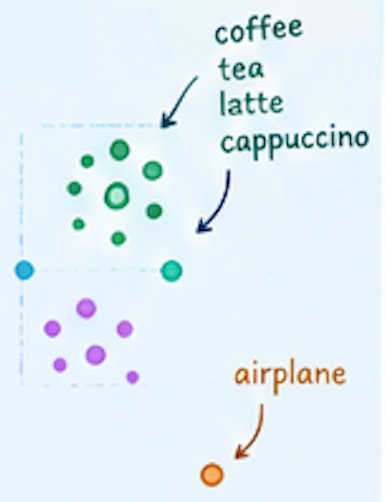
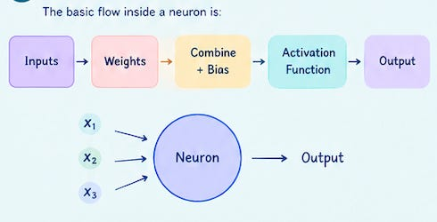
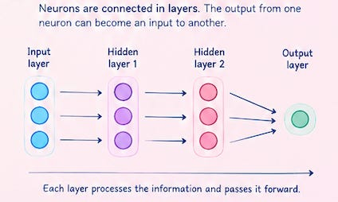

# Week 4, Day 2 - Inside a Neuron: From Vectors to Embeddings, Weights & Activation

*September 17, 2026 · [Originally published on Substack](https://niharikabatra.substack.com/p/week-4-day-2-inside-a-neuron-from)*

Yesterday, we took our first look at **neural networks**.

We saw that a neural network is made up of connected neurons arranged in layers.

Information enters the network, gets processed through these layers, and eventually produces an output. But there is an important question we haven’t answered yet:

**What exactly does a neuron receive as input, and what does it do with that information?**

Let’s go one level deeper.

---

**First, everything has to become numbers**

We’ve already seen **vectors** earlier in this series.

A vector is simply a collection of numbers used to represent information.

For example:

```
[0.2, 0.7, 0.4, 0.9]
```

A neural network can’t directly work with a sentence like:

> “This product is great.”

It needs a numerical representation.

The same idea applies to images, audio, products, documents, and many other types of data.

We first turn the information into numbers.

And sometimes, those numbers are organized into something called an **embedding**.

---

**So, what is an embedding?**

An **embedding is a numerical representation of something that captures useful characteristics or relationships about it.**

For example, imagine we want an AI system to understand words.

Instead of treating:

> coffee

as just a word, a model can represent it as a vector of numbers:

```
coffee → [0.21, -0.43, 0.78, 0.15, ...]
```

We don’t look at these numbers and immediately know what they mean.

That’s okay.

The important part is that the model can learn relationships between these representations.

Words related to:

- coffee
- tea
- latte
- cappuccino

may end up with representations that are closer to one another than something unrelated like “airplane.”



We’ll go much deeper into embeddings and how models learn them later in this series.

For now, we just need the basic idea:

> **Embeddings turn information into numbers in a way that allows models to learn useful relationships.**

---

**Now let’s look at one neuron**

Once our information has been represented as numbers, those numbers can become the **inputs** to a neuron.

Suppose our neuron receives three inputs:

```
x₁   x₂   x₃
```

Together, these form an **input vector**:

```
x = [x₁, x₂, x₃]
```

But the neuron doesn’t treat every input equally. Each input has a **weight**.

We’ve already seen weights earlier when discussing machine learning, so think of this as the same idea:

> A weight tells the model how much importance to give to an input.

So we might have:

```
x₁ → weight w₁
x₂ → weight w₂
x₃ → weight w₃
```

The neuron combines the inputs with their weights.

In simplified form:

```
x₁w₁ + x₂w₂ + x₃w₃
```

Then we add a **bias**.

So the neuron first calculates:

```
z = x₁w₁ + x₂w₂ + x₃w₃ + b
```

where `b` is the bias.

Think of bias as a small adjustment added to the neuron’s calculation.

For example, imagine you’re deciding whether to carry an umbrella. Rain probability is one factor, but you might also have a personal rule: *“If there’s even a small chance of rain, I’m taking my umbrella.”*

That extra adjustment in your decision is similar to what **bias** does for a neuron.

But we’re not done yet.

---

**What does the activation function do?**

This is where we introduce a new piece.

After combining the inputs, the neuron passes the result through an **activation function**.

You can think of an activation function as a **decision or transformation step** that determines what the neuron should pass forward.

In simple terms:

> **The neuron combines the information, and the activation function decides how that result should be transformed before passing it on.**

There are different types of activation functions.

1.  **ReLU**

One common activation function is **ReLU (Rectified Linear Unit)**.

You don’t need to remember the formula right now. Just know its basic behavior:

> **If the value is negative, ReLU turns it into 0. If it is positive, it keeps it.**

For example:

```
-3 → 0
 2 → 2
 7 → 7
```

That simple behavior helps neural networks learn more complex patterns.

1.  **Sigmoid**

Another activation function is **Sigmoid**.

Sigmoid takes a number and turns it into a value between **0 and 1**.

For example, you might see an output such as:

```
0.92
```

which can be interpreted as **92%** in situations where the model’s output represents a probability.

So, rather than worrying about the mathematical formula right now, remember:

> **Different activation functions transform the neuron’s output in different ways.**

That’s all we need for now.

We’ll come back to activation functions in more detail when we have more context.

---

**Putting one neuron together**

We can now describe the basic flow inside a neuron:



That is the fundamental operation happening inside a neuron.

**If this is overwhelming, leave me a comment. I will try to further explain!**  

---

**But one neuron isn’t the whole network**

This is where things get interesting. Yesterday, we saw that a neural network contains **many connected neurons arranged in layers**.

So the output from one neuron can become an input to another neuron.

Something like:



Each layer takes the information it receives, processes it, and passes the result forward.

And this brings us to a concept we’ll explore next.

---

**What happens when information moves through the entire network?**

When information travels from the input layer through the hidden layers and eventually reaches the output, this process is called **forward propagation**.

Think of it as the network moving information **forward** to make a prediction.

But there’s another direction we haven’t explored yet.

What happens when the prediction is wrong?

How does the network figure out:

- which weights contributed to the error?
- how much should each weight change?
- how does the information about the error travel back through the network?

That’s where **backpropagation** comes in.

And that’s what we’ll explore tomorrow.

**One concept at a time. One step closer to AI.**
