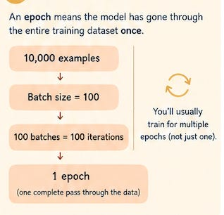
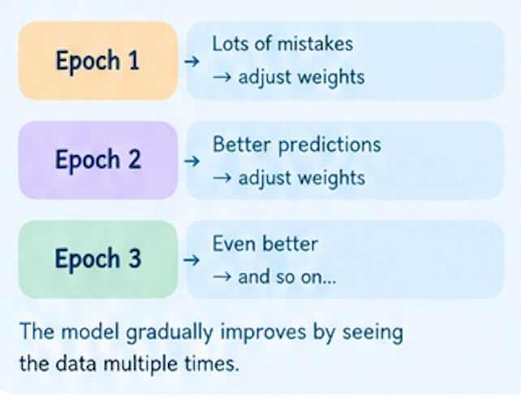
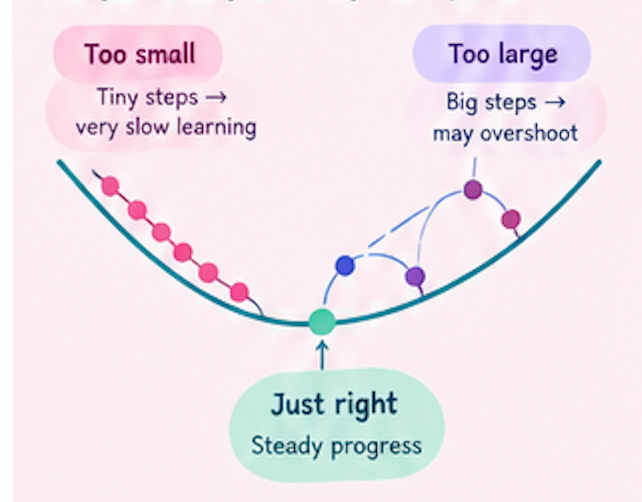

# Week 4, Day 4 - Batches, Iterations, Epochs & Learning Rate in Neural Network

*September 19, 2026 · [Originally published on Substack](https://niharikabatra.substack.com/p/week-4-day-4-batches-iterations-epochs)*

So far this week, we have slowly opened up the black box of neural networks.

Read here: [16 week AI/ML Series](https://niharikabatra.substack.com/s/16-week-aiml-series)

On Day 1, we understood **what a neural network is** and why we use layers of neurons.

On Day 2, we looked inside a neuron and learned about **vectors, embeddings, weights, bias, and activation functions**.

On Day 3, we followed what happens when a neural network makes a prediction:

**Input → Forward Propagation → Prediction → Error → Backpropagation → Gradients → Weight Updates**

But there is still one big question:

**How does a neural network keep learning when we have thousands or millions of examples?**

And how does it know **how much to change its weights each time?**

That’s what we’ll understand today.

---

**Let’s start with a simple example**

Imagine we are building a neural network that can recognize whether a photo contains a particular object.

We have **10,000 training images**.

The neural network looks at these examples, makes predictions, compares them with the correct answers, and adjusts its weights.

But we probably don’t want to give all 10,000 images to the network at once.

Instead, we break them into smaller groups.

This brings us to our first concept.

---

**1\. What is a Batch?**

A **batch** is simply a small group of training examples processed together.

Instead of processing all 10,000 at once, we could use a batch size of:

**100 examples**

So the neural network processes:

> 100 examples → calculate error → update weights

Then another 100:

> 100 examples → calculate error → update weights

And so on.

**Why do this?**

Because working with smaller groups is generally more practical for computers.

Imagine trying to carry 10,000 books at once.

Not very convenient.

Instead:

📚 100 books  
→ put them down  
→ pick up the next 100  
→ continue

The idea is similar.

---

**2\. What is an Iteration?**

Now we have batches.

But we need a way to count how many times the model has processed one of those batches.

That’s an **iteration**.

> **One iteration = one batch going through the training process**

For example:

We have **10,000 training examples** and **Batch size = 100**

Then:

**10,000 ÷ 100 = 100 batches**

So the model needs **100 iterations** to process all 10,000 examples once.

Think of it like this:

**Batch → one group of examples**

**Iteration → one training step using that batch**

---

**3\. What is an Epoch?**

Now we have one more important word.

An **epoch** means the model has gone through the **entire training dataset once**.

Let’s continue our example.

We have **10,000 examples**

Batch size: **100**

That gives us:

**100 batches**

So **100 iterations = 1 epoch**

Because after those 100 iterations, the model has seen all 10,000 training examples once.

We can visualize it like this:

---

**4\. Why Do We Need Multiple Epochs?**

You might be wondering:

If one epoch means the model has seen every training example once, shouldn’t that be enough?

Usually, **no**.

Remember what happened during training.

The model starts with weights that aren’t very good. It makes predictions. Then we calculate the error.

Backpropagation tells us how the weights contributed to that error. The model updates the weights. But one update isn’t enough to learn a complicated pattern.

So we repeat the process.

So you can think of training as:

> **See examples → make predictions → learn from mistakes → adjust → repeat**

---

**5\. Where Does the Learning Rate Come In?**

Now we reach another important piece.

We know that during training, the model changes its weights.

But here’s the question:

**How big should each change be?**

That’s where the **learning rate** comes in.

The learning rate controls **how much the model changes its weights during each update**.

Imagine you’re trying to find the lowest point in a valley while walking downhill.

You could take: **Tiny steps** or **Very large steps**

The learning rate is somewhat like controlling the size of those steps.

---

**A learning rate that is too small**

Imagine the model takes extremely tiny steps. It may eventually learn, but training could take a very long time.

**A learning rate that is too large**

Now imagine the model takes huge steps. It might jump past the useful solution instead of gradually moving toward it.

The model can struggle to settle into a good solution.

So we want a learning rate that allows the model to make **useful progress without making overly large jumps**.

---

**6\. How Does This Connect to Gradient Descent?**

You may remember **gradient descent** from earlier in the series. We can now connect the pieces. I am deliberately repeating this concept to help you connect the dots.

The gradient tells us roughly:

> **which direction the error is changing**, and the model uses that information to decide how to adjust its weights.

The learning rate tells us:

> **How big should that move be?**

So, very simply:

**Gradient → tells us how the error is changing**

**Learning rate → controls how big the update should be**

Together, they help determine the next weight update. You don’t need calculus to understand this intuition.

Just remember:

> **The gradient helps the model know which way to adjust. The learning rate helps decide how big the adjustment should be.**

---

**7\. One More Important Idea: More Training Isn’t Always Better**

At this point, it might sound like:

> “If training helps the model learn, why not just train it for hundreds or thousands of epochs?”

Because a model can start learning the **training data too specifically.**

Remember **overfitting** from Week 2?

A model can become very good at the examples it has already seen but perform poorly on new examples.

That’s why we don’t simply keep increasing the number of epochs forever.

We monitor how the model performs on data it hasn’t trained on.

This is one reason why our **validation set** is important.

We want the model to learn useful patterns, not simply memorize its training examples.

---

**Tomorrow**

We’ll connect everything we’ve learned so far and understand what actually changes when a neural network grows from a few layers into a **deep neural network**.

**One concept at a time. One step closer to AI.**
