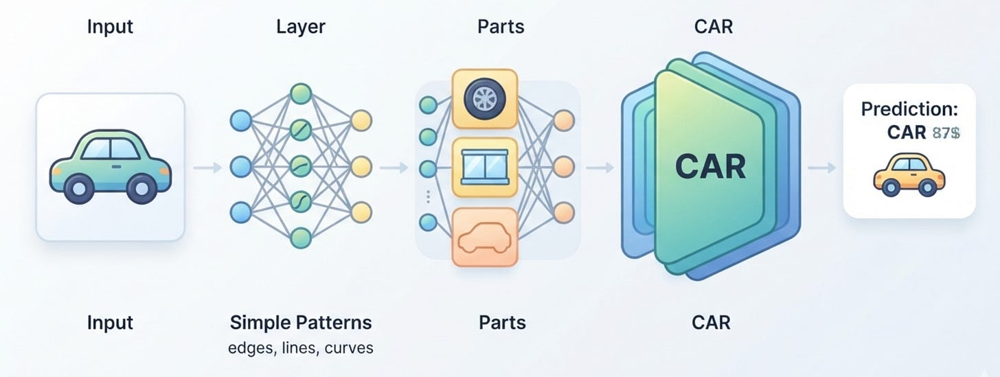

# Week 4, Day 5 - From Neural Networks to Deep Learning

*September 20, 2026 · [Originally published on Substack](https://niharikabatra.substack.com/p/week-4-day-5-from-neural-networks)*

So far this week, we’ve slowly opened up the black box of neural networks.

We started with the basic idea of a neural network.

Then we looked inside a single neuron and learned about **weights, bias, vectors, embeddings, and activation functions**.

We followed information through the network using **forward propagation** and saw how the network learns from its mistakes through **backpropagation and weight updates**.

Yesterday, we looked at what happens when we have thousands or millions of training examples - **batches, iterations, epochs, and learning rate**.

But there’s one question we haven’t answered yet:

**What makes a neural network “deep”?**

And why do we need multiple layers in the first place?

Let’s find out.

---

**First, let’s go back to a simple neural network**

Imagine we’re trying to build a model that can recognize whether a picture contains a **car**. A very simplified network might look something like this:

**Input → Hidden Layer → Output**

The input could contain the numerical representation of the image.

The hidden layer processes that information.

And the output layer gives us a prediction:

> **Car: 92%**

This is a neural network.

But what if we add more hidden layers?

We might now have:

**Input → Layer 1 → Layer 2 → Layer 3 → Output**

We haven’t fundamentally changed what a neuron is. We haven’t created a completely different type of model. We’ve simply added **more layers of neurons**.

And that’s where the word **deep** comes from.

---

**What does “deep” actually mean?**

In simple terms:

> **A deep neural network is a neural network with multiple layers between the input and the output.**

The word **deep** refers to the depth of the network - essentially, how many layers information passes through.

So:

**Few layers → shallower network**

**More layers → deeper network**

And this is the foundation of **deep learning**.

You can think of deep learning as:

> **Using neural networks with many layers to learn increasingly complex patterns from data.**

---

**But why add more layers?**

This is the interesting part.

Why not just create one enormous layer?

Because different layers can learn **different levels of patterns**.

Let’s go back to our car example.

Imagine you’re looking at a photograph of a car. You don’t identify the entire car all at once. Your brain can recognize smaller pieces and combine them into something more meaningful.

A neural network can learn patterns in a somewhat similar hierarchical way.

---

**Layer 1: Simple patterns**

The earlier layers may learn relatively simple patterns. For an image, these could include things like:

- edges
- lines
- corners
- basic shapes

The network isn’t necessarily being explicitly told:

> “Look for an edge.”

Through training, its weights adjust so that some neurons respond strongly to patterns like these.

---

**Layer 2: Combine simple patterns**

The next layer receives information from the previous layer. It can combine those simpler patterns into more meaningful shapes.

For example:

**Edges + curves + corners**

might help represent something resembling a:

> **wheel**

Or another part of the object.

---

**Layer 3: Recognize more complex patterns**

Now the network can combine those smaller patterns. For example:

**wheels + windows + body shape**

could contribute to recognizing:

> **car**

So you can imagine the network gradually building up information:

**Simple patterns**

↓

**Shapes**

↓

**Parts**

↓

**Objects**

This is one reason multiple layers can be useful.

---

**The important idea: Hierarchical learning**

This idea is worth remembering.

> A deep neural network can learn representations at **different levels of abstraction**.

That sounds complicated, so let’s simplify it.

- **Lower layers -** Often learn simpler patterns.
- **Middle layers -** Combine those patterns into more meaningful structures.
- **Higher layers -** Can use those structures to recognize more complex concepts.

So instead of trying to recognize:

> “This is a car”

directly from millions of raw numbers,

the network can gradually build a representation:

> lines → shapes → parts → object

Again, this is a simplified way of thinking about what happens inside a network, but it’s a useful mental model

---

**And this isn’t just about images**

The same broader idea appears in other types of data. For example, imagine a model working with language.

A network may process information that eventually helps it represent:

**individual pieces of language**

↓

**words / tokens**

↓

**relationships between words**

↓

**larger patterns in a sentence**

↓

**meaning useful for the task**

The exact mechanisms depend on the architecture.

But the broader idea remains:

> **Different layers can transform the information into increasingly useful representations.**

---

**So what changed when we added more layers?**

This is an important distinction. Remember our single neuron from Day 2?

It still works the same basic way.

It receives inputs.

It applies weights.

Adds a bias.

Uses an activation function.

And produces an output.

We haven’t changed the basic building block.

Instead, we’re connecting many of these building blocks together.

> Each layer receives information from the previous layer and transforms it before passing it forward.
> 
> That repeated transformation is what allows the network to learn more complicated representations.

---

**More layers = automatically better?**

Not necessarily.

This is an important point.

It might be tempting to think:

> “If deep networks can learn complex patterns, then just keep adding layers!”

But real-world machine learning isn’t that simple.

A deeper network can:

- require more computation
- take longer to train
- need more data
- be harder to optimize
- potentially overfit

And the right architecture depends on the problem.

So the goal isn’t:

> **Make the network as deep as possible.**

The goal is:

> **Use an architecture that can learn the patterns needed for the problem.**

We’ll come back to this idea when we start looking at different neural network architectures.

---

You’ve probably heard terms like:

**CNNs, RNNs, Transformers, Attention, Large Language Models**

These can sound like completely different worlds.

They’re not.

They build on many of the same ideas we’ve been learning this week:

**neurons → layers → representations → training → optimization**

The difference is in **how the networks are designed and what kinds of problems they’re particularly suited for**.

That’s where we’re headed next.

---

**Tomorrow**

We’ll start exploring **different neural network architectures** and understand why we don’t use the exact same network for every type of problem.

**One concept at a time. One step closer to understanding AI.**
