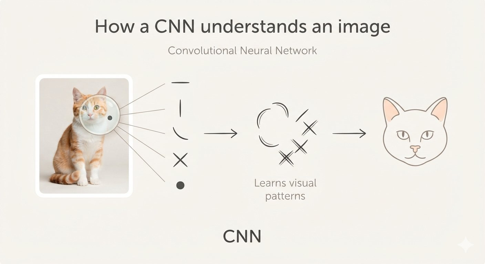
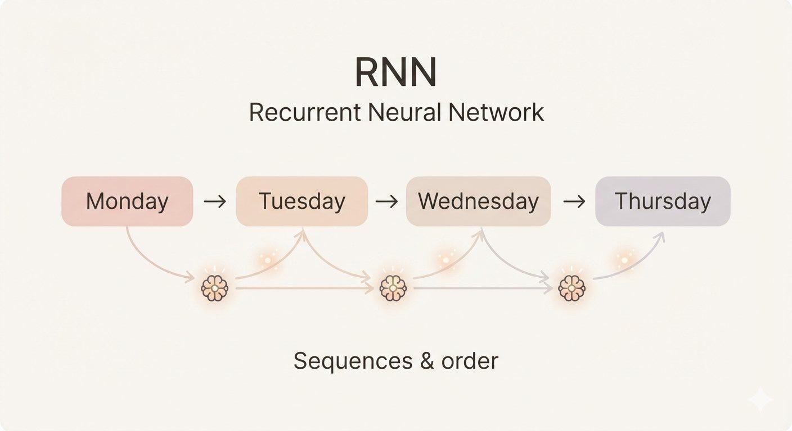
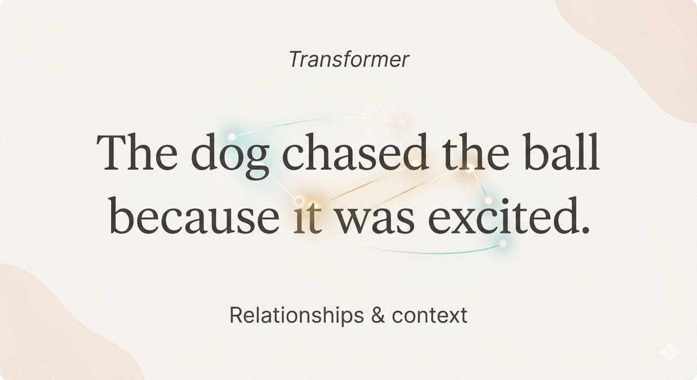

# Week 4, Day 6 - CNNs, RNNs & Transformers - Why Neural Networks Have Different Architectures

*September 21, 2026 · [Originally published on Substack](https://niharikabatra.substack.com/p/week-4-day-6-cnns-rnns-and-transformers)*

Yesterday, we learned how a neural network actually **learns**.

We talked about **batches, iterations, epochs, and learning rate**, all the pieces that help a neural network improve through repeated practice.

But that brings us to another question:

**Do we use the exact same neural network for every kind of problem?**

Not really.

An image, a sentence, and a stream of temperature readings are all data, but they are structured very differently.

So researchers developed different ways of **designing and arranging neural networks** depending on the kind of data and problem they were working with.

These arrangements are called **neural network architectures**.

Don’t worry, today we’re not going deep into the mathematics of each one.

Instead, let’s build a simple mental map.

---

**One neural network, many possibilities**

Think about a person learning different skills. The basic human brain is the same.

But the way we approach different tasks can be very different.

If you’re looking at a photograph, you’re looking for **visual patterns**.

If you’re reading a sentence, you’re paying attention to **words and their relationships**.

If you’re looking at a stock price or temperature over several days, you’re interested in **what happened over time**.

AI has a similar idea.

The basic building blocks of neural networks can be arranged differently depending on what we’re trying to understand.

---

**1\. CNN - Convolutional Neural Network**

Let’s start with images. Imagine showing an AI a picture of a handwritten **8**.

An image is made up of pixels, but looking at individual pixels alone doesn't tell us much. What matters is the **patterns formed by groups of pixels**.

What matters are the **patterns formed by those pixels**.

You might notice:

- lines
- curves
- shapes
- textures

And eventually, those patterns help you recognize:

**“This is an 8.”**

A **CNN**, or **Convolutional Neural Network**, is a type of neural network that is especially good at learning patterns in images.

**So what does “convolutional” mean?**

The word comes from **convolution**, a mathematical operation that allows the network to look at small parts of an image and identify useful patterns.

You don’t need to understand the math behind convolution yet.

For now, think of it like this:

Pixels
   ↓
Lines & edges
   ↓
Shapes & textures
   ↓
Parts of an object
   ↓
Object

The network can gradually learn which patterns are useful for the task.

CNNs have been widely used in computer vision — things like image classification, object detection, facial recognition, and medical imaging.

---

**2\. RNN - Recurrent Neural Network**

Now let’s change the problem.

Imagine this sentence:

> **“I went to the bank to deposit money.”**

The word **bank** makes sense partly because of the words around it.

Now consider:

> **“I sat beside the bank and watched the river.”**

Same word.

Different meaning.

Here, **order and context matter**.

This is called **sequential data** - information where the order in which things happen matters.

Text is one example.

Time-series data is another.

For example:

Monday → 72°F
Tuesday → 75°F
Wednesday → 79°F
Thursday → 81°F

Looking at the sequence can tell us more than looking at one temperature by itself.

This is where **RNNs**, or **Recurrent Neural Networks**, come in.

**So what does “recurrent” mean?**

The word **recurrent** refers to the network repeatedly processing a sequence while carrying information from earlier steps forward.

In simple terms:

> **What happened before can help the model understand what comes next.**

This made RNNs useful for things like:

- language
- speech
- time-series data

RNNs were an important step in helping neural networks work with sequences.

But they also had limitations, especially when dealing with very long sequences.

And that brings us to the architecture that became extremely important in modern AI.

---

**3\. Transformers**

Now imagine you’re reading a paragraph.

To understand one sentence, you might need to connect it with words or ideas that appeared much earlier.

For example:

> **“The dog chased the ball because it was excited.”**

What does **“it”** refer to?

You use the surrounding context to figure it out.

Instead of only thinking about what came immediately before, we want a model to understand:

> **Which parts of the information are important to each other?**

This is where **Transformers** come in.

Instead of processing information only step by step, Transformers can look at relationships between different parts of the input and determine which ones are more relevant to each other.

And this became extremely important for language.

Today, Transformers are behind many modern AI systems, including many of the **large language models (LLMs)** you’ve probably heard about.

We’ll explore *how* they do this tomorrow.

---

**Tomorrow:**

You’ve probably heard people say:

> *“Transformers use attention.”*

But what does **attention** actually mean?

We’ll break it down with a simple example **without starting with equations** and see how a model can figure out which parts of a sentence matter most when understanding its meaning.

**One concept at a time. One step closer to AI.**
