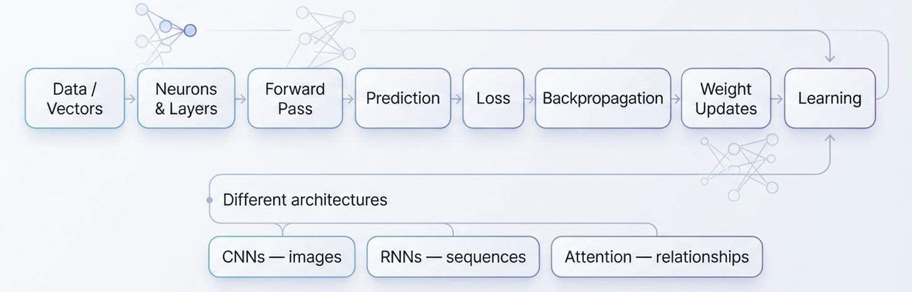

# Week 4, Day 7 - A Week of Neural Networks, In One Picture

*September 22, 2026 · [Originally published on Substack](https://niharikabatra.substack.com/p/week-4-day-7-a-week-of-neural-networks)*

I wanted to start **Transformers** today.

Honestly, I was ready to jump right into attention and see what makes Transformers so important in modern AI.

But then I remembered something a few of you asked for:

**“Can we have a recap at the end of the week?”**

And I think that’s a really good idea.

Because when you’re learning AI one concept at a time, it’s easy to understand each topic individually but still wonder:

**“Wait… how does all of this connect?”**

So before we move on to our next big topic tomorrow, let’s take a step back and connect what we learned about **neural networks** this week.

Not another lesson.

Not a list of definitions.

Just the **big picture.**

---

**Where We Started**

At the beginning of the week, we asked:

**What actually is a neural network?**

> 📄 **Week 4, Day 1 - Neural Networks: What Are They and How Do They Work?**
> September 16, 2026 · [Read the original on Substack](../04-week-4/day-1-neural-networks-what.md)

We learned that it isn’t some mysterious “AI brain.”

> At its core, it’s a collection of **neurons arranged in layers** that learn patterns from data.

And those neurons work with numbers.

That’s why we talked about **vectors and embeddings**, ways of representing information numerically so a neural network can work with it.

> 📄 **Week 4, Day 2 - Inside a Neuron: From Vectors to Embeddings, Weights & Activation**
> September 17, 2026 · [Read the original on Substack](../04-week-4/day-2-inside-a-neuron-from.md)
---

**Then We Asked: How Does It Learn?**

A neural network starts with some weights.

It makes a prediction.

The prediction may be wrong.

So we measure the error using **loss**.

Then we work backward to understand how the weights contributed to that error.

That’s where **backpropagation** comes in.

And then **gradient descent** helps update those weights.

So the bigger idea is simply:

**Make a prediction → see how wrong it was → adjust → try again.**

And this happens over and over again.

> 📄 **Week 4, Day 3 - Forward Propagation, Backward Propagation & Gradient Descent in Neural Network**
> September 18, 2026 · [Read the original on Substack](../04-week-4/day-3-forward-propagation.md)
---

**But It Doesn’t Learn From Everything at Once**

That’s where **batches, iterations and epochs** came in.

Instead of throwing the entire dataset at the model in one go, training can happen in smaller batches.

The model makes updates.

It goes through the data.

And it repeats this process over multiple epochs.

The **learning rate** controls how big those updates are.

So all those terms we learned aren’t isolated vocabulary.

They’re pieces of the same learning process.

> 📄 **Week 4, Day 4 - Batches, Iterations, Epochs & Learning Rate in Neural Network**
> September 19, 2026 · [Read the original on Substack](../04-week-4/day-4-batches-iterations-epochs.md)
---

**And Then We Asked Another Question**

**Do we use the same neural network for every kind of problem?**

> 📄 **Week 4, Day 5 - From Neural Networks to Deep Learning**
> September 20, 2026 · [Read the original on Substack](../04-week-4/day-5-from-neural-networks.md)

Not necessarily.

An image has spatial patterns.

A sequence has an order.

So we looked at different architectures designed to work with different kinds of patterns.

**CNNs** → useful for spatial patterns such as images.

**RNNs** → designed for sequential information where order matters.

> 📄 **Week 4, Day 6 - CNNs, RNNs & Transformers - Why Neural Networks Have Different Architectures**
> September 21, 2026 · [Read the original on Substack](../04-week-4/day-6-cnns-rnns-and-transformers.md)

And this brings us to where we’re going next.

Because there is another way of thinking about relationships in data that changed the direction of modern AI.

---

**And That’s Where Attention Comes In**

Imagine you’re reading a sentence.

Not every word is equally important when you’re trying to understand the meaning of another word.

Sometimes, one word needs to “look at” another word to understand what is happening.

That simple idea leads us to:

**Attention.**

And from attention, we’ll get to:

**Self-Attention → Transformers → Large Language Models**

That’s our starting point for Week 5.

**Tomorrow, we start with Attention.**

And this time, we’re getting one step closer to understanding what’s happening inside the AI systems we interact with every day.
