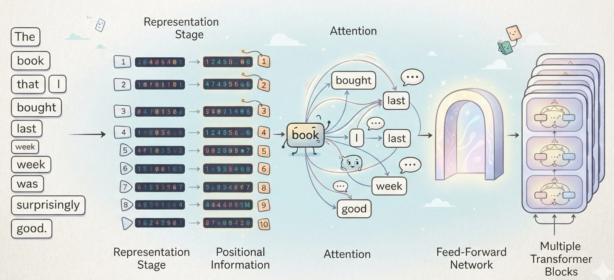

# Week 5, Day 2 - The Big Picture of a Transformer

*September 24, 2026 · [Originally published on Substack](https://niharikabatra.substack.com/p/week-5-day-2-the-big-picture-of-a)*

Yesterday, we started our journey into **Attention**.

We learned one simple but powerful idea:

> **Attention helps a model determine which parts of the input are relevant to each other.**

But attention doesn’t exist by itself.

It is part of a larger architecture called the **Transformer**.

And today, instead of jumping straight into the details, let’s take a step back and understand the **big picture**.

---

**So, what exactly is a Transformer?**

A Transformer is a type of neural network that helps a model understand how different parts of an input relate to one another, especially in things like sentences.

Think about a sentence:

> **“The book that I bought last week from the bookstore near my office was surprisingly good.”**

As humans, we don’t read this sentence by treating every word as completely independent.

We naturally connect words with one another.

When we read **“book,”** we understand that:

- “bought” tells us something about the book
- “bookstore” is related to where it came from
- “good” describes the book
- “I” is the person who bought it

A Transformer is designed to help a model learn these kinds of relationships.

And **attention is one of the key mechanisms that makes this possible.**

---

**Before attention, there is an input**

A neural network doesn’t simply see the sentence the way we do. The words first need to be converted into a form the model can work with. This is where **tokens and embeddings** come in.

**Step 1: The sentence becomes tokens**

The text is broken into smaller pieces called **tokens**.

For example:

> The | book | that | I | bought | last | week | ...

A token might be a whole word, part of a word, or sometimes even punctuation.

The exact way text is split depends on the tokenizer being used.

---

**Step 2: Tokens become embeddings**

Computers don’t naturally understand the meaning of the word **“book.”**

> So each token is represented as a vector of numbers called an **embedding**.

You can think of an embedding as a numerical representation that captures useful information about a token.

Very roughly:

**book → \[0.21, -0.47, 0.83, ...\]**

We don’t need to worry about what each individual number means right now.

The important idea is:

> **Words are converted into numerical representations that a neural network can process.**

We actually saw this idea earlier when we discussed **vectors and embeddings** in Week 4.

> 📄 **Week 4, Day 2 - Inside a Neuron: From Vectors to Embeddings, Weights & Activation**
> September 17, 2026 · [Read the original on Substack](04-week-4/day-2-inside-a-neuron-from.md)

Now we’re going to see why those embeddings become so important inside Transformers.

At this stage, **“book” has a starting numerical representation**.

As the model processes the sentence, these representations can be transformed based on the surrounding context.

**Attention plays an important role in that process.**

---

**But there is a problem...**

Consider these two sentences:

> **“The dog chased the cat.”**

and

> **“The cat chased the dog.”**

They contain almost exactly the same words. But they mean completely different things.

Why?

Because **the position and relationship between the words matter.**

The Transformer therefore needs some way to know where each token occurs in the sequence. This brings us to **positional information**.

---

**Step 3: Positional information**

The model needs to distinguish between both of the above sentences. So information about the position of each token is incorporated into its representation.

You can think of it as giving each token an additional hint:

> “You are the first token.”
> 
> “You are the second token.”
> 
> “You are the third token.”

And so on.

There are different ways Transformers can represent positional information. We’ll keep that discussion for later.

For now, remember:

> **Embeddings tell the model what the tokens represent, while positional information helps tell the model where they occur in the sequence.**

---

**Step 4: Now comes Attention**

This is the part we’ve been building toward. Once the model has token representations along with information about their positions, attention can help it determine how those tokens relate to one another.

Remember our sentence:

> **“The book that I bought last week from the bookstore near my office was surprisingly good.”**

When processing the word **“book,”** the model may need to consider other words in the sentence.

Which words are relevant?

How strongly should they influence the representation of **“book”**?

Attention provides a mechanism for the model to calculate these relationships.

And this is where things start getting really interesting.

---

**But attention isn’t the end**

A simplified view of what happens next is:

**Input**  
↓  
**Token Embeddings + Positional Information**  
↓  
**Attention**  
↓  
**Feed-Forward Network**  
↓  
**Next Transformer Block**

The **Feed-Forward Network** is another neural-network component.

Its job is to further transform and process the information after the attention mechanism has helped the model understand relationships between tokens.

You can think of it very roughly as:

> **Attention helps the model look at relationships.**
> 
> **The feed-forward network helps transform the information it has gathered.**

These components work together. And in an actual Transformer, this process isn’t performed just once.

**Think of this combination as a Transformer block. Multiple blocks are then stacked together to build the larger Transformer.**

---

So instead of:

**Attention → Done**

we have something more like:

**Layer 1**  
→ Attention  
→ Feed-Forward

**Layer 2**  
→ Attention  
→ Feed-Forward

**Layer 3**  
→ Attention  
→ Feed-Forward

**...**

and so on.

Each layer can build on representations produced by the previous layer.

This allows the model to gradually develop richer representations of the input.

This is intentionally simplified.

A real Transformer has additional components such as **residual connections and normalization**, and different Transformer architectures organize these pieces differently.

We’ll get there. For now, don’t worry about memorizing the diagram.

Just understand the flow.

---

**One important clarification**

You may hear the word **Transformer** and think:

> “So Transformer = Attention?”

Not quite.

**Attention is a mechanism.**

**Transformer is an architecture that uses attention along with other components.**

That’s an important distinction.

Think of it like this:

> **Attention is one of the important tools inside the Transformer toolbox.**

The Transformer is the **larger system** that brings multiple pieces together.

---

Tomorrow, we’ll zoom inside the attention mechanism and start unpacking what is happening under the hood.

And over the next few days, we’ll gradually explore the other pieces that make up the Transformer, including **encoders, decoders, self-attention, and the other components that work together behind the scenes**.

We’ll take them one at a time, so there’s no need to understand everything today.

One concept at a time. One step closer to understanding AI.
