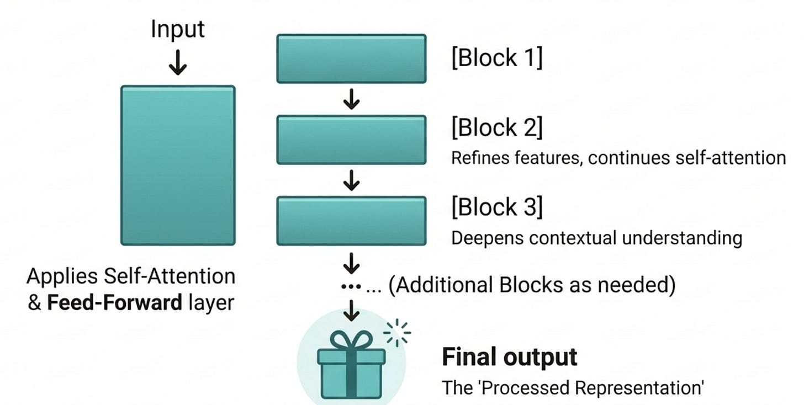
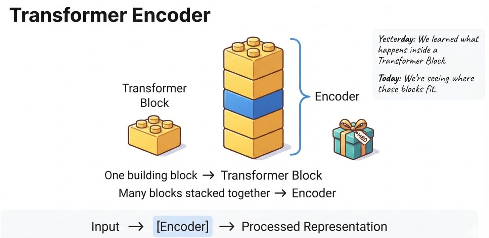

# Week 5, Day 3 - How Does a Transformer Understand What It Reads? Meet the Encoder

*September 25, 2026 · [Originally published on Substack](https://niharikabatra.substack.com/p/week-5-day-3-how-does-a-transformer)*

Yesterday, we went **inside a Transformer Block**.

We learned about **self-attention** and the **feed-forward network**, and how these pieces work together inside a block.

But that leaves us with a natural question:

> **Where do these Transformer Blocks actually fit in the bigger Transformer architecture?**

This is where the **Encoder** comes in.

And here’s the good news:

**We’re not learning a bunch of completely new mechanisms today.**

We’re taking what we learned yesterday and putting it into the bigger picture.

---

**If you’re new to AI, start here**

Think of the **Encoder** as a collection of Transformer Blocks stacked together.

Something like this:

**Input**

↓

**Transformer Block**

↓

**Transformer Block**

↓

**Transformer Block**

↓

**Processed representation**

That’s the basic idea.

So yesterday, we learned:

> **What happens inside one Transformer Block?**

Today, we’re asking:

> **What happens when we put multiple Transformer Blocks together?**

That’s what we mean by the **Encoder**.

If you’re completely new to AI, honestly, that’s enough for today. 😊

But if you want to understand what this looks like technically, let’s go one step deeper.

---

Imagine we have a sentence:

> **“The book that I bought last week was surprisingly good.”**

The sentence first enters the Transformer. It doesn’t go through one giant operation.

Instead, it moves through a series of Transformer Blocks.

Very roughly:

Each block takes the output from the previous block and processes it further.

And remember what we learned yesterday?

Inside each block, we have things like:

- **Attention**
- **Feed-Forward Network**

So we’re not introducing those concepts again. We’re simply stacking them.

---

**Why stack multiple blocks?**

You might wonder:

> **If one Transformer Block can process the input, why do we need several?**

Because one block doesn’t have to do everything.

Multiple layers allow the model to repeatedly transform the information.

Think about it like working through a problem in several stages.

- The first stage produces something useful.
- The next stage takes that result and processes it further.
- Then another stage builds on that.
- And so on.

The model is able to create increasingly rich representations as the information moves through the layers.

The exact patterns learned by each layer aren’t as simple as:

> Layer 1 learns words.  
> Layer 2 learns sentences.  
> Layer 3 learns meaning.

Real models don’t work quite that neatly.

The safer way to think about it is:

> **Each layer transforms the representation it receives, allowing the network to build more complex patterns across multiple layers.**

---

**So what exactly is the Encoder?**

Now we can give it a slightly more technical definition.

> **The Encoder is a stack of Transformer Encoder Blocks that processes the input and produces contextual representations.**

The important part is that the Encoder isn’t just one new magical component.

It’s a **larger structure built from the blocks we’ve already learned about.**

> 📄 **Week 5, Day 2: The Big Picture of a Transformer**
> September 24, 2026 · [Read the original on Substack](../05-week-5/day-2-the-big-picture-of-a.md)
---

**Think of it like building with LEGO 🧱**

I am probably going to be building LEGO this weekend, so this analogy is already on my mind. 😄 I got a LEGO set as a birthday gift!

Imagine one LEGO piece.

Yesterday, we studied that piece.

Today, we’re looking at what happens when you use many of those pieces to build something bigger.

One piece → **Transformer Block**

Many pieces together → **Encoder**

Of course, a real Transformer is much more complicated than LEGO.

But the mental model is useful:

> **A Transformer Block is a building block. The Encoder is a larger structure made by stacking those blocks.**

---

**What comes out of the Encoder?**

After the input passes through all those blocks, the Encoder produces an output representation. We can think of the journey like this:

**Input**

↓

**Transformer Blocks**

↓

**More Transformer Blocks**

↓

**More processing**

↓

**Context-rich representations**

These representations can then be used for different tasks.

And depending on the Transformer architecture, they might be passed to another part of the model.

Which brings us to our next question...

---

**But wait, where’s the Decoder?**

If the Encoder processes the input, what happens when we want the model to **generate an output**?

For example:

**English → French**

or

**Question → Answer**

or

**Prompt → Generated text**

We need another part of the architecture to help produce that output.

And that brings us to the **Decoder**.

Tomorrow, we’ll meet the Decoder and see how it differs from the Encoder.

And once we understand both, we’ll be able to answer a bigger question:

> **Why do some Transformers have an Encoder and Decoder, while models like ChatGPT work differently?**

That’s where this architecture starts becoming much more interesting.
