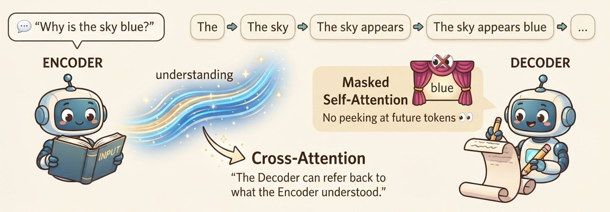

# Week 5, Day 4 - How Does a Transformer Generate an Output? Meet the Decoder

*September 26, 2026 · [Originally published on Substack](https://niharikabatra.substack.com/p/week-5-day-4-how-does-a-transformer)*

Yesterday, we met the **Encoder**.

We saw how a Transformer takes an input, processes it through multiple layers, and gradually builds a representation that captures the context of the entire input.

But that leaves us with an important question:

> **If the Encoder understands the input, who actually generates the output?**

That’s where the **Decoder** comes in.

Today, we’ll first build a simple mental model of what the Decoder does.

Then, once that feels intuitive, we’ll go one level deeper and look at what is actually happening inside a Decoder block.

---

**Let’s start with a simple example**

Imagine we ask a model:

> **Why is the sky blue?**

We expect an answer such as:

> **The sky appears blue because sunlight is scattered by the Earth’s atmosphere.**

But the model doesn’t simply create this entire sentence in one shot.

It generates the output **one token at a time**.

We can imagine the process like this:

```
The
↓
The sky
↓
The sky appears
↓
The sky appears blue
↓
The sky appears blue because
↓
...
```

At every step, the model is essentially asking:

> **“Given everything I have so far, what should come next?”**

This is the core intuition behind the Decoder.

The Decoder is responsible for **generating the output sequence progressively**.

---

**But there’s a catch...**

If the Decoder is trying to predict the next token, it shouldn’t be allowed to look at the tokens that come **after** it.

Think about this:

Suppose we’re trying to predict:

> **The sky appears \_\_\_**

If the model could already see:

> **The sky appears blue because...**

then it wouldn’t really be predicting **blue**.

It would simply be looking at the answer.

So the Decoder needs a rule:

> **You can look at what has already been generated, but you cannot look ahead at the future.**

This is where something called **masked self-attention** comes in.

---

**Masked Self-Attention: No Peeking 👀**

We’ve already learned about **self-attention**.

The Decoder uses the same basic idea, but with one important restriction.

Let’s imagine the output tokens are:

```
The   sky   appears   blue
```

When processing **“appears”**, the Decoder can use:

```
The
sky
appears
```

But it cannot use:

```
blue
```

because **blue comes later**.

Conceptually:

```
                 Can look at →

                 The    sky    appears    blue

The               ✓       ✗        ✗        ✗

sky               ✓       ✓        ✗        ✗

appears            ✓       ✓        ✓        ✗

blue               ✓       ✓        ✓        ✓
```

The blocked positions form a mask. That’s why we call it:

**Masked Self-Attention** or **Causal Self-Attention.**



The mask prevents each position from attending to future positions, preserving the left-to-right generation process.

---

**So what’s different from the Encoder?**

The **Encoder** is processing an input that is already completely available.

For example:

> “Why is the sky blue?”

The entire question is there.

So the Encoder can look at the words before **and after** any particular word.

**The Decoder is different. It’s generating something. So it has to respect the order of generation.**

A simple way to remember it:

> **Encoder:** “I can look at the whole input.”
> 
> **Decoder:** “I can only look at what I’ve generated so far.”

That’s the first major difference.

---

**But there’s another question...**

Let’s say the Decoder has generated:

> **The sky appears...**

How does it know that we’re talking about **the sky being blue**?

After all, the Decoder needs to use the information from the original question:

> **Why is the sky blue?**

This is where the Encoder and Decoder need to communicate. And this brings us to an important concept:

**Cross-Attention**

We’ve already learned about **self-attention.** Now we’re introducing **cross-attention**.

The simplest distinction is:

> **Self-attention:** look within your own sequence.
> 
> **Cross-attention:** look at information coming from another sequence.

In the original Transformer, the Decoder uses cross-attention to attend to the output produced by the Encoder.

So our picture now looks like this:

```
                    QUESTION
                       │
                       ▼
                  ┌─────────┐
                  │ ENCODER │
                  └─────────┘
                       │
                       │
                       ▼
              Encoder representation
                       │
                       │
                       ▼
                  ┌─────────┐
                  │ DECODER │
                  └─────────┘
                       │
                       ▼
                    ANSWER
```

The Encoder processes the input.

The Decoder generates the output.

And **cross-attention is one of the ways the Decoder uses what the Encoder understood.**

---

**Think of it like this**

Imagine you’re answering a question from a book.

The **Encoder** reads the material and builds a useful representation of what it found.

The **Decoder** starts writing the answer.

While writing, it can essentially ask:

> “Which information from what I read is relevant to what I’m writing right now?”

That’s the intuition behind cross-attention.

The Decoder is generating, but it isn’t generating blindly.

It can **refer back** to the information produced by the Encoder.

---

For today, that's all we need to know about cross-attention. We got the intuition:

> **The Decoder can look back at what the Encoder understood while generating the output.**

But how does it actually do that?

Tomorrow, we’ll slow down and look inside **cross-attention**.

We’ll break it down with a simple example and then connect it back to the Transformer architecture we’ve been building throughout this week.

**One concept at a time. One step closer to understanding AI.**
