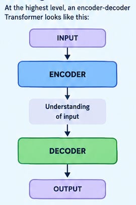
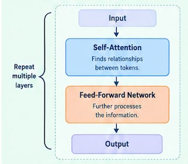
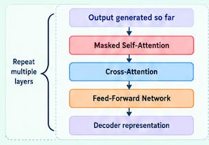
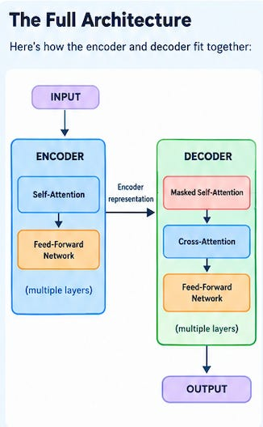
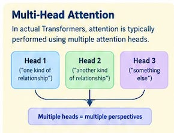

# Week 5, Day 5 - Putting the Transformer Together 

*September 27, 2026 · [Originally published on Substack](https://niharikabatra.substack.com/p/week-5-day-5-putting-the-transformer)*

Yesterday, we met the **Decoder**.

Earlier, we saw how encoder takes an input, processes it through multiple layers, and gradually builds a representation that captures the context of the entire input.

We also learned that decoder has a different job: it takes what has been generated so far, looks back at what the Encoder understood, and helps produce the next part of the output.

We’ve now talked about quite a few pieces.

So today, instead of adding another complicated concept, let’s step back.

> **How do all these pieces actually fit together?**

Think of today as putting our LEGO pieces together. 🧱

---

**The Big Picture**

At the highest level, a Transformer looks like this:

That’s the simplest version. But there is a lot happening inside those two boxes.

Let’s open them up.

---

**Inside the Encoder**

Remember what the Encoder’s job is:

> **Understand the input and build a useful representation of it.**

To do that, an Encoder layer has a few important pieces.

The first is:

**Self-Attention**

This is where the model looks at the different parts of the input and understands how they relate to one another.

For example:

> **“The book that I bought last week was surprisingly good.”**

To understand this sentence, the model needs to understand relationships between words across the sentence.

That’s what self-attention helps with.

Then comes:

**Feed-Forward Network**

Once the model has gathered information through attention, it processes that information further. We’ve already seen feed-forward networks when we learned about neural networks.

So the Encoder isn’t learning a completely new idea here.

It’s combining things we’ve already learned.

A simplified Encoder layer looks like:

And this layer isn’t used just once.

A Transformer stacks **multiple Encoder layers** on top of each other.

Each layer can build on the representation produced by the previous one.

---

**Now Let’s Look at the Decoder**

The Decoder has a different job.

Its job is to:

> **Generate the output, one token at a time.**

And it has three important pieces.

**1\. Masked Self-Attention**

The Decoder looks at what it has generated so far. But it cannot look into the future.

If it has generated:

> “The sky is”

it can use those tokens.

But it can’t peek at the next word before generating it. That’s why we use **masked self-attention**.

---

**2\. Cross-Attention**

This is where the Decoder can look back at the information created by the Encoder. Remember our simple explanation from yesterday:

> **The Encoder understands the input. The Decoder can look back at that understanding when generating the output.**

So if the Decoder is trying to generate the next token, it can ask:

> **“What part of the input is useful for what I’m generating right now?”**

That’s the basic idea behind cross-attention.

---

**3\. Feed-Forward Network**

Just like in the Encoder, the Decoder also has a feed-forward network that further processes the information.

So, at a high level:

And, just like the Encoder, the Decoder also contains **multiple layers**.

---

**Now Put Them Together**

Let’s open up both sides.

And suddenly, the Transformer doesn’t look quite so mysterious anymore.

It’s a collection of pieces we’ve been learning one at a time.

---

**One Small Detail We Haven’t Talked About**

You might notice something missing from our picture.

How does the Transformer know **where each word appears in the input?**

After all, the Transformer doesn’t process words strictly one after another like older sequence models did. So it needs some way of representing **position**.

This is where **positional information** comes in.

The model needs to know that:

> “The cat chased the dog”

is different from:

> “The dog chased the cat.”

The words are the same. Their positions and therefore their relationships are different.

So Transformers include information about the position of tokens as part of the input representations. We don’t need to get into the mathematics of positional encodings yet.

For now, just remember:

> **Attention helps the model understand relationships between tokens, while positional information helps it know where those tokens occur.**

We’ll come back to this when we need it.

---

**And What About Multi-Head Attention?**

You may have also heard the term:

> **Multi-Head Attention**

Don’t worry, we haven’t forgotten it.

We’ve been using the phrase **self-attention** to understand the core idea first. In an actual Transformer, attention is typically performed using **multiple attention heads**.

A simple way to think about this is:

Imagine you’re looking at a sentence from several different perspectives.

- One perspective might focus on one kind of relationship.
- Another might focus on another.
- Another might focus on something else.

Multiple attention heads allow the model to learn different relationships at the same time.

We don’t need to understand the mathematical details yet.

The important thing for today is:

> **Multi-head attention is a way of allowing the Transformer to look at relationships from multiple learned perspectives.**

We’ll unpack this separately.

---

**The Transformer in One Sentence**

If I had to explain the entire architecture in one simple sentence, I’d say:

> **The Encoder builds an understanding of the input, and the Decoder uses that information along with what it has generated so far to produce the output step by step.**

That’s the Transformer at a high level. Of course, there is a lot more happening mathematically underneath.

But you don’t need the mathematics to understand the architecture.

---

You’ve probably heard terms like **LLM, GPT, and Generative AI** quite a lot by now.

But what does a Transformer actually have to do with all of them?

Tomorrow, we’ll take a simple, non-technical look at **how modern AI models use Transformers**, and how the ideas we’ve been learning show up in the AI tools we interact with every day.

**One concept at a time. One step closer to understanding AI.**
