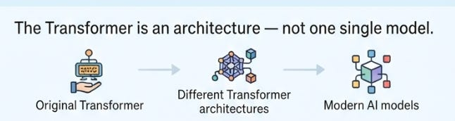
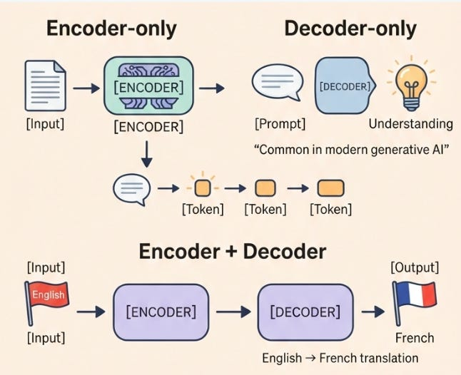

# Week 5, Day 6 - How Transformers Power Modern LLMs

*September 28, 2026 · [Originally published on Substack](https://niharikabatra.substack.com/p/week-5-day-6-how-transformers-power)*

Yesterday, we put the **complete Transformer architecture** together.

We saw how the Transformer is built from pieces like **attention, feed-forward networks, embeddings, and positional information**.

But there’s one question left:

> **If Transformers were originally designed with both an encoder and a decoder, why do we hear about them everywhere when talking about ChatGPT, Gemini, Claude, and other AI models?**

The answer is interesting:

**Modern language models don’t all use the Transformer in exactly the same way.**

---
#### The original Transformer had an Encoder + Decoder

When the Transformer was introduced in the 2017 paper *Attention Is All You Need*, it had two major parts:

**Encoder**  
Processes the input and builds a representation of it.

**Decoder**  
Uses that information to generate the output.

For example, imagine translating:

> **English:** I love coffee.  
> **French:** J’aime le café.

The encoder processes:

> I love coffee.

and builds a representation of the sentence.

The decoder then uses that information to generate:

> J’aime le café.

**one token at a time.**

This is called an **encoder-decoder architecture**.

And this architecture is still useful today, especially for tasks where there is a clear:

> **Input → Output**

relationship.

Models such as **T5** and **BART** follow this general approach. Comment below if you have never heard of these models.

But as Transformer-based models evolved, researchers found that they didn’t always need both pieces.

---
#### Three ways Transformers can be used

You can think of Transformer-based models as having **three broad architectural choices**.

##### 1\. Encoder-only

**Input → Encoder → Representation**

The encoder’s job is primarily to build a rich representation of the input.

These models can be useful for things like:

- classification
- understanding the meaning of text
- extracting information
- finding relationships between words
- generating embeddings

A famous example is **BERT (**Bidirectional Encoder Representations from Transformers).

You don’t need to understand BERT in detail right now. The important idea is simply:

> **Encoder-only models are mainly designed to analyze and represent the input.**

In simple terms, they are useful when we want the model to work with information that is already there, rather than generate a long sequence of new text.

---
##### 2\. Decoder-only

**Input → Decoder → Next token → Next token → Next token**

This is the architecture that became especially important for modern generative AI.

The basic task is surprisingly simple:

> **Given everything I’ve seen so far, what token should come next?**

For example:

> The capital of France is...

The model might predict:

> **Paris**

Now the sequence becomes:

> The → capital → of → France → is → Paris

And the model predicts the next token again.

This happens repeatedly to generate a complete response.

The decoder uses **masked self-attention**, which means that when predicting a token, it cannot look at tokens that come later in the sequence.

That makes this architecture naturally suited to **next-token prediction and text generation**.

Many modern LLMs are built primarily around this decoder-only idea.

#### But where does the input go?

This is where decoder-only models can feel confusing.

A decoder-only model **still receives and processes the input**.

For example:

> **“The capital of France is...”**

The text is first broken into tokens and converted into embeddings.

Those representations then pass through the decoder-style Transformer layers. The model uses **self-attention** to look at the tokens it has received and build contextual representations of them.

It then predicts:

> **Paris**

Then **Paris becomes part of the sequence**, and the model uses the updated sequence to predict what comes next.

So the simplified process is:

> **Input → tokens → embeddings → decoder-style Transformer → next token → next token → next token**

**There is no separate encoder before the decoder.**

This is the key difference from the original encoder-decoder Transformer, where the encoder and decoder were separate components.

---
##### 3\. Encoder-decoder

**Input → Encoder → Decoder → Output**

Here, the encoder processes the input and the decoder generates the output.

This can be especially useful when there is a clear source and target.

For example:

> **Input:** Translate this sentence into French.  
> **Output:** The French translation

Or:

> **Input:** Summarize this article.  
> **Output:** A short summary

The encoder helps represent the input, while the decoder generates the output.

---
#### So why do we hear about Transformers everywhere?

Because the Transformer isn’t just **one specific model**.

It’s better to think of it as an **architecture, a way of building models using ideas such as attention**.

The original Transformer had an encoder and a decoder. But researchers later found different ways to use and modify the architecture.

These three choices help explain why Transformer-based models can look very different from one another, even though they share the same underlying ideas.

And these approaches can be further modified and combined with many other techniques.

---
#### What about ChatGPT, Gemini, and Claude?

When we casually say:

> **“ChatGPT uses Transformers.”**

we are talking about the broader Transformer family of ideas.

We are **not** saying that ChatGPT is simply the exact Transformer from the original 2017 paper.

Modern AI models have evolved considerably.

Researchers have kept the core ideas around **attention and Transformer layers**, while making many changes and improvements for things like:

- training at enormous scale
- handling longer contexts
- making models faster
- improving reasoning and instruction following

So when you use ChatGPT, Gemini, Claude, or another modern AI assistant, you’re interacting with a much more sophisticated system built from ideas that evolved from the original Transformer architecture.

The important takeaway for now is:

> **The Transformer is the architectural family. Modern AI models are much more sophisticated descendants of that original idea.**

---
#### But ChatGPT can translate too. Doesn’t translation need an encoder?

Not necessarily.

This is another important distinction:

> **The task does not automatically determine the architecture.**

The original Transformer used an encoder-decoder architecture for translation.

But a decoder-only model can also translate.

For example, you can give a decoder-only model:

> **Translate “I love coffee” into French.**

The model can process the entire instruction and then generate:

> **“J’aime le café.”**

It is still generating the answer **one token at a time**.

So:

> **Translation does not automatically mean encoder-decoder.**

Different architectures can perform similar tasks. What changes is **how the model processes the input and produces the output**.

---
#### Why did decoder-only become so important?

Decoder-only Transformers turned out to be particularly well suited for **generating text**. Once a model is trained to predict the next token, the same mechanism can be repeated over and over to produce an entire response.

That simple setup scales surprisingly well. As these models became larger and were trained on enormous amounts of text, they became capable of tasks such as:

- answering questions
- writing emails
- summarizing
- explaining concepts
- writing code
- translating
- having conversations

The interesting part is that many of these tasks can be turned into a text-generation problem.

- A question can become text to complete.
- A translation can become text to generate.
- A summary can become text to generate.

That’s one of the reasons decoder-only Transformers became so important to the modern **LLM era**.

[Read Week 5, Day 4: How Does a Transformer Generate an Output? Meet the Decoder](../05-week-5/day-4-how-does-a-transformer.md)

---

The main thing to remember is:

> **Transformers are not one single model. They’re an architecture that can be used in different ways.**

Some models are **encoder-only**.

Some are **decoder-only**.

Some use **both an encoder and a decoder**.

And modern AI systems have built many additional techniques on top of these ideas.

---
#### Tomorrow

We’ve spent the last few days understanding the pieces. Let’s put them together from the user’s point of view:

> **What actually happens when you type a prompt into an LLM?**

We’ll follow the journey from:

**Your words → tokens → Transformer → probabilities → generated response**

And finally see how all these pieces work together to produce the answer you see on your screen.
