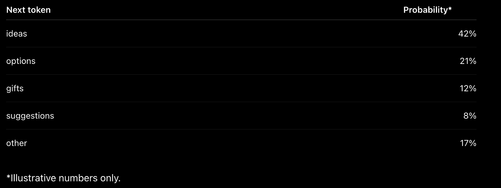
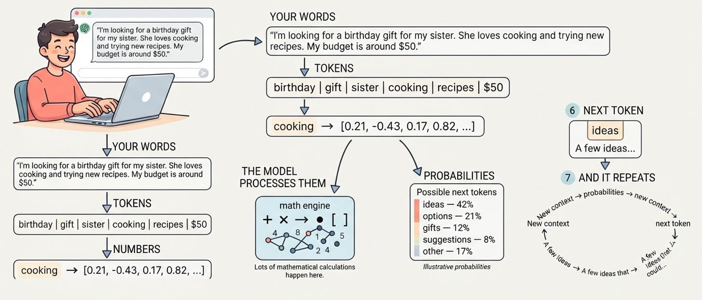

# Week 5, Day 7 - What Actually Happens When You Type a Prompt Into an LLM?

*September 29, 2026 · [Originally published on Substack](https://niharikabatra.substack.com/p/week-5-day-7-what-actually-happens)*

Yesterday, we finally put the Transformer pieces together.

We saw how **embeddings, attention, positional information, feed-forward networks, and multiple layers** work together and how these ideas power modern AI models.

But there’s one question we haven’t really followed from beginning to end:

> **What actually happens when you type a prompt into an LLM?**

Let’s take a simple example.

---
### Imagine you type:

> **“I’m looking for a birthday gift for my sister. She loves cooking and trying new recipes, but she already has most of the basic kitchen tools. My budget is around $50, and I’d love something that feels a little special.”**

You press Enter.

A moment later, the model might respond:

> **“A few ideas that could work well are a personalized recipe box, a high-quality spice set, or a cooking class…”**

But how did it get there?

---
#### 1\. Your words become tokens

The model first breaks your text into smaller pieces called **tokens**.

Something like:

**birthday | gift | sister | cooking | recipes | kitchen | $50 | special...**

The exact tokens depend on the model.

But the important idea is:

> **LLMs work with tokens, not raw text.**

---
#### 2\. Tokens become numbers

A computer can’t perform mathematical operations directly on the word:

> **cooking**

So each token is represented as a numerical vector called an **embedding**.

Conceptually:

> **cooking → \[0.21, -0.43, 0.17, 0.82, ...\]**

The actual vector contains many more numbers.  
Other tokens are represented as vectors too.

So we’ve gone from:

> **words → numbers**

And now the model can perform mathematical operations on them.

---
#### 3\. The model processes the context

This is where the Transformer comes in. The model isn’t just looking at:

> **“birthday gift”**

It has the whole context:

**sister + cooking + recipes + already has kitchen tools + $50 + special**

Attention helps the model **capture relationships between these pieces**.

For example, the fact that she **already has basic kitchen tools** makes certain gift suggestions less useful.

The fact that she **loves cooking** makes other possibilities more relevant.

What feels to us like:

> **“The model understands what I’m looking for.”**

is happening through mathematical operations on those numerical representations.

---
#### 4\. And then comes the interesting part: probabilities

Eventually, the model needs to generate something.

It starts predicting:

> **What token should come next?**

Suppose it begins:

> **“A few…”**

The model calculates a **probability distribution over possible next tokens.**

For example:

Suppose it generates:

> **ideas**

Now it has:

> **“A few ideas…”**

And it predicts again.

Maybe:

> **“A few ideas that…”**

Then:

> **“A few ideas that could…”**

And it keeps going.

**One token at a time.**

---
#### So what does an LLM actually do?

At a very high level:

**Your words → numbers → calculations → probabilities → next token**

Then it does it again:

**more context → more calculations → probabilities → next token**

And again.

And again.

Until a complete response appears.

That’s the basic idea behind **next-token prediction**.

---
#### And here’s the part I find amazing

When we use an LLM, it feels like we’re having a conversation.

We type a question.

It seems to understand us.

It writes a thoughtful answer.

But underneath that experience is something much more mathematical:

> **Numbers being processed → probabilities being calculated → one token being generated → and the process repeating.**

We see **language**.

Underneath, there is **mathematics**.

And that is probably the most useful mental model to take away from this week.

Just remember:

> **An LLM processes your context, calculates probabilities for possible next tokens, and generates them one at a time.**

**One token at a time.**

---
#### Week 5 Complete 🎉

This week we went from **Attention → Transformers → Encoder → Decoder → Complete Transformer Architecture → Modern LLMs → Next-token prediction**

And hopefully, Transformers now feel a little less like a mysterious piece of AI terminology.

---
#### Tomorrow: Week 6 Begins 🚀

**Week 6 is about Building with LLMs.**

And no, we are **not abandoning traditional Machine Learning.** 😄

We’ve spent the first five weeks building the foundation from ML basics to neural networks, attention, Transformers, and LLMs.

We’ve reached LLMs. So now let’s spend some time asking:

> **How do we actually build with them?**

How do we prompt them?  
Why do they behave differently?  
How does temperature affect their responses?  
What happens when our context gets too large?  
How can we get structured outputs or let an LLM use tools?

So for the next **two weeks, we’ll work with LLMs from a practical perspective.**

**Week 6:** Prompting → Model behavior → Temperature → Context windows → Structured outputs → Tool calling

**Week 7:** Hallucinations → Grounding → RAG → Embeddings in practice → Evaluation

And then we’ll come back to our **classical ML journey** and explore algorithms like XGBoost, Naive Bayes, clustering, PCA, and more including when these approaches make more sense than using an LLM.

Because understanding AI isn’t about choosing **LLMs OR Machine Learning.**

It’s about understanding **when and why to use each one.**

**Tomorrow, we start building. 🛠️**

*One concept at a time. One step closer to understanding AI.*
