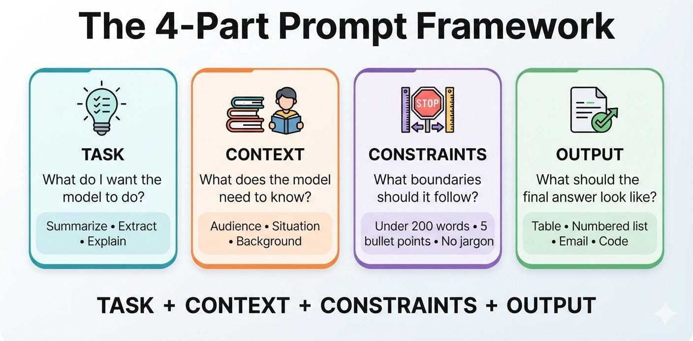

# Week 6, Day 1 - You Can Talk to an LLM. But Can You Prompt One?

*September 30, 2026 · [Originally published on Substack](https://niharikabatra.substack.com/p/week-6-day-1-you-can-talk-to-an-llm)*

Over the last few weeks, we’ve learned what’s happening **inside** AI models.

Today, we’re going to start working with one.

Not building one.

Not training one.

**Using one.**

And this is where prompting becomes important.

Because here’s something you might have already noticed:

> Two people can give an AI model the same task and get completely different results.

Why?

A big part of the answer is **how they communicate the task to the model.**

That’s prompting.

And this week, I want to go beyond:

> “Just ask ChatGPT nicely.” 😄

We’re going to start thinking about prompting as a skill.

---
##### First, let’s get an LLM running

Before we learn how to prompt one, let’s actually get one on your computer.

We’re going to use **LM Studio**.

##### What is LM Studio?

LM Studio is a desktop application that lets you download and run LLMs locally on your computer.

Instead of sending your prompt to a cloud-based AI service, you can run a supported model directly on your machine.

You don’t need to build anything for this.

You don’t need Python.

You don’t need an API.

LM Studio gives you a simple interface where you can:

**Download a model → load it → send prompts → see the response**

I’ve created a GitHub repository to walk you through the setup:

[Getting Started with LM Studio — GitHub](https://github.com/niharika2309/getting-started-with-lm-studio)

For today, follow the README until you can **load a model and see the chat interface.**

That’s all the setup we need.

---
##### Why am I introducing you to local AI?

I use cloud AI tools all the time - ChatGPT, Gemini, Claude, and others. They’re incredibly useful, and I’m not suggesting you stop using them.

But as you learn AI, I also want you to know that **you can run an LLM on your own computer.**

Think about what we now share with AI:

**Documents. Code. Images. Work information.**

This is especially important when people upload things like **their kids’ pictures to create trendy AI images.** Before uploading something personal, it’s worth asking:

> **Where is this data going, and how is it being used?**

With a local LLM, the model runs on **your own computer**, giving you another way to experiment with AI.

I discovered this side of AI through the **open-source AI community**, including Nokast. If you’re curious about local AI and open-source projects, **I’d definitely recommend following** **and seeing what people are building.**

You don’t need to understand all of it today. Just start exploring.

That’s why I wanted you to have a local LLM running before we dive deeper into prompting.

---
##### Now let’s talk about prompting

You’ve probably heard the term **prompt** many times.

A prompt is simply the input we give to an AI model.

For example:

> Write a summary of this article.

That’s a prompt.

But here’s where things get interesting.

The model has to **infer what you mean** by “a summary.”

Do you want:

- 2 sentences?
- 500 words?
- bullet points?
- something for a 5-year-old?
- something for your manager?
- just the key findings?
- technical details?

The model has to make assumptions.

And **the more assumptions the model has to make, the less predictable your output becomes.**

This is one of the first things to understand about prompting.

---
##### Prompting is about removing ambiguity

Suppose I say:

> Write an email about a meeting.

That’s technically a valid prompt.

But it’s not a very useful one.

There are a lot of unanswered questions.

**Which meeting?**

**Who is the email for?**

**What is the purpose?**

**What tone should I use?**

**How long should it be?**

Now let’s add some of that information:

> Write a short, professional email to my manager asking to move tomorrow’s 10 AM meeting to Thursday afternoon because I have a conflict.

Now the model has much more to work with.

We didn’t use a secret prompt.

We simply **removed ambiguity.**

That’s the first prompting skill I want you to learn.

---
##### A simple prompt framework

When you’re writing a prompt, start thinking about four things:

##### 1\. Task

**What do I want the model to do?**

> Summarize this report.
> 
> Extract the key risks.
> 
> Write a Python function.
> 
> Explain attention.

---
##### 2\. Context

**What does the model need to know?**

> This report is for a non-technical audience.
> 
> The reader knows Python but not machine learning.
> 
> I’m preparing this for a presentation to executives.

Context helps the model understand **the situation around the task.**

---
##### 3\. Constraints

**What boundaries should the model follow?**

> Keep it under 200 words.
> 
> Don’t use technical jargon.
> 
> Return the answer as JSON.

Constraints make the expected output clearer.

---
##### 4\. Output

**What should the final answer look like?**

> Use a table.
> 
> Give me a numbered list.
> 
> Give me Python code followed by an explanation.

---

So you can think about a prompt as:

**Task + Context + Constraints + Output**

But don’t treat this as a formula you have to follow every single time.

Sometimes your prompt might be one sentence.

Sometimes it might be several paragraphs.

The point isn’t to make your prompts longer.

The point is to give the model **the right information.**

---
##### Let’s run an experiment

Don’t just read this section. **Open an LLM and try it yourself.**

We’re going to give the model the same task twice.

##### Round 1: Keep it vague

Try:

> **Write a LinkedIn post about learning AI.**

Run it and read the response.

Now ask yourself: **What did I actually tell the model?**

Not much.

---
##### Round 2: Add some context

Now try:

> **Write a LinkedIn post sharing what you learned from Niharika’s 16-Week AI/ML Series on Substack. Mention that learning one concept at a time helped you understand AI better. Keep the tone genuine and conversational, not overly promotional.**

Run it again.

Now compare the two.

**Same model. Same basic task. Very different instructions.**

That’s prompting.

And yes, I may be slightly biased about this example. 😄

**Also, if you actually end up writing this LinkedIn post, don’t forget to tag me. 😉**

---
##### One last thing

Today, I didn’t want you to memorize a list of prompting techniques.

I wanted you to **see the difference for yourself.**

Today’s takeaway is simple:

> **Good prompting isn’t about finding magical words.**

It’s about being clear about what you want.

And the best way to get better at it?  
**Experiment.**

Change one thing.  
Run it again.  
Compare the results.

Because prompting is a skill you build by **using AI, not just reading about it.**

And now that you have an LLM running locally, you have your own little playground to experiment with. 🙂

**Tomorrow, we’ll take this one step further.**

Until then, go play around with your model and yes, **I expect to see some of those LinkedIn posts. 😉**

Read. Experiment. Share what you learn.

**One concept at a time. One step closer to understanding AI.**
