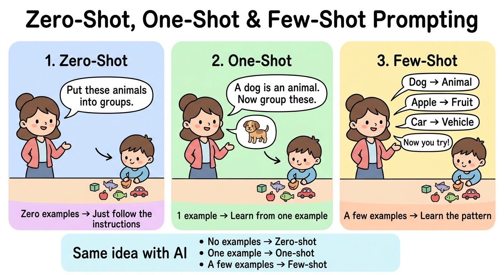
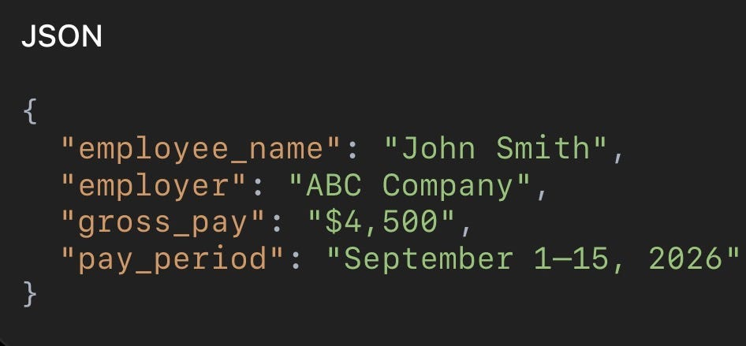

# Week 6, Day 2 - Zero-Shot, One-Shot & Few-Shot Prompting

*October 1, 2026 · [Originally published on Substack](https://niharikabatra.substack.com/p/week-6-day-2-zero-shot-one-shot-and)*

Yesterday, we started working with a local AI model using **LM Studio**.

Today, we’re going to make our prompts a little smarter.

There are a few simple ways to give an AI model more context when asking it to do something:

- **Zero-shot prompting**
- **One-shot prompting**
- **Few-shot prompting**

And we’re going to use a practical example: **document parsing and information extraction.**

---

**Zero-Shot Prompting**

> Zero-shot simply means **You give the model a task without giving it an example.**

Imagine a company receives different types of documents:

- W-2
- Pay stub
- Tax form
- Company policy
- Invoice

You could tell the model:

Classify this document into one of these categories: W-2, Pay Stub, Tax Form, Company Policy, or Invoice.

Then you provide the document.

You haven’t shown the model what a W-2 or a company policy looks like.

You’re simply telling it **what task to perform and what the possible categories are.**

That’s **zero-shot prompting**.

---

**One-Shot Prompting**

Now let’s give the model **one example**.

For example:

**Example:**  
Document: “Employees are eligible for 15 days of paid time off…”  
Category: Company Policy

**Now classify this document:**  
“Employees must submit vacation requests at least two weeks in advance…”

The model now has **one example** of how you want the task to work.

That’s **one-shot prompting**.

Think of it as:

**“Here’s one example. Now do the same thing.”**

---

**Few-Shot Prompting**

Few-shot is the same idea, but instead of one example, you give the model **a few examples**.

For example:

**Example 1**  
Document: “Employer identification number…”  
Category: W-2

**Example 2**  
Document: “Gross pay: $3,250…”  
Category: Pay Stub

**Example 3**  
Document: “Employees are eligible for 15 days of paid time off…”  
Category: Company Policy

**Now classify this document:**  
“Vacation requests should be submitted through the employee portal…”

The examples give the model a better understanding of **what you mean by each category**.

And you don’t necessarily need hundreds of examples.

Sometimes a few carefully chosen examples are enough to clarify the task.

---

**Let’s take this beyond classification**

This is actually an area where I consider myself a bit of an expert. I’ve been working with **NLP and document processing for around 3 years**.

I’ve gone from things like:

**Bag of Words → NLP → spaCy → Named Entity Recognition → ML models → LLMs**

And honestly, LLMs have made some parts of this work **so much easier.**

One of the things I find particularly useful is **turning unstructured documents into structured information.**

---

**Imagine we have a document**

For example, a pay stub might contain:

Employee: John Smith  
Employer: ABC Company  
Gross Pay: $4,500  
Pay Period: September 1–15, 2026

Instead of writing a bunch of rules to find every field, we can simply tell an LLM:

Extract the following information from this document:

- Employee Name
- Employer
- Gross Pay
- Pay Period

Return the result as JSON.

The model could return:

And suddenly, something that traditionally required a lot of NLP and document-processing logic becomes much simpler to prototype.

---

**But what about all the complexity?**

Of course, real-world document processing gets complicated.

What happens when:

- the document is a scanned image?
- the information is missing?
- the layout changes?
- the model extracts the wrong value?
- there are multiple pages?
- you need very high accuracy?
- you have thousands of documents?
- you need to validate every answer?

Those are all real engineering problems.

**But you don’t need to solve all of them before you can get started.**

Start simple.

Get a document.

Give the model a clear prompt.

Ask it to extract structured information.

Then we can discuss the complexities **as they come.**

---

**Want me to build this?**

Comment below if you’d like me to build a **simple document-parsing app using just prompting**.

No complicated ML pipeline.

Just:

**Upload document → Prompt → Extract information → Get structured output**

Because honestly, one of the simplest and most useful things you should be able to do with an LLM is:

> **Take unstructured information and turn it into structured information.**

And that’s exactly where we’re headed next.
