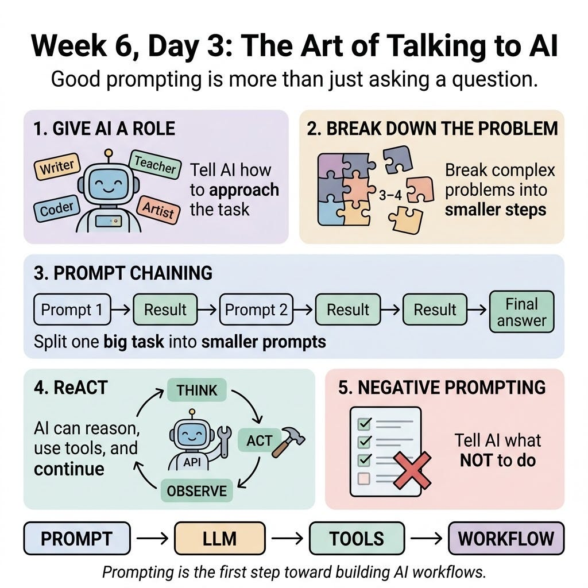

# Week 6, Day 3 - The Art of Talking to AI

*October 2, 2026 · [Originally published on Substack](https://niharikabatra.substack.com/p/week-6-day-3-the-art-of-talking-to)*

Yesterday, we talked about **zero-shot, one-shot, and few-shot prompting**.

We saw that sometimes, giving an AI model an example can completely change the way it approaches a task.

But prompting is not just about giving examples.

There are many other ways to communicate what you want from an AI model.

And today, we’re going to explore a few of them.

Don’t worry about memorizing the names.

The goal is to understand **how and why these approaches work.**

---

**1\. Give AI a Role**

Imagine you walk into a company and say:

“Explain this document.”

You might get a very different answer from a lawyer, a teacher, or a data scientist.

The same idea can be used with AI.

You can give the model a **role**.

For example:

> You are a customer support specialist.  
> Read the following customer complaint and write a professional response.

Compare that with:

> Write a response to this customer complaint.

The first prompt gives the model more context about **how it should approach the task**.

Another example:

You are a Python instructor teaching someone who has never programmed before. Explain this code using simple language.

Now the model knows:

- what role it should take
- who it is explaining something to
- how the answer should be presented

This is often called **role prompting**.

---

**2\. Ask AI to Break Down a Problem**

Not every task is as simple as:

“Give me the answer.”

Some problems have multiple steps.

For example:

A company receives 1,000 documents.  
20% require manual review.  
Of those, 30% are rejected.  
How many documents are rejected?

The model needs to work through the problem.

You might structure your prompt like:

> Break this problem into smaller steps and solve it. Give me the final answer with a brief explanation.

The idea here is simple:

> **Complex problem → smaller steps → final answer**

> This approach is often associated with **chain-of-thought prompting**.

You may hear this term frequently when learning about LLMs.

One important point, though: in real applications, you don’t necessarily need or want the model to expose a long internal reasoning process. Often, asking for a **concise explanation of the key steps** is enough.

---

**3\. Don’t Make One Prompt Do Everything**

This is something you might naturally do:

> Read this company policy, summarize it, identify the important rules, find the eligibility criteria, create a table, and write an employee email.

That’s a LOT for one prompt.

Instead, we can break the task into smaller pieces.

**Step 1**

Summarize the policy.

↓

**Step 2**

Identify the eligibility criteria from the summary.

↓

**Step 3**

Put the criteria into a table.

↓

**Step 4**

Write a simple employee email using this information.

> The output from one step becomes the input for the next.

> This is called **prompt chaining**.

Why is this useful?

Because smaller steps can be:

- easier to understand
- easier to test
- easier to debug
- easier to change

And this is where prompting starts becoming more interesting.

You’re no longer just **asking AI a question**.

You’re designing a **workflow**.

---

**4\. What If AI Needs to Use a Tool?**

Now let’s take this one step further.

Imagine you ask an AI assistant:

> “What’s the weather in Dallas today? Should I carry an umbrella?”

The model may need information it doesn’t already have.

So instead of simply generating an answer, an AI system could:

User asks a question

↓

AI decides what information it needs

↓

Uses a weather tool

↓

Gets the result

↓

Looks at the result

↓

Responds to the user

> This general idea is called **ReAct - Reason + Act**. The system can reason about what it needs, **take an action**, observe the result, and continue.

The action could be:

- searching the web
- calling an API
- querying a database
- retrieving a document
- running code
- using another tool

This concept becomes particularly important when we start talking about **AI agents**.

An agent isn’t simply answering questions.

It can potentially **decide what action to take and interact with tools to accomplish a task.**

We’ll come back to agents later.

---

**5\. Tell AI What NOT to Do**

Here’s another simple but powerful technique.

Sometimes telling the model what you **don’t want** can be just as useful as telling it what you want.

For example:

> Extract the employee’s name, department, and start date from this document.  
> Do not infer information that isn’t explicitly mentioned.

That last instruction is important.

You’re telling the model:

**If the information isn’t there, don’t make it up.**

This is sometimes referred to as **negative prompting** or using negative constraints.

---

**Why Does This Matter?**

Because prompting is often the **first layer** of an LLM application.

But real-world systems can look much more like:

User

↓

Prompt

↓

LLM

↓

Retrieve information

↓

Use tools / APIs

↓

Validate the result

↓

Return an answer

And once you start building systems like this, you’ll run into new questions:

**What if the model makes something up?**

**What if the answer isn’t in the documents?**

**What if the model calls the wrong tool?**

**How do we know whether the system is actually working well?**

Those questions lead us into topics like **function calling, agents, evaluation, and monitoring.**

But before we get there, we need to understand one of the biggest problems with LLMs:

> **Sometimes, AI can sound completely confident while being completely wrong.**

And that’s what we’ll explore next.

Thanks for reading! This post is public so feel free to share it.
