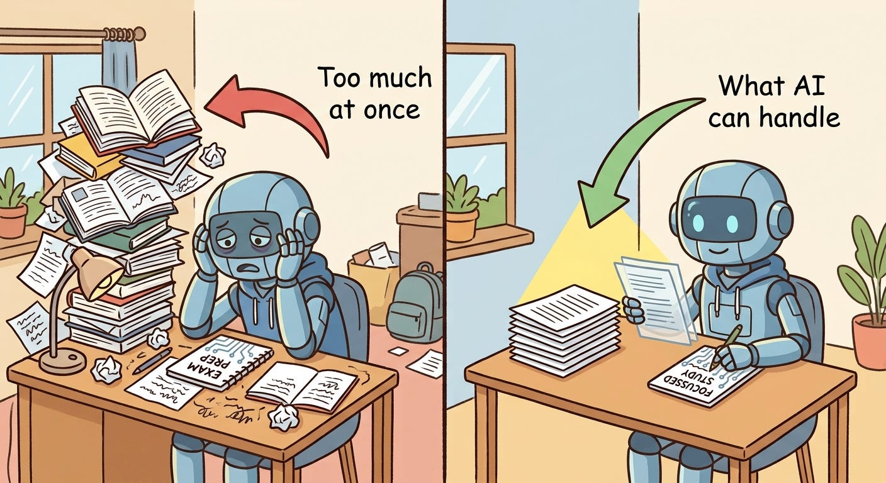

# Week 6, Day 4 - Understanding Context Windows - How Much Can AI Remember?

*October 3, 2026 · [Originally published on Substack](https://niharikabatra.substack.com/p/week-6-day-4-understanding-context)*

Yesterday, we talked about **the art of talking to AI**.

Today, let’s talk about something that can be confusing when you first start using AI:

> **How much information can an AI actually handle at once?**

You might think:

> “If I give AI more information, it should give me a better answer.”

But that’s not always true.

And this is where **context windows** come in.

---
### What is a context window?

A **context window** is simply the amount of information an AI model can look at and work with at one time.

Think about reading a book.

You can have a huge bookshelf at home, but you can’t put the entire bookshelf in front of you and read everything at once.

You open the pages you need, read them, and answer your question based on them.

AI works in a similar way.

It has a limit to how much information it can work with in one interaction.

---
### What counts as “information”?

It isn’t just the question you type. The information can include:

- Your instructions
- Your question
- Previous messages in the conversation
- Text you provide
- Documents you upload
- Information another system gives to the AI

For example, imagine you tell an AI:

> “You are helping me understand my company’s vacation policy.”

Then you ask:

> “Can I take Friday off?”

The AI might need to look at the relevant vacation policy before answering.

But imagine you give it **100 pages of company documents**, most of which have nothing to do with vacation.

Now the AI has much more information to work through.

> More information doesn’t automatically mean a better answer.

---
## Why do context windows matter?

You have a 50-page document. But your question is:

> “How many days of parental leave do employees get?”

You don’t necessarily need the AI to focus equally on all 50 pages. The useful information might be contained in just a few paragraphs.

A good AI system should be able to focus on the information that actually matters. This is one of the reasons AI applications need to be designed carefully.

---
## What does “128K context window” mean?

You may have seen AI models advertised with numbers like:

**32K**

**128K**

**1 million**

These numbers refer to how much text the model can work with in one interaction.

The “K” means **thousand**.

So 128K means roughly **128,000 units of text called tokens**.

> **A larger context window means the model can work with more information at once.**

But that doesn’t mean you should always give it everything you have.

---
## Bigger isn’t always better

Imagine you’re asking someone:

> “What’s the dress code for tomorrow?”

Would you hand them your company’s entire employee handbook?

Probably not.

You’d give them the section about the dress code. AI is similar.

> Instead of giving the model **everything**, a well-designed AI application tries to give it **the information relevant to the question**.

This is especially important when AI is working with large amounts of information.

---
## Let’s try a simple experiment

You can try this yourself. Ask your local AI:

> Explain machine learning to a beginner in 3 sentences.

Now try again, but add a large amount of unrelated text before the question. For example, paste several paragraphs about cooking, travel, sports, or anything else.

Then ask the same question:

> Explain machine learning to a beginner in 3 sentences.

Compare the two answers.

The goal isn’t to prove that one will always be worse. Instead, you’re seeing an important idea:

**The information you give an AI can affect how it responds.**

---
## Does AI actually “remember” our conversations?

This is another important distinction.

When you have a long conversation with an AI, it can feel like the AI remembers everything you’ve ever said.

But what the model can use depends on the information available to it at that moment.

That’s why AI systems often need additional ways to:

- keep important information
- find information when needed
- summarize older conversations
- retrieve relevant documents

The AI model is only one part of the whole system.

---
## The bigger lesson

As we move from simply **using AI** to understanding how AI applications are built, you’ll start seeing that there are many questions beyond:

> “Which AI model should I use?”

You also need to think about:

> **“What information should I give it?”**

And sometimes, the answer isn’t:

**“Everything.”**

It’s:

**“Only what it needs.”**

#### In one sentence:

> **A context window is the amount of information an AI model can work with at one time — and giving it more information doesn’t always mean giving it better information.**

Next, we’ll look at **how to make AI return answers in a format that we can actually use.**
