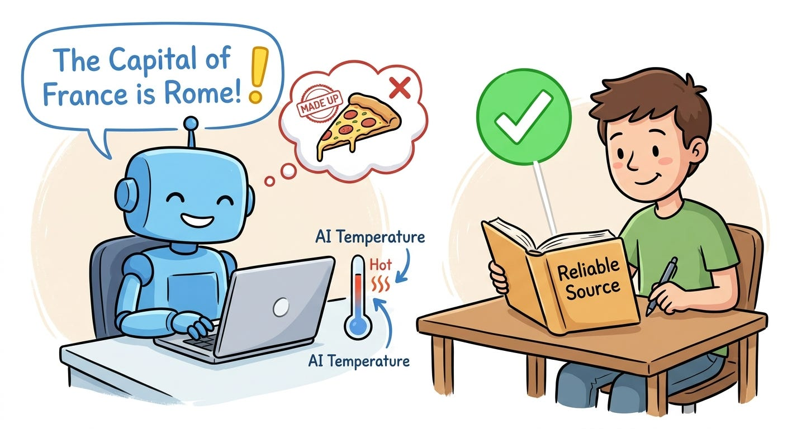

# Week 6, Day 5 - AI Hallucinations : Why Does AI Make Things Up?

*October 4, 2026 · [Originally published on Substack](https://niharikabatra.substack.com/p/week-6-day-5-ai-hallucinations-why)*

Have you ever asked an AI a question and received an answer that sounded **completely confident**…

…and then realized it was wrong?

That has a name:

**AI hallucination.**

But why does this happen?

And can we do anything about it?

Let’s break it down.

---
### What is an AI hallucination?

An AI hallucination happens when a model gives you information that **sounds believable but isn’t actually correct**.

For example, imagine asking:

> “Who was the first person to walk on Mars?”

There hasn’t been a person who has walked on Mars.

But an AI might still give you a name, a date, and a detailed explanation.

The scary part?

It might sound very convincing.

That’s why one of the most important things to remember when using AI is:

> **Confident doesn’t always mean correct.**

---
### But why does this happen?

Remember what we learned earlier about how language models work.

At a very basic level, a language model generates text by predicting what should come next based on patterns it learned.

It’s not sitting there thinking:

> “Let me check whether this fact is true.”

So when it doesn’t have reliable information, it can sometimes generate an answer that **looks like a reasonable continuation**.

This is one reason hallucinations happen. And this brings us to an interesting setting:

### Temperature 🌡️

Temperature is a parameter that can influence **how predictable or varied** a model’s responses are. Think of it as controlling how much the model sticks to the more likely choices.

**Lower temperature** - The model tends to be more predictable and consistent.

**Higher temperature** - The model tends to produce more varied and creative responses.

For example, ask an AI:

> “Give me 5 creative names for my novel”

A higher temperature can be useful here because we’re looking for **variety and creativity**.

But now ask:

> “What is the capital of India?”

You don’t need creativity. You want the most reliable answer.

So temperature can be useful depending on **what you’re asking the model to do**.

---
### Does lowering temperature prevent hallucinations?

**No.**

This is an important distinction.

You might think:

> “I’ll just set the temperature really low and AI won’t make things up.”

Unfortunately, it doesn’t work that way.

Temperature influences how the model chooses between possible responses, but it doesn’t give the model a fact-checking system.

Even with a low temperature, an AI can confidently give you incorrect information.

So we need something else.

---
## How do we ground AI?

One way to reduce hallucinations is to give the AI **reliable information to work from**.

This is called **grounding**.

Instead of saying:

> “Tell me about our company’s vacation policy.”

you could give the model the actual policy and say:

> “Using only the policy below, tell me how many vacation days employees receive.”

Now the AI doesn’t have to rely only on what it learned during training.

You’re giving it a source to work with.

---
### Grounding can look like this:

**Company policy → AI → Answer**

**Research paper → AI → Summary**

**Database → AI → Answer**

**Search results → AI → Response**

The idea is simple:

> **Give AI relevant information before asking it to answer.**

This is one of the ideas behind systems like **RAG (Retrieval-Augmented Generation)**, which we’ll get to later in this series.

---
## You can also tell AI not to guess

For example:

> **“Answer using only the information provided. If the answer isn’t present, say ‘I don’t have enough information to answer.’ Do not make up an answer.”**

This gives the model a clear boundary. It still doesn’t guarantee that every answer will be correct.

But you’re making your expectations much clearer.

---
## And sometimes, you still need to verify

This is especially important for things like:

- Medical information
- Financial decisions
- Legal information
- Company policies
- Important business decisions

AI can be incredibly useful for **finding, organizing, explaining, and summarizing information**.

But that doesn’t mean every answer should automatically be treated as fact.

---

So far, we’ve focused on **how AI understands and generates responses**.

**Tomorrow**, we’ll look at how we can ask AI to return information in a **specific format** instead of getting a long paragraph when we really need a clean list, table, or structured response.

This is especially useful when you want AI to work **with other tools or applications**, not just chat with you.
