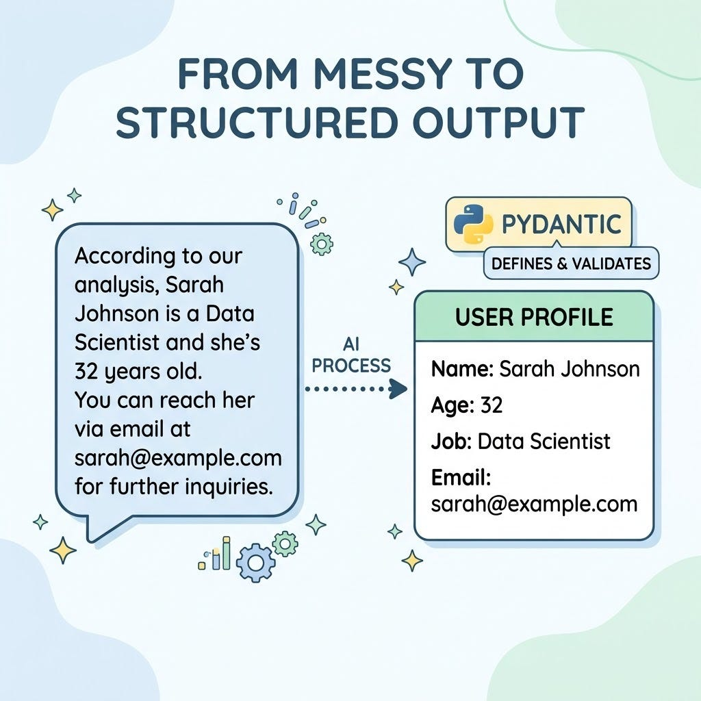
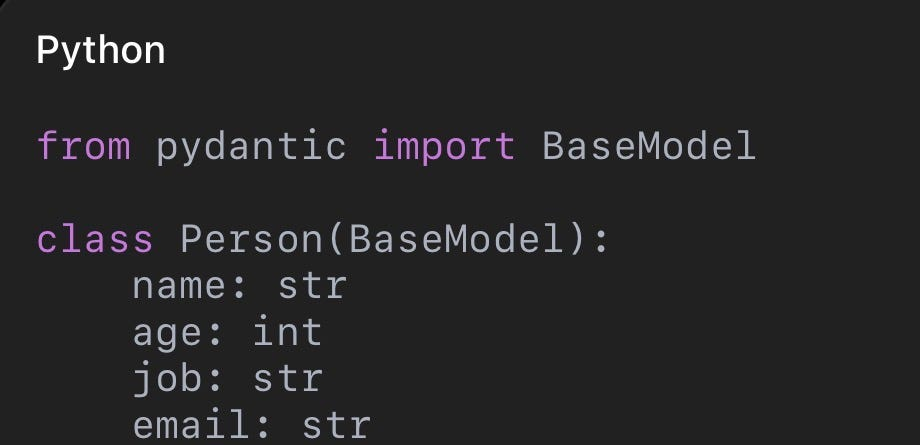

# Week 6, Day 6 - How Do We Get AI to Give Us Predictable Answers?

*October 5, 2026 · [Originally published on Substack](https://niharikabatra.substack.com/p/week-6-day-6-how-do-we-get-ai-to)*

So far, we’ve mostly asked AI to **give us an answer**.

But when we start building applications with AI, we often need something more specific.

We don’t just want an answer that makes sense to a human.

We want an answer that our **code can understand and work with**.

Let’s see why.

---

**What if we’re extracting information from a document?**

Imagine we give an AI model this document:

**Name:** Sarah Johnson  
**Age:** 32  
**Job:** Data Scientist  
**Email:** [sarah@example.com](mailto:sarah@example.com)

And we ask:

Extract the person’s information.

The model might respond:

> Sarah Johnson is 32 years old and works as a Data Scientist. Her email address is [sarah@example.com](mailto:sarah@example.com).

That’s a perfectly good answer for a human.

But imagine we’re building an application that needs to store this information.

It would be much easier if the model returned:

> {
> 
> "name": "Sarah Johnson",
> 
> "age": 32,
> 
> "job": "Data Scientist",
> 
> "email": "sarah@example.com"
> 
> }

Now our application knows exactly where to find each piece of information.

This is the idea behind **structured output**.

---

**Why not just ask AI for JSON?**

You can.

For example, we could simply tell the model:

> Return the answer as JSON with the fields name, age, job and email.

But remember what we’ve learned about LLMs. They generate responses based on patterns.

So you might get something like:

> {
> 
> "name": "Sarah Johnson",
> 
> "age": "thirty-two",
> 
> "job": "Data Scientist"
> 
> }

The email might be missing.

The age might be returned as text instead of a number.

Or the model might add information we didn’t ask for.

For a conversation, this might not matter much.

For an **application**, it can cause problems.

We want predictable data.

---

**This is where schemas come in**

A **schema** is basically a description of what we expect our data to look like.

For example:

> Person
> 
> ├── name → text
> 
> ├── age → number
> 
> ├── job → text
> 
> └── email → text

We’re telling our application:

These are the fields I expect, and this is what type of information each field should contain.

In Python, one popular way to define these schemas is with **Pydantic**.

---

**So, what is Pydantic?**

**Pydantic is a Python library for data validation and parsing.**

In simple terms, it lets us define what our data should look like and then check whether the data follows those rules.

For example:

We’re defining a Person with four fields.

- name should be text
- age should be a number
- job should be text
- email should be text

Think of it like a **form with rules**.

Instead of accepting just anything, we have clearly defined expectations.

---

**What does this have to do with AI?**

Quite a lot.

Modern LLM APIs can work with structured-output schemas. So instead of simply saying:

> “Tell me about this person.”

we can define the structure we want the model to return.

The model can then return information that follows that structure. And once we have that structured response, our Python application can work with it much more easily.

We could:

- save it to a database
- display it in a UI
- use it in another part of our application
- send it to another service
- process thousands of documents automatically

This is where LLMs start becoming more than just a chatbot.

---

**But does structured output prevent hallucinations?**

**Not completely.**

And this is an important connection to yesterday’s article.

Structured output controls the **shape of the answer**.

It doesn’t guarantee that the information inside the answer is factually correct.

For example, suppose our document says:

**Age: 32**

The model could still incorrectly return 42.

The response may have the correct structure. But the information is wrong.

This solves different problem.

---

**Why is this useful in real AI applications?**

Imagine you’re processing thousands of documents.

Without a defined structure, you could end up with thousands of slightly different responses.

With structured output, you can tell the system:

I need these specific fields in this specific format. Now the output becomes much easier for your application to handle.

That’s a big shift:

**Chatting with AI**

↓

**Getting predictable data from AI**

↓

**Building software around AI**

---

**Tomorrow: Let’s actually build something**

We’ve now talked about:

- prompting
- temperature
- context windows
- hallucinations
- structured output

Tomorrow, we’ll put these ideas together.

We’ll build a small **document-parsing application** and make an actual LLM call.

We’ll see where things like temperature, prompts, context, and structured output fit into the code.

One concept at a time. One step closer to understanding AI.
