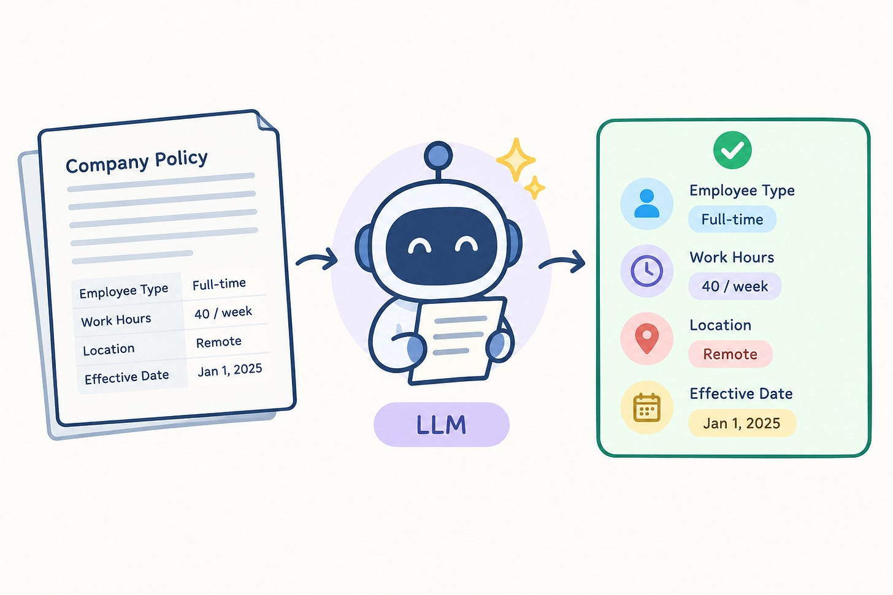

# Week 6, Day 7 - Let’s Build Our First LLM Application

*October 6, 2026 · [Originally published on Substack](https://niharikabatra.substack.com/p/week-6-day-7-lets-build-our-first)*

For the past few days, we’ve been learning about individual pieces of working with LLMs:

- Prompting
- Temperature
- Context windows
- Hallucinations
- Structured output

Today, instead of learning another concept, **let’s put them together.**

We’re going to build a small **document-parsing application** that takes information from a document and asks an LLM to extract what we need.

And for the first time in this series, we’ll make an **actual LLM API call from code.**



---
### What are we building?

Imagine you have a company policy document.

It might contain something like:

> **Remote Work Policy**  
> Employees can work remotely up to 3 days per week.  
> Remote work requests should be submitted at least 2 days in advance.  
> Employees must have manager approval.

A person can read this and pick out the important information.

But imagine doing this for **hundreds or thousands of documents**.

That’s where an LLM can help.

We could ask it to extract specific information such as:

```
Policy name
Remote days allowed
Notice period
Approval required
```

Instead of getting a paragraph back, we’d like something predictable like JSON:

```
{
  "policy_name": "Remote Work Policy",
  "remote_days": 3,
  "notice_period_days": 2,
  "manager_approval": true
}
```

Now that information can be used by the rest of our application.

That’s the basic idea behind **document parsing with LLMs**.

---
## Step 1: Give the LLM something to read

Until now, we’ve mostly interacted with LLMs through interfaces like ChatGPT.

But an application can also communicate with an LLM **programmatically** using an API.

At a very simple level, an LLM call might look something like this:

```
response = client.chat.completions.create(
    model="your-model",
    messages=[
        {
            "role": "user",
            "content": "Extract the important information from this document..."
        }
    ]
)
```

If this code looks unfamiliar, don’t worry. You don’t need to understand the syntax yet.

Just think of it as:

**Our Python application → sends a request → to an LLM → gets a response back**

That’s the big shift we’re making today.

We’re moving from:

> **“Ask ChatGPT this question.”**

to:

> **“My Python application is sending a request to an LLM.”**

---
## Step 2: Our prompt gives the model instructions

Now let’s tell the model exactly what we want.

For example:

```
Read the document below.

Extract:
- policy name
- number of remote days allowed
- notice period
- whether manager approval is required

Return only the requested information.
```

Then we provide the document.

This is where everything we’ve learned about **prompting** becomes useful.

We’re not just asking:

> “What’s in this document?”

We’re giving the model a specific task.

---
## Step 3: Where does context come in?

Remember our discussion about **context windows**?

The document we’re sending becomes information the model can use when generating its response.

Conceptually, we’re doing this:

```
Instructions
      +
Document
      ↓
    LLM
      ↓
   Response
```

The **instructions** tell the model what to do.

The **document** gives it the information it needs to do the task.

Together, they form part of the context for the request.

This is why context windows matter.

If your document is too large to fit within the model’s context window, you can’t simply send the entire thing in one request.

You may need to split the document into smaller pieces or use other techniques.

For our small example, though, we can keep it simple.

---
## Step 4: What if we want a predictable response?

Let’s say we make the API call and the model responds with:

> The policy is called Remote Work Policy. Employees can work remotely up to 3 days per week, requests must be submitted 2 days in advance, and manager approval is required.

That answer is perfectly understandable to a human.

But imagine our application needs to **store this information in a database**.

It would be much easier if the response always followed the same structure:

```
{
  "policy_name": "Remote Work Policy",
  "remote_days": 3,
  "notice_period_days": 2,
  "manager_approval": true
}
```

This is where **structured output** becomes useful.

Instead of asking the model for just any answer, we can tell it the structure we expect.

If you want a refresher on structured output, you can read **[Week 6, Day 6: How Do We Get AI to Give Us the Output We Want?](../06-week-6/day-6-how-do-we-get-ai-to.md)**.

---
## Step 5: Defining that structure

In Python, one popular library for defining and validating this kind of structure is **Pydantic**.

For example:

```
from pydantic import BaseModel

class Policy(BaseModel):
    policy_name: str
    remote_days: int
    notice_period_days: int
    manager_approval: bool
```

You don’t need to understand every part of this code yet.

The important idea is simply:

> **We’re describing what a valid policy should look like.**

We’re saying:

- `policy_name` should be text
- `remote_days` should be a number
- `notice_period_days` should be a number
- `manager_approval` should be true or false  

Pydantic then helps **validate and parse data according to that structure**. And an important clarification:

**Pydantic itself isn’t an AI tool.**

It’s a Python library for data validation and parsing that we can use alongside an LLM.

---
## Step 6: Putting everything together

Now our application can make an LLM call and ask for the information in the structure we defined.

The exact code depends on the LLM provider and API we’re using, so I’m intentionally not going to turn this article into a deep dive into API syntax.

At a high level, we’re doing this:

```
Document
    ↓
Prompt + instructions
    ↓
LLM API call
    ↓
LLM
    ↓
Structured response
    ↓
Our application
```

And this is the important part:

**All the concepts we’ve been learning are now working together.**

---
## Where does temperature fit?

We learned about **temperature** earlier this week.

When we’re making an LLM call from code, we can configure settings such as temperature as part of that request.

For example, conceptually:

```
temperature = 0
```

For a document-extraction task, we usually don’t need the model to be creative, so a **lower temperature may make sense** for this kind of task.

You don’t need to memorize the setting.

Just notice where it belongs:

```
Our application
      ↓
LLM API call
      ↓
Prompt + document + settings
      ↓
LLM
```

This is the first time in the series we’re seeing something we learned conceptually actually appear in an application.

---
## But what about hallucinations?

Here’s where our **Day 5 discussion** becomes important.

Even if we use structured output, the model can still make a mistake.

For example, imagine the document says:

> Employees can work remotely up to 3 days per week.

But the model somehow returns:

```
{
  "remote_days": 5
}
```

The output is perfectly structured.

**It’s still wrong.**

That’s an important distinction:

> **Structured output makes the response predictable. It does not automatically make the information correct.**

We still need to validate and evaluate what the model is giving us.

For some applications, we may also add business rules or human review.

---
## Why does this matter?

This pattern shows up in many real-world AI applications.

You might have:

```
Document
    ↓
LLM
    ↓
Structured information
    ↓
Application
```

The document and the information you’re extracting might change, but the basic pattern can remain similar.

For example:

- extracting information from forms
- processing invoices
- pulling fields from contracts
- turning reports into structured data
- classifying or routing documents  

This is one of the reasons LLMs can be useful in applications. The LLM isn’t necessarily the entire application. It can be **one component inside a larger workflow**.

---
### A note about the code

If some of the API code in this article looked unfamiliar, that’s completely okay.

Things like `client`, `model`, `input`, `response`, and API keys are concepts worth understanding separately. If needed, leave a comment below.

I don’t want to squeeze all of that into today’s article because then we’d lose the main idea. So for today, the important thing is that you’ve now seen the journey from:

**document → prompt → LLM → structured information → application**

And that’s a real LLM application pattern.

---
## Want to see it in action?

I’ve put together a small Python example that brings everything we discussed today into one place.

**[Week 6, Day 7 — Build Your First LLM Application →](https://github.com/niharika2309/week6-day7-build-my-first-llm-application)**

It’s a simple **document parser** that takes a document, sends it to an LLM, and extracts the information we’re looking for in a structured format.

You don’t need to understand every line of code.

Instead, use it to **see what the concepts we’ve been learning actually look like when they come together in a real application.**

You can also take the example and:

- change the document
- add another field
- remove a field
- change what information you’re asking the LLM to extract  

and see what happens.

That’s often one of the best ways to learn:

**Read → Try → Change something → See what happens.**

And with that, we’ve officially gone from **learning about LLM concepts to building with an LLM.** 🚀

**One concept at a time. One step closer to understanding AI.**
