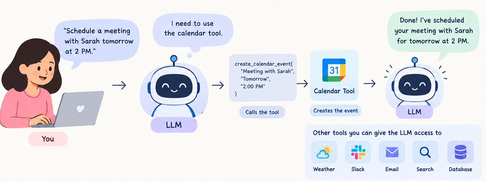

# Week 7, Day 1 - Tool Calling - Giving AI the Ability to Take Action

*October 7, 2026 · [Originally published on Substack](https://niharikabatra.substack.com/p/week-7-day-1-tool-calling-giving)*

So far, we’ve mostly used AI to **understand information and generate responses**.

We’ve asked an LLM to:

- understand our prompts
- extract information from documents
- return structured data
- answer questions

But there’s something it normally **can’t do on its own**:

**Take action in another application.**

For example, if you tell ChatGPT:

> “Schedule a meeting with Sarah tomorrow at 2 PM.”

The LLM can understand what you want. But understanding the request is different from actually creating the calendar event.

This is where **tool calling** comes in.

---

**What is tool calling?**

**Tool calling** lets an LLM ask your application to use a tool when it needs to get information or take an action.

Think of a tool as something your application gives the AI access to.

> For example:
> 
> Calendar Tool → Create a calendar event
> 
> Weather Tool → Get the current weather
> 
> Slack Tool → Send a message
> 
> Database Tool → Look up information

The LLM doesn’t magically control these systems. Instead, it can recognize:

“I need the calendar tool to accomplish what the user asked.”

---

**Let’s go back to our meeting example**

Suppose you say:

> “Schedule a meeting with Sarah tomorrow at 2 PM called Project Review.”

Without a tool, the LLM can only respond with text:

> “Sure! You should create a calendar event for tomorrow at 2 PM.”

Helpful, but it hasn’t actually done anything.

With a calendar tool available, the flow can look like this:

The important part is that **the LLM decides that the calendar tool is needed and provides the information that tool needs.**

---

**What does a tool look like to an LLM?**

We don’t need to get into complicated code yet.

At a basic level, a tool has:

- **A name** - create\_calendar\_event
- **A description** - Creates a new event on a calendar.
- **The information it needs** - title, date, time, attendees

So when the user asks something to schedule with these details, the LLM can figure out that the calendar tool needs to be called and provide the relevant information.

---

**Tool calling isn’t just for calendars**

This is where things start getting interesting.

Imagine your AI application has access to several tools: 📅 Calendar, 💬 Slack, 📧 Email, 🔎 Search, 🧑‍💻Database

Now you could ask:

> “Schedule a meeting with Sarah and send her the meeting details on Slack.”

The LLM could use the appropriate tools:

LLM

↓

Calendar Tool → Create meeting

↓

Slack Tool → Send message

And the user doesn’t need to manually perform each step.

---

**One tool vs. multiple tools**

Tool calling can start very simple.

**One tool**

“What’s the weather in Dallas?”

The LLM can call a **weather** tool.

**One action**

“Create a calendar event for tomorrow.”

The LLM can call a **calendar** tool.

**Multiple tools**

“Create the meeting and send Sarah a Slack message.”

The LLM can use more than one tool.

> So tool calling can be as simple as **one tool for one task**, or it can become part of a much larger application.

---

**But here’s an important distinction**

**Tool calling does not mean the AI is an agent.**

> Tool calling is simply giving an LLM a way to interact with external tools.

Agents can use tool calling as one of their building blocks, but we’ll leave agents for another day.

---

**Why does this matter?**

This changes what we can build with LLMs.

Instead of only building applications that say:

“Here is your answer.”

we can start building applications that say:

“I’ve done it.”

And that’s a pretty big shift.

Tomorrow, we’ll take this idea out of the explanation and **actually build a small application that uses a tool to create a Google Calendar event.**

**One concept at a time. One step closer to understanding AI.**
