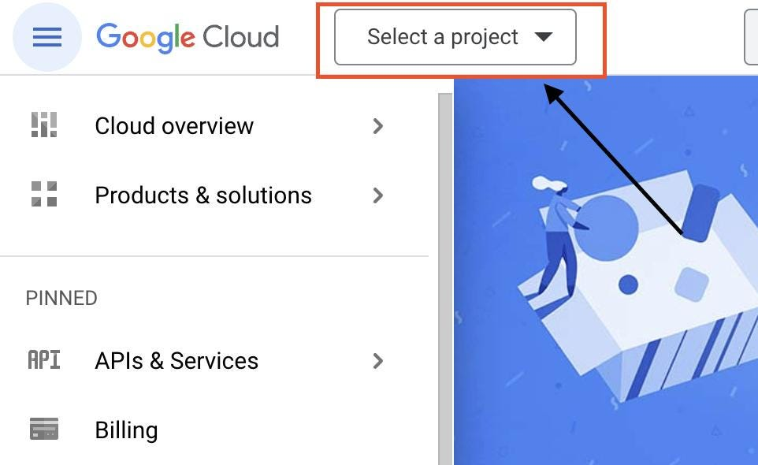
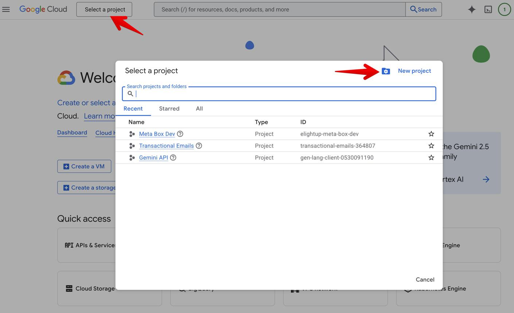
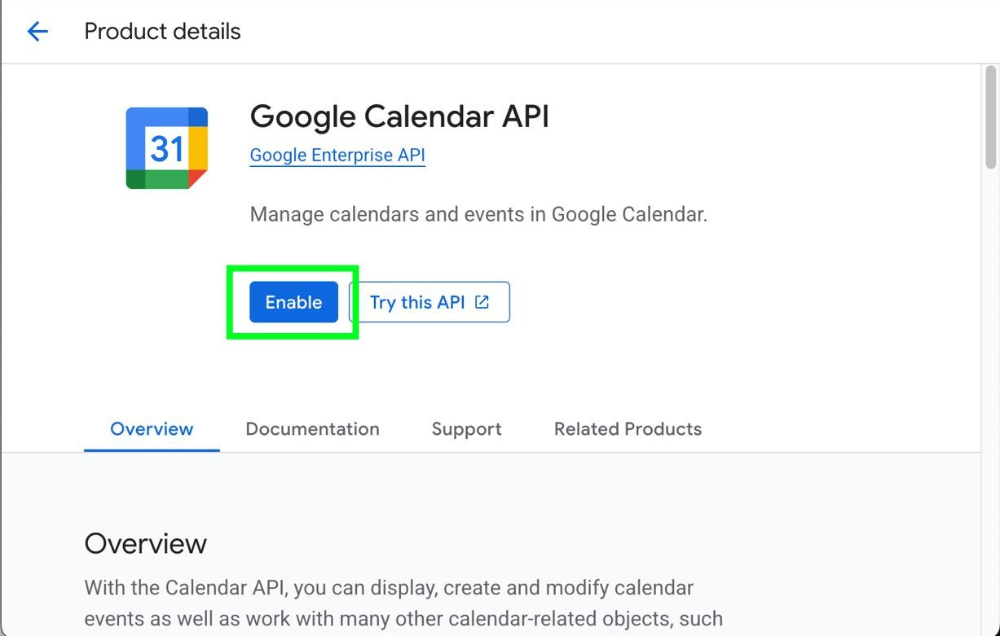
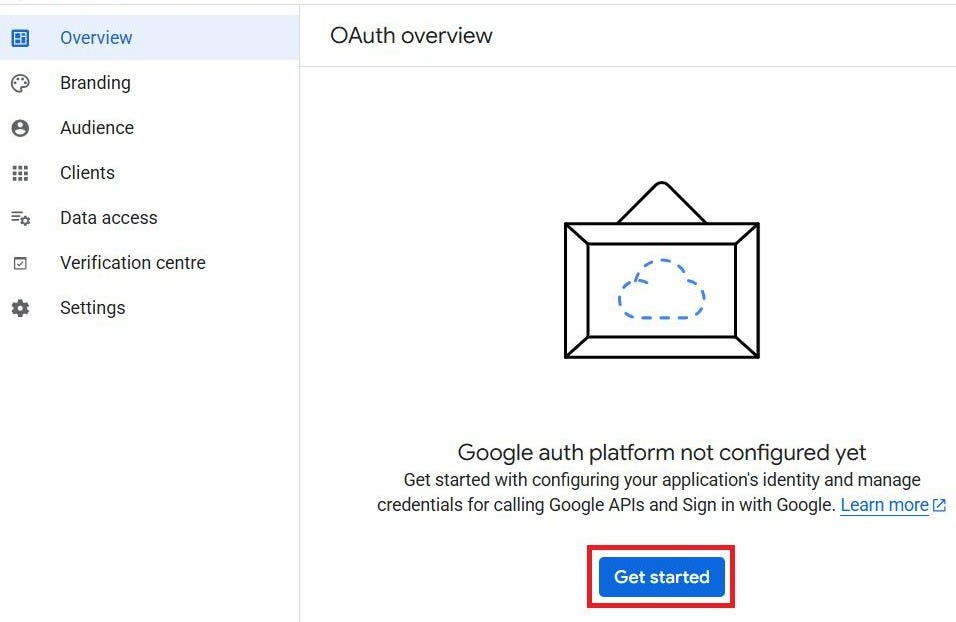
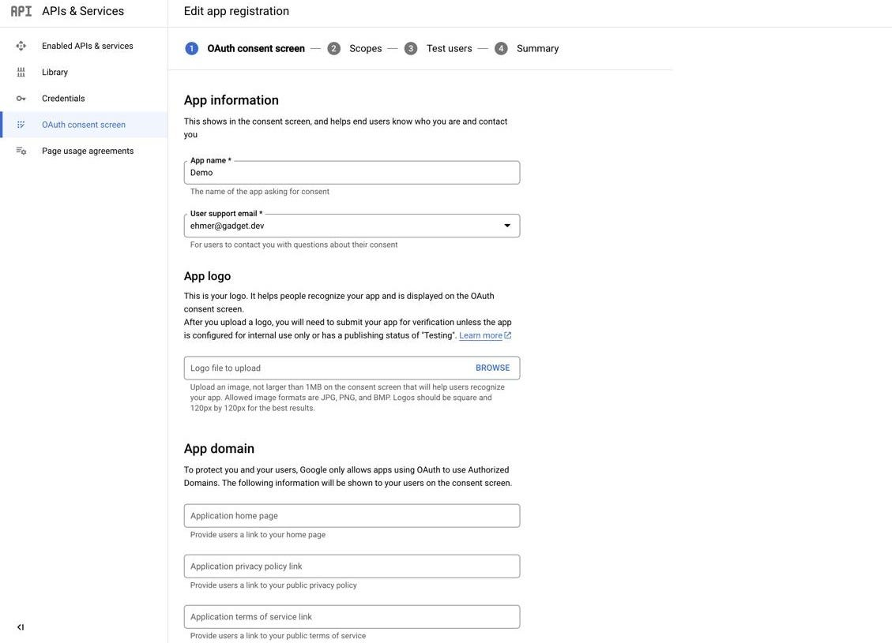
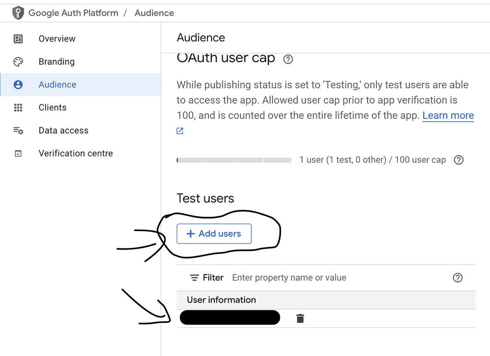
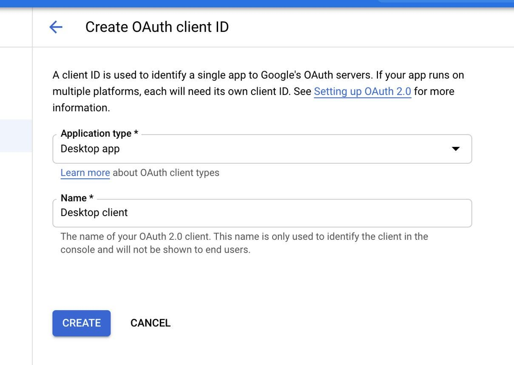

# Week 7, Day 2 - Let’s Build a Tool Calling Mini Project with Google Calendar

*October 8, 2026 · [Originally published on Substack](https://niharikabatra.substack.com/p/week-7-day-2-lets-build-a-tool-calling)*

Yesterday, we learned what **tool calling** is.

Today, we’re going to start building one.

Our goal is simple:

> **We’ll eventually be able to tell an AI assistant, “Schedule a meeting tomorrow at 2 PM,” and have it created the event in Google Calendar.**

But before we can give an LLM access to our calendar, we need to set up the Google Calendar API.

So today, we’re only doing the setup.

---
### Step 1: Open Google Cloud

Go to the [Google Cloud Console](https://console.cloud.google.com/).

If you’ve never used Google Cloud before, you’ll first need to sign in with your Google account.

**Look for the project selector at the top of the page.**





#### What is a project?

A Google Cloud **project** is basically a workspace for your application.

Our project will contain the APIs, authentication settings, and credentials that our calendar application needs.

If you don’t already have a project, use the project selector to create one.

Give it a simple name, such as:

`AI Calendar Assistant`

---
### Step 2: Enable the Google Calendar API

Now we need to tell Google Cloud which Google service our application wants to use.

Open the [Google Calendar API page](https://console.cloud.google.com/apis/library/calendar-json.googleapis.com).

Make sure your project is selected at the top.

You should see an **Enable** button.



Click **Enable**.

And that’s our first important step done.

We’ve now told Google Cloud:

> “This application needs to be able to communicate with Google Calendar.”

---
### Step 3: Set up authentication

There’s another important question.

> How does Google know that our application is allowed to access **our** calendar?

We need **authentication**.

For this project, we’ll use **OAuth 2.0**. You’ve probably seen this before.

When an application says:

**“Sign in with Google”**

and Google asks:

**“Do you want to allow this application to access your calendar?”**

that’s the kind of permission flow we’re setting up.

Open **Google Auth Platform** in your Google Cloud project.





Follow the setup prompts and provide:

- App name: `AI Calendar Assistant`
- Your email/contact information
- Your intended audience

For a personal project, you’ll generally keep the app in **testing** rather than publishing it publicly.

---
### Step 4: Add yourself as a test user

Because we’re building this as a personal project, we don’t need to make our application available to everyone on the internet.

Instead, we can add our own Google account as a **test user**.



Add the Google account whose calendar you want to use for this project.

This tells Google:

> “This person is allowed to test this application.”

---
### Step 5: Create OAuth credentials

Now our application needs credentials.

Go to the **Clients** section of Google Auth Platform and create a new OAuth client.



For the application type, choose:

**Desktop app**

Give it a name such as:

`AI Calendar Assistant Desktop`

Then create the client.

Download the credentials JSON file.

We’ll use this file from Python in the next step.

---
### ⚠️ One important warning

**Do not upload your credentials file to GitHub.**

Your credentials are private.

If you’re putting your project on GitHub, add the file to `.gitignore`.

For example:

```
credentials.json
token.json
```

We’ll also generate a token when we authenticate with Google, so that should remain private too. Now we’re ready to connect Python to Google Calendar.

**Leave a comment and tell me** - did this feel too technical, or are you enjoying getting hands-on with tool calling? I’d love to know so I can set the right pace for the next few days.

---
### So, what have we actually done?

At this point, we **haven’t used an LLM yet**. And that’s intentional.

We’ve prepared the Google Calendar side of our application:

**Google Cloud project**

↓

**Calendar API enabled**

↓

**Authentication configured**

↓

**OAuth credentials created**

The next step is to actually connect Python to our calendar.

Once we can successfully create a calendar event **with Python**, we’ll turn that function into a **tool that an LLM can call**.

And that’s where tool calling starts becoming much more interesting.

#### Tomorrow

We’ll write our first small Python function that creates a Google Calendar event.

Then we’ll connect that function to an LLM.

**One concept at a time. One step closer to understanding AI.**
