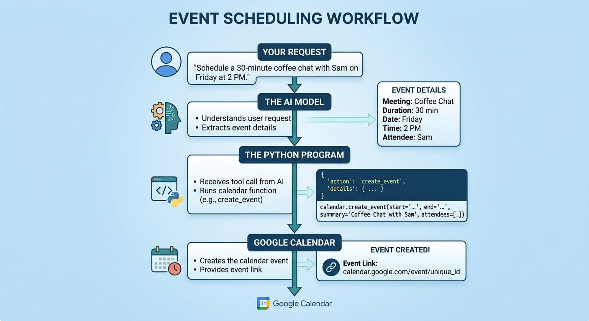
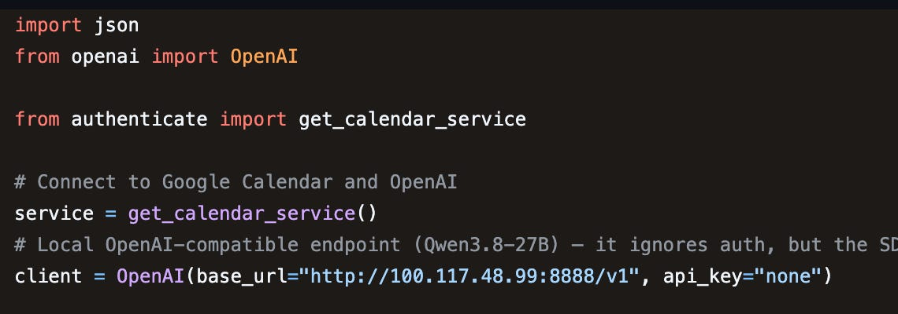
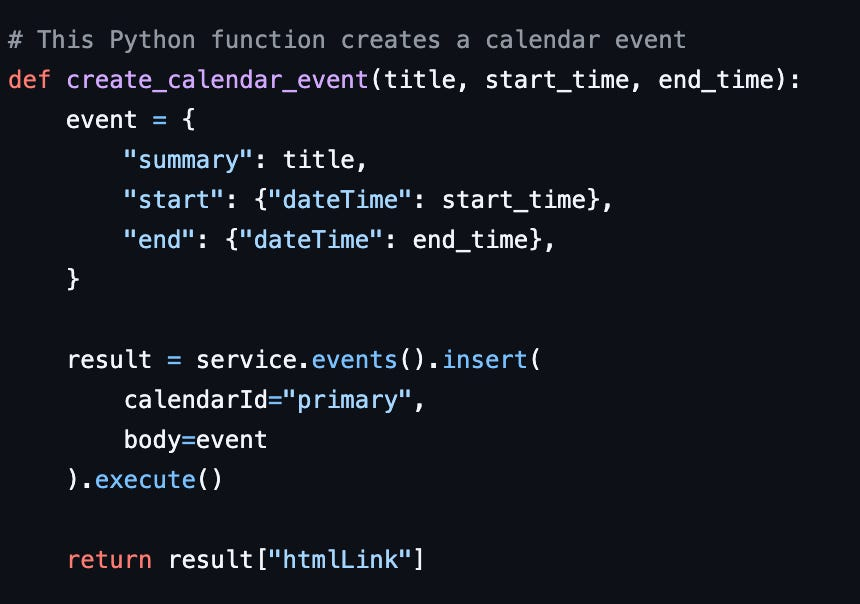
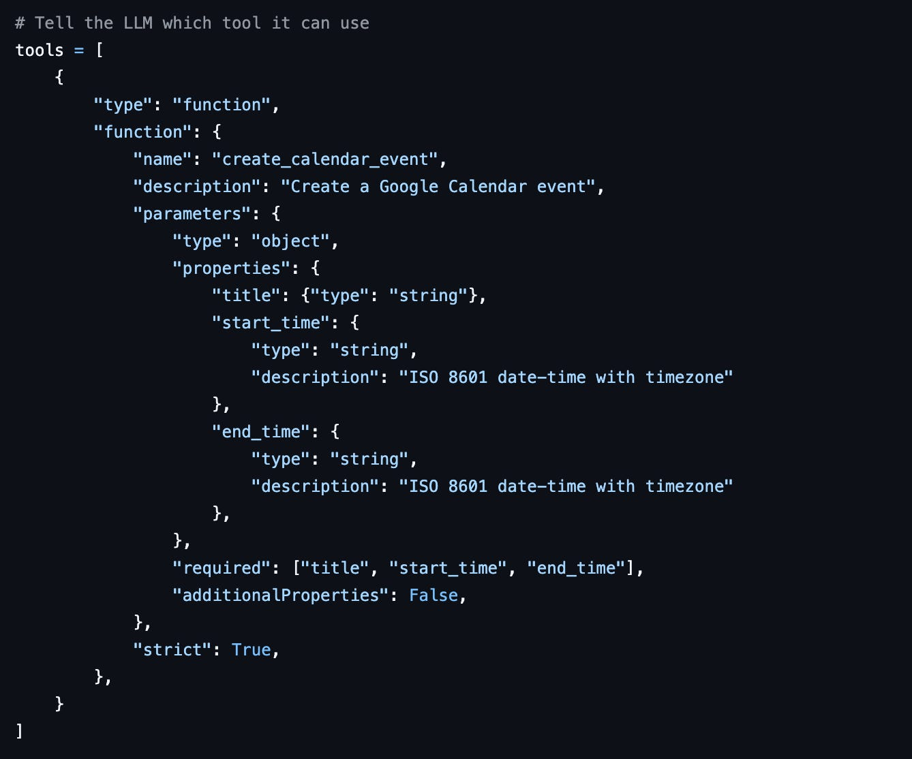
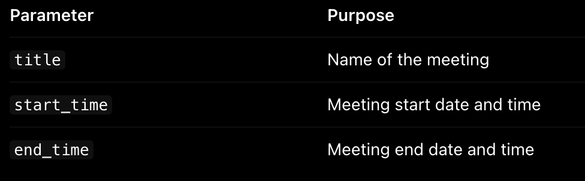
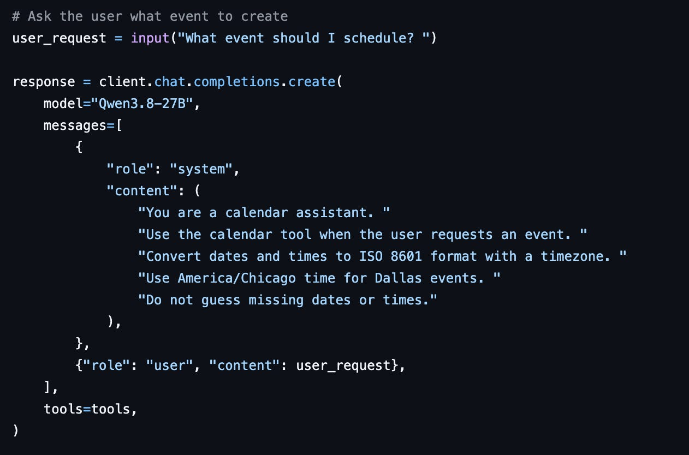
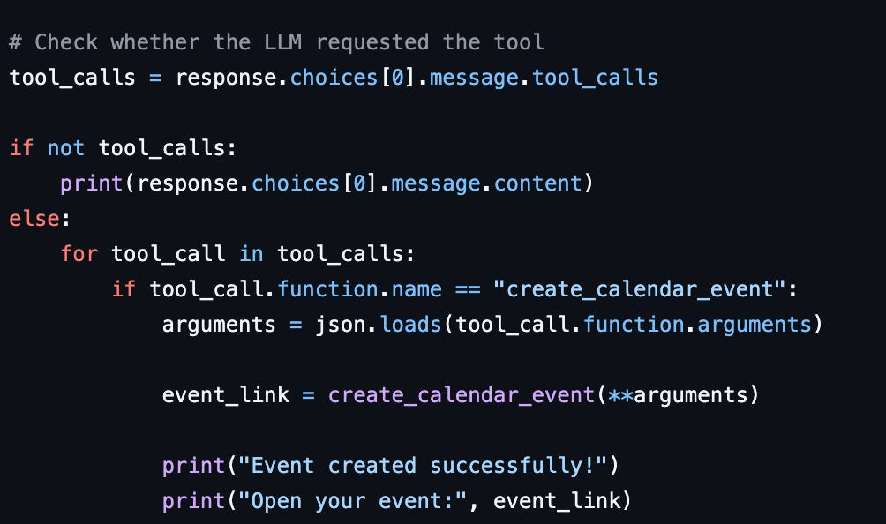
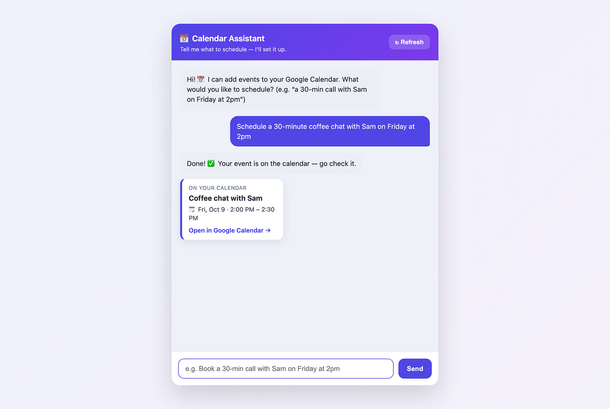

# Week 7, Day 3 - From AI Response to Real Action: Building a Google Calendar Integration

*October 9, 2026 · [Originally published on Substack](https://niharikabatra.substack.com/p/week-7-day-3-from-ai-response-to)*

Over the last two days, we’ve explored **tool calling** and how an AI application can use functions to interact with other systems.

> 📄 **Week 7, Day 1 - Tool Calling - Giving AI the Ability to Take Action**
> October 7, 2026 · [Read the original on Substack](07-week-7/day-1-tool-calling-giving.md)

Today, let’s put that into practice.

**If you’re a non-technical reader who isn’t interested in code, feel free to skip today’s article and join me for the next concept! 😊**

For those who want to explore the technical side, I will walk you through a Python project that takes a meeting request in plain English and uses tool calling to create a Google Calendar event. I’ll break down the code step by step so you can understand how the different components work together.

---
### Part 1: What are we building?

Imagine typing this into an AI assistant:

> Schedule a 30-minute coffee chat with Sam on Friday at 2 PM.

The application needs to turn that request into a real calendar event.



The interesting part is how the AI model and the Python program work together.

The model prepares the request for the tool. The Python code executes the function, and Google Calendar performs the actual action.

If the request is missing an important detail, the application should ask for clarification rather than guess. The basic command-line version of this project demonstrates the core flow; the repository also includes an optional chatbot interface.

Now let’s look at how the code makes this happen.

---
### Part 2: Understanding the code

For readers who want to explore the implementation, checkout this github repo:  
**[tool-calling](https://github.com/niharika2309/tool-calling-google-calendar/blob/main/README.md)**

We’ll use the actual `calendar_assistant.py` file from the project.

#### 1\. Connecting to Google Calendar and the AI model

The first step is to establish connections to the systems our application needs.

If you followed Day 2, you’ve already worked with Google Calendar credentials. In this project, we’ll use the [authenticate.py](https://github.com/niharika2309/tool-calling-google-calendar/blob/main/authenticate.py) script to connect those credentials to our application.

> 📄 **Week 7, Day 2 - Let’s Build a Tool Calling Mini Project with Google Calendar**
> October 8, 2026 · [Read the original on Substack](07-week-7/day-2-lets-build-a-tool-calling.md)

Run the script with:

```
python authenticate.py
```

The script uses your Google Calendar API credentials to authorize access. If authorization is needed, it opens a browser flow so you can sign in and grant permission. It saves the resulting authentication token so it can reuse or refresh the credentials later.

Once connected, it prints a confirmation message.

A few things to know before running it:

- You need the Google Calendar API credentials file (`credentials.json`) configured as described in the repository.
- The script creates or reuses `token.json` to manage your authorization.
- Keep both files private. Don’t commit your personal credentials or authentication tokens to a public repository.

Github - You can read the actual authentication logic in [authenticate.py](https://github.com/niharika2309/tool-calling-google-calendar/blob/main/authenticate.py)

Now that we understand the authentication step, let’s move to the main application.



Let’s break this down.

- `import json` gives Python the ability to read and work with JSON data.
- `OpenAI` is the client used to communicate with an AI model through an OpenAI-compatible API.
- `get_calendar_service()` comes from our `authenticate.py` file and establishes the Google Calendar connection.
- `client = OpenAI(...)` configures the connection to the AI model.

Notice that we’re connecting to two separate systems. The AI model interprets the user’s request, while Google Calendar stores the event.

The project uses a locally hosted, OpenAI-compatible model endpoint. The address shown in the code is specific to my environment, so you’ll need to configure your own reachable endpoint and model if you’re running the project elsewhere.

---
#### 2\. Creating the function that does the actual work

Next, we define the function that creates a Google Calendar event.



Think of a function as a small worker with a specific responsibility.

This function needs three inputs:

- `title`: the name of the event.
- `start_time`: when the event begins.
- `end_time`: when the event finishes.

It organizes those values into the structure Google Calendar expects, sends the request to the Calendar API, and returns the event’s link.

A few details are worth noticing:

- `event` is a Python dictionary containing the event information.
- `calendarId="primary"` tells Google Calendar to use the user’s primary calendar.
- `.insert()` requests the creation of an event.
- `.execute()` sends the request.
- `result["htmlLink"]` retrieves the link returned by Google Calendar.

This is the function that performs the real action. The AI model doesn’t create the event by generating text; the connected Python function makes the API request.

---
#### 3\. Telling the AI what the tool can do

Now we need to describe the function to the AI model.

The relevant code begins with:



Why is this necessary?

The AI needs to know which tools are available and how to request them. We can’t simply expect it to invent a valid function call.

In this project, the tool definition specifies:



The definition also specifies that these three parameters are required.

You’ll see `type: "function"` in the code. This tells the API that the tool represents a function the application can execute.

You’ll also see `strict: True`. This requests adherence to the specified argument schema when supported by the model and API.

One distinction matters here: the tool definition describes the function; it doesn’t execute it. We already wrote the function in the previous step. Now we’re describing its interface to the model.

---
#### 4\. Sending the user’s request to the model

Once the function is defined and described, the program asks the user what they’d like to schedule. The request is then sent to the AI model:



Let’s understand the key components.

- `model` identifies the model being used.
- `messages` contains the instructions and the user’s request.
- `role: "system"` provides behavioral instructions for the assistant.
- `role: "user"` contains the request we typed.
- `tools=tools` provides the tool definition we created earlier.

The system instructions tell the model to use the calendar tool when appropriate, format dates and times correctly, and avoid guessing missing information.

For example, if the user says, “Schedule a meeting tomorrow,” without giving a time, the application should seek clarification rather than invent one.

Notice that the model call returns a `response`. At this point, the program has asked the AI what to do, but it hasn’t yet executed the calendar function.

---
#### 5\. Checking whether the model requested the tool

After receiving the model’s response, the program checks whether a tool call was requested.



There are two possible paths.

If the model hasn’t requested a tool, the program prints its text response.

If the model has requested a tool, the program checks the function name and proceeds when it matches `create_calendar_event`.

This is an important part of tool calling: the model returns a structured request, and the application processes that request.

The Python program is the part that invokes the function. The tool definition alone doesn’t cause the action to happen.

> And that’s the complete flow: the AI prepares the request, Python executes the function, and Google Calendar performs the action.

For a production application, you’d also want to validate the arguments, handle API errors, and add safeguards to prevent incorrect or unintended calendar changes.

---
### Try the project yourself

I’ve shared the complete project, including the authentication script and the calendar assistant, on GitHub. I created a little UI to play with it.



> Tool Calling with Google Calendar
> 
> [Read the README and setup instructions](https://github.com/niharika2309/tool-calling-google-calendar/blob/main/README.md)
> 
> [View the main Python script](https://github.com/niharika2309/tool-calling-google-calendar/blob/main/calendar_assistant.py)
> 
> [View the authentication script](https://github.com/niharika2309/tool-calling-google-calendar/blob/main/authenticate.py)

### The takeaway

We’ve connected three important pieces:

- An AI model that interprets a request and prepares tool arguments.
- Python code that defines and executes a function.
- Google Calendar, which performs the requested action.

This is how an AI application can go beyond generating text and interact with an external system.

**One concept at a time. One step closer to understanding AI.**
