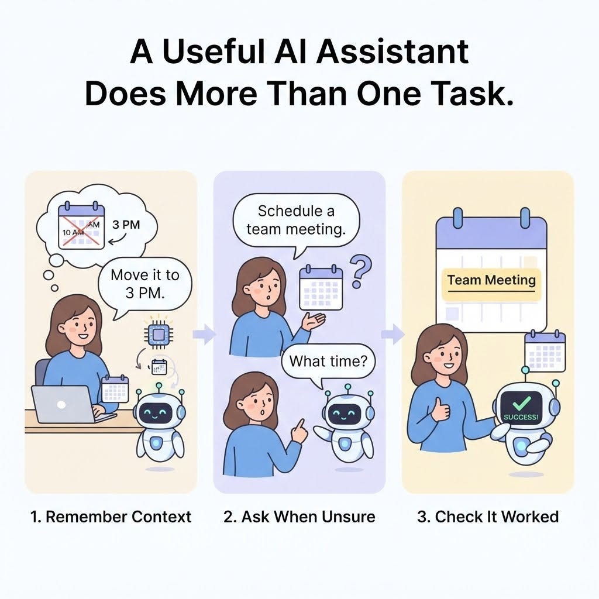

# Week 7, Day 4 - Your AI Assistant Worked Once. Can It Handle a Real Conversation?

*October 10, 2026 · [Originally published on Substack](https://niharikabatra.substack.com/p/week-7-day-4-your-ai-assistant-worked)*

Yesterday, we built a small AI assistant that could use Google Calendar to schedule a meeting.

We learned how AI can use tools to do things beyond answering questions.

But here’s something to think about.

Real conversations aren’t always as simple as one question followed by one answer.

You might change your mind, forget to mention a detail, or ask a follow-up question without repeating everything you said earlier.

Can your AI assistant handle that?

Let’s find out.

---
### 1\. Real conversations don’t happen in one message

Imagine having this conversation with your AI assistant.

> You: Schedule a meeting with Priya tomorrow at 2 PM.
> 
> AI Assistant: Sure! I’ll schedule that meeting.
> 
> You: Actually, make it 3 PM.
> 
> AI Assistant: I’ll update the meeting to 3 PM.

Notice something?

You didn’t repeat your entire request. You simply said, “Actually, make it 3 PM.”

For this to work, the assistant needs to understand that you’re still talking about the meeting you mentioned earlier.

This is where **conversation context** becomes important.

The assistant needs relevant information from earlier messages to understand what you mean now. Without that context, it might not know which meeting you’re referring to.

---
### 2\. What if you leave something out?

Imagine you say:

“Schedule a meeting with Priya tomorrow.”

What time should the assistant choose?

> **It shouldn’t simply guess.**

Instead, it could ask:

**AI Assistant:** What time would you like to meet?

This is an important part of building a useful AI assistant.

> **Sometimes, the best next step isn’t to perform an action. It’s to ask a question.**

An assistant needs to recognize when it has enough information to proceed and when it needs clarification.

---
### 3\. What if you change your mind?

Let’s say your meeting is already on the calendar, and you say:

“Can you move it to Friday instead?”

The assistant needs to do more than understand your request.

It needs to identify the existing meeting and update it rather than accidentally creating a second one.

Remember our Google Calendar mini-project from yesterday?

We created a tool that could schedule an event. **But creating an event and updating an existing event are two different actions.**

The application needs the right tool for the job.

Understanding what you want and knowing how to carry it out are two separate things.

---
### 4\. What if something goes wrong?

Suppose the assistant tries to schedule your meeting, but the calendar connection fails.

Should it tell you the meeting is scheduled anyway?

Of course not!

**A good assistant should check whether the action succeeded and explain what happened if it didn’t.**

There’s an important difference between an AI saying it completed a task and the application actually completing that task.

This matters whenever AI interacts with real-world tools, whether that’s a calendar, an email application, or a booking system.

---
### Bringing it all together

Let’s compare two types of AI assistants.

A basic tool-calling demo:

- Receives an instruction.
- Calls a tool.
- Returns a response.

A more useful AI assistant:

- Understands follow-up messages using conversation context.
- Asks questions when important details are missing.
- Handles corrections and changes.
- Checks whether an action succeeded.
- Explains what happened to the user.

These capabilities don’t automatically appear just because an application uses tool calling. Developers need to design them into the application.

And that’s the lesson for today.

> **Getting AI to perform one action is a great first step. Making it handle the way people actually communicate is the next challenge.**

Yesterday, we explored how AI can use tools.

Today, we explored what it takes to make that interaction more useful and reliable.

**One concept at a time. One step closer to understanding AI.**
