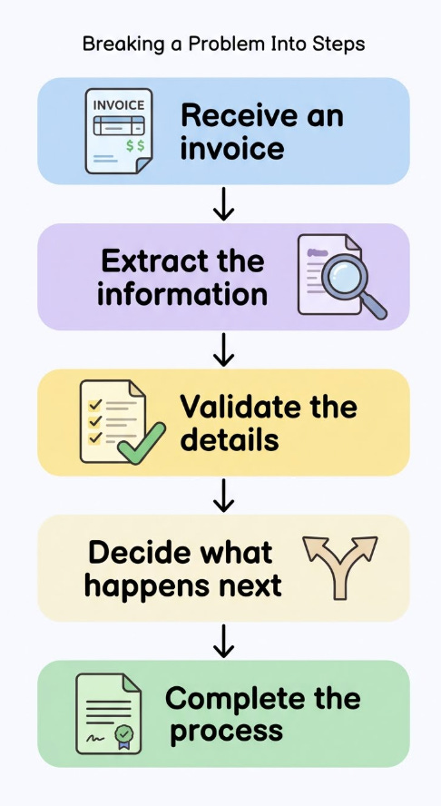

# Week 7, Day 5 - Before You Build AI application, Design the Workflow

*October 11, 2026 · [Originally published on Substack](https://niharikabatra.substack.com/p/week-7-day-5-before-you-build-ai)*

Sometimes, the first step isn’t writing code. It’s taking out a pen and paper.

Whenever I have a problem to solve, one of the first things I do is take out a pen and paper. Before jumping into code or thinking about which AI model to use, I break the problem down into simple steps.

I draw little blocks.

What needs to happen first? What comes next? What information do I need from one step to complete the next?

Once I can see the whole process in front of me, the problem starts to feel much more manageable.

And this is exactly the idea I want to introduce today: **workflow design**.

---
### 1\. Start with a problem, not a model

Imagine you’re building an application that processes incoming invoices.

Every day, a company receives invoices from different vendors. Someone needs to read each invoice, identify important details, check the information, and send it to the appropriate place.

Instead of thinking, “Let’s build an AI application,” let’s first ask:

What are all the steps required to solve this problem?

We might break it down like this:

That’s our first workflow.

Notice that we haven’t written a single line of code or selected an AI model yet.

We’ve simply broken one big problem into smaller, understandable blocks.

---
### 2\. Why does the order matter?

Let’s say we try to validate an invoice before extracting any information from it.

How would we check whether the invoice amount is present if we haven’t identified the amount yet?

Or imagine sending an invoice for processing before checking whether important details are missing.

The order of the steps matters because the output of one step often becomes the input for the next.

This is why drawing the workflow first is useful. It helps us identify dependencies, missing steps, and decisions we need to make before building the application.

---
### 3\. Where does AI fit into this?

Now that we’ve designed the workflow, we can decide which steps need AI and which don’t.

For example:

- **Receiving the invoice:** Regular application code can handle the upload.
- **Extracting information:** An AI model can read the document and identify the relevant details.
- **Validating the information:** Regular code can check required fields and apply business rules.
- **Deciding what happens next:** Application logic can route complete invoices forward and flag incomplete ones.
- **Storing the results:** Regular code can save the information to a database or another system.

We don’t need AI for every step.

Sometimes, a simple rule is more reliable and easier to maintain than asking an LLM to make a decision.

> **The goal isn’t to use AI everywhere. It’s to identify where AI genuinely helps.**

---
### 4\. What does this have to do with tool calling?

Remember our previous lessons on tool calling?

A **tool** gives an AI application a way to perform a particular **action**, such as extracting information or saving a record.

> **Workflow design helps us decide which actions are needed, in what order, and how they connect.**

For our invoice example, a developer might create separate functions for extracting invoice details, validating them, and saving the results.

The application can then coordinate those functions according to the workflow we designed.

The LLM doesn’t have to invent the entire process. We can define the process in advance and use AI where it makes sense.

---
### The takeaway

The next time you have a problem to solve, try doing what I do.

Take out a pen and paper. Draw a few blocks. Write down what needs to happen first, what depends on it, and what should happen next.

> **You don’t need to know how to code to start designing a good workflow.**

Before we teach an AI application how to perform a task, we need to understand the task ourselves.

**That’s where good AI application design begins.**

**One concept at a time. One step closer to understanding AI.**
