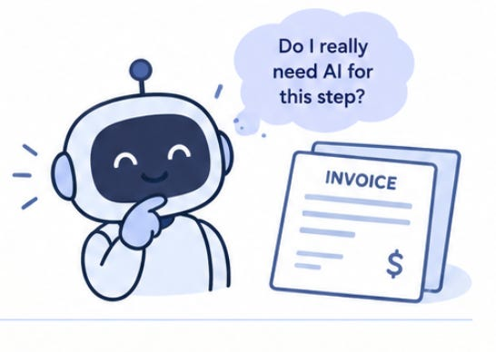
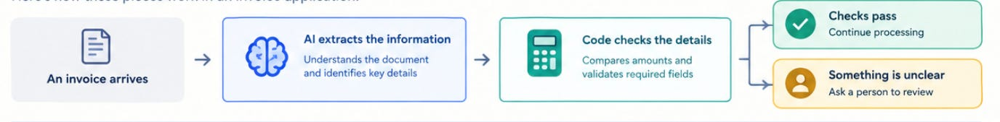

# Week 7, Day 6 - Does Every Step Need AI? Let's Think Before We Build

*October 12, 2026 · [Originally published on Substack](https://niharikabatra.substack.com/p/week-7-day-6-does-every-step-need)*

We’ve spent the past few days exploring how AI can use tools to take action and how to break a problem into smaller steps before building an application.

Today, let’s look at a different question.

> Does every step in an AI application actually need AI?

The answer is no. In fact, knowing when not to use AI is just as important as knowing where to use it.

---
### Let’s take a simple example

Suppose you’re building an application that reads invoices.

An invoice arrives, and you want your application to read it, check the details, and decide what needs to happen next.

You might assume AI should handle everything. But let’s look at three different situations.

---
### 1\. When you need AI

Imagine receiving invoices from 20 different companies. Each company uses a different format. The vendor name appears in a different place, the dates look different, and the total amount isn’t always presented in the same way.

You want your application to identify the vendor name, invoice date, and total amount.

This is where AI can help.

AI can interpret the document and identify the information you’re looking for, even when the layout changes.

> **Use AI when a task requires interpreting language, understanding context, or dealing with variation.**

---
### 2\. When ordinary code is enough

Now you’ve extracted the total amount from the invoice.

You want to check whether that amount matches the total recorded in your system.

Do you need AI to compare two numbers?

No. A simple comparison in Python can do that.

**The same applies to adding numbers, checking whether a field is empty, or verifying whether a date falls within a particular range.**

These are predictable tasks with clear rules. Ordinary code can handle them without the additional cost or complexity of an AI model.

> **Use ordinary code when a task follows clear, predictable rules.**

---
### 3\. When a human should step in

Let’s say the application reads an invoice, but two different sections show different total amounts.

The application might not have enough information to determine which amount is correct.

**Instead of confidently choosing one, it can flag the invoice for human review.**

A person can examine the discrepancy and decide what to do.

This is especially important when a mistake could have financial or other significant consequences.

> **Use human review when a decision requires judgment, additional context, or accountability.**

---

Notice something important: AI is only responsible for the part where it adds value.

The rest of the application uses simpler, more predictable methods.

This is how AI and traditional software can work together.

---
### Why does this matter when building AI applications?

It’s tempting to think that adding more AI makes an application smarter. But that’s not necessarily true.

Using AI for a straightforward calculation doesn’t make the calculation better. Asking an AI model to follow a rule that ordinary code can enforce may introduce unnecessary uncertainty.

There are practical considerations, too:

- **Cost**: Unnecessary model calls can add expense.
- **Reliability**: Clear rules are often more predictable than model-generated answers.
- **Speed**: Simple operations don’t need to wait for an AI model.
- **Simplicity**: Fewer unnecessary moving parts make applications easier to maintain.

Of course, AI can make mistakes when interpreting documents, too. Its output still needs appropriate validation.

> **The goal isn’t to minimize AI at all costs. It’s to use AI where it provides meaningful value.**

---
### A small exercise for you

Think of an application you’d like to build. It could be a personal finance assistant, a travel planner, or an app that organizes your emails.

Ask yourself three questions:

1.  Which part of the task requires understanding language or context?
2.  Which part can be handled using straightforward rules or calculations?
3.  Which decisions might require a human?

You don’t need to write a single line of code to start thinking like an AI application designer. And that’s the point of today’s lesson.

---

When building an AI application, don’t start by asking how much AI you can use.

Start by asking where AI actually helps.

**Good AI engineering isn’t about using AI for everything. It’s about choosing the right approach for each task.**

**Tomorrow**, we’ll wrap up Week 7 by bringing together what we’ve explored this week and looking at how these individual concepts fit into the bigger picture of building AI applications.
