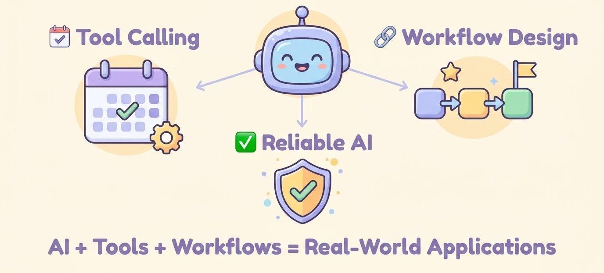

# Week 7, Day 7 - From AI Responses to AI Applications

*October 13, 2026 · [Originally published on Substack](https://niharikabatra.substack.com/p/week-7-day-7-from-ai-responses-to)*

We’ve spent this week exploring something important: AI doesn’t have to stop at generating text.

It can interact with tools, work with external services, and help complete tasks.

We started with tool calling, built a small Google Calendar assistant, explored how conversations require clarification, and learned why workflow design matters before writing code.

Today, let’s connect these ideas and understand what they teach us about building AI applications.

---
### 1\. From a model to an application

Think about how you normally use ChatGPT. You ask a question, and it gives you an answer.

Now imagine asking an assistant to schedule a meeting, retrieve information from a calendar, or perform an action in another application.

That requires more than generating text. The AI needs to understand your request and determine which action might help fulfill it.

This is where tool calling comes in.

> **The model can request an action through a tool, but the application is responsible for connecting that request to the actual system that performs it.**

If you followed our Google Calendar mini-project, you saw this idea in practice.

The process brought together three components:

- **The LLM**: Interprets the user’s request and determines which available tool may be appropriate.
- **The application**: Connects the model to the tool, validates inputs, and manages execution.
- **The external service**: Performs the requested operation, such as creating a calendar event, and returns a result.

Each component has a different responsibility.

The LLM doesn’t automatically have access to your calendar or permission to create events. The application must provide the necessary connections and handle the execution.

**This separation is an important part of designing AI applications.**

If you’d like to revisit how these pieces work together, here are two articles from this week:

[Day 1: Tool Calling — Giving AI the Ability to Take Action](07-week-7/day-1-tool-calling-giving.md)

[Day 3: From AI Response to Real Action — Building a Google Calendar Integration](07-week-7/day-3-from-ai-response-to.md)

---
### 2\. Designing for the real world

One of my favorite habits when approaching a problem is taking out a pen and paper before opening the code editor. I break the problem into smaller steps and figure out what should happen next.

This becomes especially useful when building AI applications.

Imagine you’re designing a system to process an invoice. The workflow might involve:

1.  Extracting information from the invoice.
2.  Validating the amounts.
3.  Checking a database for matching records.
4.  Flagging discrepancies.
5.  Routing the invoice for approval.

Would you use an LLM for every step?

Not necessarily.

Extracting information from an unstructured document might benefit from AI. Validating whether an amount matches a defined rule may be better handled by ordinary code. Checking a database requires connecting to the relevant system.

The goal isn’t to add AI everywhere. It’s to understand the problem first and decide where AI actually helps.

And designing the ideal workflow is only part of the job.

Real applications must also handle situations that don’t go as planned.

A user might leave out the meeting time. An API might return an error. A requested action might fail because of permissions.

The application needs to know what to do next. It might ask the user for clarification, validate missing information, retry an operation when appropriate, or explain why it couldn’t complete the task.

There’s another important detail here: requesting an action is not the same as completing it.

An assistant shouldn’t tell you that a meeting has been scheduled just because it generated a valid calendar-tool request. It needs to check the actual result before confirming success.

> **This is why workflow design, validation, and error handling matter just as much as getting a good response from the model.**

A useful question to ask when designing any AI application is:

> **What should happen next if this step doesn’t work?**

Thinking about that question early can save a lot of trouble later.

---
### 3\. When do you actually need an AI agent?

By now, you might be wondering: if AI can call tools and complete tasks, does every application need an agent?

No.

Tool calling and agents are related, but they aren’t interchangeable.

> **Tool calling allows a model to request actions through defined tools.**
> 
> **An agentic system can use tools as part of a broader process, potentially making decisions and taking multiple steps toward a goal.**

The right approach depends on the task.

**A simple question** - You ask an AI to explain a concept. A **model call** may be enough.

**A specific action** - You ask an assistant to schedule a meeting. **Tool calling** lets the application connect the request to your calendar.

**A multi-step task** - You ask a system to research a topic, compare information from several sources, and prepare a report. A structured workflow or **agentic** approach might be useful, depending on how much decision-making is required.

> **An agent isn’t automatically better just because it can take more steps.**

More components can introduce additional complexity, cost, and opportunities for failure.

Good engineering means choosing an approach that fits the problem, rather than automatically choosing the most sophisticated option.

---
### Coming up in Week 8: RAG 📚

So far, we’ve focused on how AI applications can interact with external tools to perform actions.

Next, we’ll explore a different challenge: **helping AI find the right information before generating an answer.**

Imagine asking questions about company policies, product documentation, or a collection of internal files.

How can an application retrieve relevant information from those sources and use it to generate a useful, grounded response?

**That’s where Retrieval-Augmented Generation (RAG) comes in.**

We’ll break down how retrieval works, how retrieved information is used to generate responses, and why this approach is useful when working with your own data.

Thank you for following along with the 16-week series. Whether you’ve been reading every article or joining whenever you can, I hope these concepts are becoming easier to understand and connect.

One concept at a time. One step closer to understanding AI.
