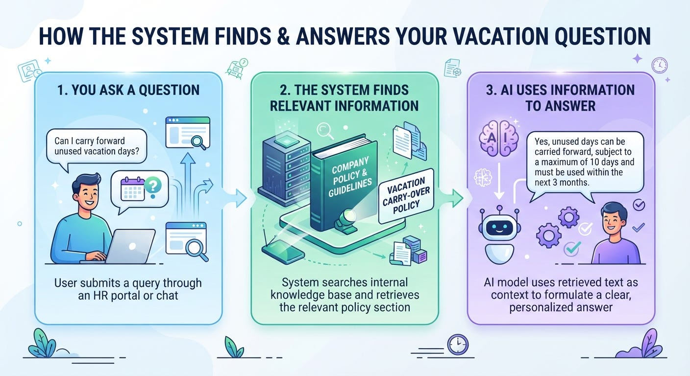

# Week 8, Day 1 - What Is RAG, and Why Does AI Need It?

*October 14, 2026 · [Originally published on Substack](https://niharikabatra.substack.com/p/week-8-day-1-what-is-rag-and-why)*

AI can answer questions, write emails, explain complicated topics, and help you solve problems.

But what if you ask it a question about a document sitting on your laptop that it has never seen?

**For example, you have a 50-page company policy document, and you just want to know whether you can carry forward your unused vacation days.**

You don’t want to read the entire document. And you don’t want AI to guess the answer.

You want it to find the relevant information and explain it to you.

**That’s where RAG comes in.**

**RAG stands for Retrieval-Augmented Generation.** And despite the complicated name, the idea is surprisingly simple.

---
### Why can’t AI just answer everything?

Remember when we discussed hallucinations?

That’s when AI generates an answer that sounds convincing but contains incorrect or made-up information.

**One reason this can happen is that the model doesn’t have the information needed to answer your specific question.**

Let’s return to our company policy example.

AI might know a lot about how vacation policies typically work. But that doesn’t mean it knows what **your** company allows.

It might give you a **general answer** when you actually need a specific one.

You could try writing a more detailed prompt, but there’s a limit to what better instructions can do when the information itself is missing.

> **Sometimes, the problem isn’t how you ask the question. It’s whether AI has access to the information needed to answer it.**

### What about the context window?

We’ve also talked about **context windows - the amount of text an AI model can work with in a conversation at a given time.**

Imagine trying to work with hundreds of pages of documents.

Even if a model supports a large context window, putting every document into the conversation isn’t always practical. **It can be expensive, inefficient, and difficult to manage as the collection grows.**

And here’s something important: a large context window doesn’t automatically mean the model knows where the most relevant information is or will use it correctly.

What if, instead of giving AI everything, we could help it find the information that matters for the question?

**That’s the problem RAG is designed to address.**

---
### So, how does RAG help?

Think about how you would answer a question about a long document.

You’d probably do something like this:

- Find the document that contains the information.
- Look for the section relevant to your question.
- Read that section.
- Use what you found to answer the question.

RAG brings a similar approach to AI applications.

That’s the basic idea.

> **Retrieve relevant information first. Generate an answer using it next.**

The model doesn’t need to memorize your entire company handbook. The application retrieves relevant information when someone asks a question and provides it to the model.

---
### Does RAG mean training the model again?

No. This is an important distinction.

Suppose your company updates its vacation policy **next month.**

You don’t necessarily need to train the AI model again to reflect that change.

You can update the documents available to the **retrieval system**. When someone asks a question, the system can retrieve information from the **updated policy** and provide it to the model.

The model’s underlying parameters remain unchanged.

> **This makes RAG particularly useful when an application needs to work with private documents, changing information, or knowledge that wasn’t part of the model’s original training.**

Of course, the system still needs to retrieve the correct, up-to-date document. RAG doesn’t guarantee that automatically.

---
### Where can we use RAG?

Once you understand the idea, the applications become easier to recognize.

- **Customer support:** Answering questions using product manuals and help articles.
- **Company assistants:** Finding information in internal policies and documentation.
- **Research:** Answering questions using relevant passages from reports and papers.
- **Document intelligence:** Helping people find and understand information across large collections of documents.

The common thread is that the AI needs access to information beyond what it can reliably answer from its existing knowledge alone.

---
### One last thing to remember

RAG doesn’t magically make an AI smarter, and it doesn’t eliminate hallucinations.

> **It gives an AI application a way to retrieve relevant information and use it when generating an answer.**

Think of it this way:

- A better prompt helps you explain what you want.
- A larger context window lets a model work with more information at once.
- RAG helps an application find the information that matters and bring it into the conversation.

And that brings us to our next question.

If you have thousands of documents, how does the system find the right information without manually searching through every page?

That’s what we’ll explore tomorrow.

**One concept at a time. One step closer to understanding AI.**

Subscribe the [16-Week AI/ML Series](https://niharikabatra.substack.com/s/16-week-aiml-series) for the next lesson.
