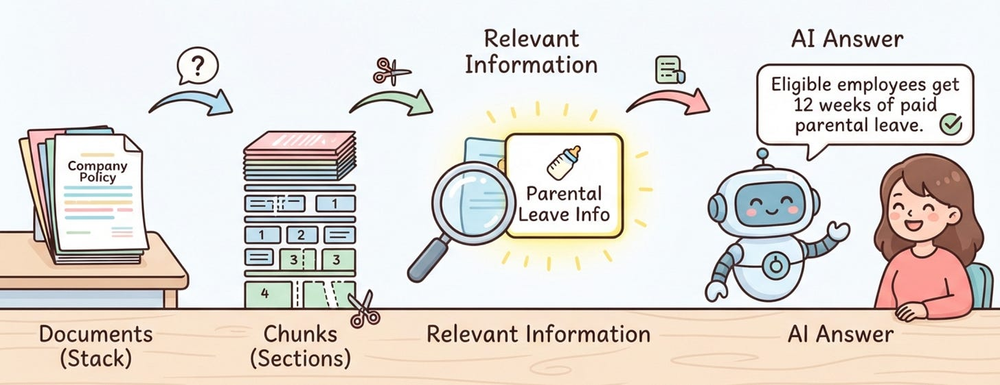

# Week 8, Day 2 - How Does RAG Find the Right Information in Documents?

*October 15, 2026 · [Originally published on Substack](https://niharikabatra.substack.com/p/week-8-day-2-how-does-rag-find-the)*

Yesterday, we explored why AI sometimes needs help answering questions accurately.

An LLM has a limited context window, and it may not know the information we want it to use. **RAG helps by finding relevant information from external sources and giving it to the LLM before it generates an answer.**

But that brings us to an interesting question.

How does AI find the right information in the first place?

Imagine you have 1,000 documents containing company policies, employee guidelines, FAQs, and other information.

Someone asks:

“How many days of parental leave does the company offer?”

You don’t want to send all 1,000 documents to the LLM. You want to find the specific section that answers the question.

Let’s understand how that works.

---
### 1\. First, We Need to Prepare the Documents

Before a system can search through documents effectively, it needs to make their contents easier to work with.

> **One common approach is to split documents into smaller pieces called chunks.**

Why?

Imagine a company policy document that is 50 pages long. Only one small section might explain parental leave.

Sending the entire document every time someone asks a question would be inefficient. Instead, we can break it into smaller sections so the system can find and retrieve only the parts that matter.

For example, a policy document might contain these sections:

- Chunk 1: Working hours and attendance
- Chunk 2: Vacation and paid time off
- Chunk 3: Parental leave
- Chunk 4: Health insurance and benefits

**Now, instead of searching through one large document, the system can work with smaller, more focused pieces of information.**

And these chunks can be created from many documents, not just one.

---
### 2\. What Makes a Good Chunk?

Splitting a document isn’t just about dividing it into equal pieces.

> **The goal is to keep related information together.**

Imagine a policy says:

“Employees who meet the eligibility requirements can take 12 weeks of parental leave. Employees must notify their manager before the leave begins.”

If we split this text in the wrong place, we might separate the number of weeks from the context explaining who qualifies.

That could make the retrieved information less useful.

**A good chunk should contain enough context to help the LLM understand what the information means.**

This is why document structure matters. Headings, paragraphs, and related sentences can help us decide where one chunk should end and another should begin.

The goal isn’t simply to create smaller pieces. It’s to create useful pieces of information.

---
### 3\. What Happens When Someone Asks a Question?

Let’s return to our question:

“How many days of parental leave does the company offer?”

The system has already prepared the documents and divided them into chunks.

**When the question arrives, the system needs to identify which chunks are most relevant to it.**

It might find the chunk containing the parental leave policy rather than the sections about vacation or health insurance.

That relevant chunk can then be passed to the LLM along with the original question.

The LLM uses the provided information to generate an answer.

For example:

“The policy provides 12 weeks of parental leave for eligible employees.”

The answer is grounded in the retrieved policy rather than relying only on what the LLM already knows.

Of course, the quality of the answer still depends on whether the correct information was retrieved and whether the LLM interpreted it accurately.

---
### 4\. Why Can’t We Just Search for Matching Words?

Suppose someone asks:

“Can I take time off when my baby is born?”

But the document uses the heading “Parental Leave Policy.”

**The question and the document don’t use exactly the same words.**

> **A basic keyword search might struggle to connect the two.**

People often describe the same idea in different ways. A useful retrieval system needs ways to identify information that is relevant even when the wording differs.

We’ll explore how systems do this in the next few days.

> **For now, remember that finding relevant information is not always the same as finding matching words.**

---

This is one of the core ideas behind **Retrieval-Augmented Generation (RAG).**

We’ve now seen why documents need to be prepared, why chunking matters, and why retrieving the right information is essential.

### What’s Next?

Not all chunks are created the same way.

We could split a document every 500 words, break it at paragraph boundaries, or use the document’s meaning and structure to decide where to split.

Each approach has its advantages and trade-offs.

Tomorrow, we’ll explore the different types of chunking and understand how to choose the right approach for a RAG application.
