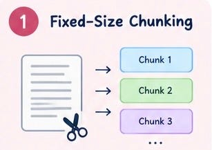
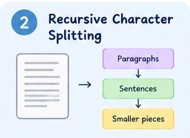
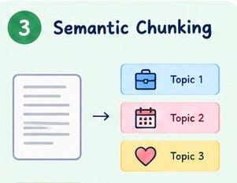
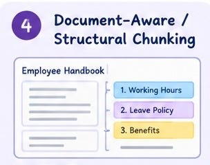
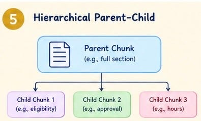
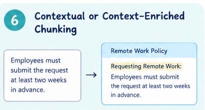
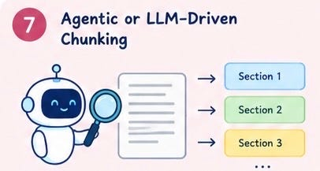

# Week 8, Day 3 - Chunking Strategies That Make RAG Work Better

*October 16, 2026 · [Originally published on Substack](https://niharikabatra.substack.com/p/week-8-day-3-chunking-strategies)*

Yesterday, we learned how RAG finds relevant information in documents and why breaking documents into smaller chunks matters.

> But here’s something interesting: there isn’t just one way to split a document.

Think about a 100-page employee handbook. You could split it into equal-sized pieces, separate it by sections, or use AI to decide where each piece should begin and end.

> Each approach creates chunks differently, and that can affect how well RAG retrieves the right information.

Today, let’s explore seven chunking strategies in simple terms.

---

**1\. Fixed-Size Chunking**

The idea: Cut a document into equal-sized pieces.

Imagine cutting a long document into chunks of 500 words each.

You keep going until you’ve covered the entire document. You can also allow some overlap between chunks so that information near a boundary isn’t easily separated from its surrounding context.

For example:

- Chunk 1: Words 1–500
- Chunk 2: Words 451–950
- Chunk 3: Words 901–1,400

Notice that some words appear in both chunks. That’s the overlap.

Why use it? **It’s simple to implement and works well as a starting point.**

> The drawback: A chunk might end in the middle of a sentence or split an explanation into two pieces.

---

**2\. Recursive Character Splitting**

The idea: Try to split text at natural boundaries before cutting it into smaller pieces.

Instead of immediately cutting a document at an exact character count, this strategy tries separators in an order, often paragraphs first, then lines, then sentences or spaces.

If a section is still too large, it splits that section further until the chunks fit the desired size.

Imagine splitting an employee handbook:

- Try to separate it by paragraphs.
- If a paragraph is too long, try splitting it into sentences.
- If a sentence or remaining piece is still too large, split it further.

> The exact separators and order depend on how the splitter is configured.

Why use it? **It tries to keep related text together while still controlling chunk size.**

> The drawback: It follows text boundaries, not necessarily changes in meaning.

---

**3\. Semantic Chunking**

The idea: Split text when the meaning changes.

Imagine a document discussing three topics:

- Remote work eligibility
- How to request leave
- Employee benefits

Instead of splitting every 500 words, semantic chunking tries to keep sentences discussing the same topic together.

When the meaning shifts from one topic to another, that may be a good place to create a new chunk.

> This typically involves using embeddings or other semantic similarity techniques to identify changes in meaning.

Why use it? **Chunks can contain more coherent, related information.**

> The drawback: It can require more computation and tuning, and identifying the right boundaries isn’t always straightforward.

---

**4\. Document-Aware or Structural Chunking**

The idea: Use the document’s existing structure.

Not all documents are just walls of text. They may already have headings, sections, tables, bullet points, or chapters.

Document-aware chunking uses these structures to decide where chunks should begin and end.

For example, an employee handbook might contain:

- Section 1: Working Hours
- Section 2: Leave Policy
- Section 3: Benefits

Each section can become its own chunk, or a large section can be divided into smaller chunks while preserving its heading.

Why use it? **It preserves useful organization and makes chunks easier to understand.**

> The drawback: It works best when the document has a meaningful structure. Poorly formatted documents can make this harder.

---

**5\. Hierarchical Chunking: Parent and Child**

The idea: Keep both the big picture and the smaller details.

Sometimes, a large chunk provides useful context, but a smaller chunk is better for finding an exact answer.

> Hierarchical chunking addresses this by organizing text at different levels.

Imagine a handbook section about remote work.

- Parent chunk: The complete remote work policy section.
- Child chunks: Smaller pieces covering eligibility, approval, and working hours.

When someone asks a question about approval, RAG can retrieve the relevant child chunk. The system can then also use its parent chunk to provide additional context.

Why use it? **It combines precise retrieval with broader context.**

> The drawback: The system needs to maintain relationships between parent and child chunks and decide how much context to return.

---

**6\. Contextual or Context-Enriched Chunking**

The idea: Give a chunk additional context so it makes sense on its own.

Here’s a common problem.

A chunk might contain:

“Employees must submit the request at least two weeks in advance.”

But which request? The chunk may have lost the heading or surrounding explanation when the document was split.

Contextual chunking adds relevant information, such as the document title, section heading, or a short explanation of what the chunk refers to.

For example:

“Remote Work Policy - Requesting Remote Work: Employees must submit the request at least two weeks in advance.”

Now the chunk carries more of its original context.

> Some approaches add headings or metadata using simple rules. Others use an LLM to generate a contextual description for each chunk.

Why use it? **It helps make isolated chunks more understandable and potentially easier to retrieve accurately.**

The drawback: Adding context can increase storage and processing costs. Generated context can also introduce errors if it isn’t checked.

---

**7\. Agentic or LLM-Driven Chunking**

The idea: Let an AI model help decide how a document should be split.

So far, most strategies follow a predefined approach: split by size, follow headings, or detect changes in meaning.

> With LLM-driven chunking, a language model can examine the content and help determine where boundaries should go based on the document’s meaning and purpose.

For example, imagine a complex legal or technical document. An LLM might identify that a paragraph explains a rule, the next describes an exception, and the following one gives an example.

Rather than splitting these sections blindly, it can help keep related pieces together.

More advanced agentic approaches can go further by selecting strategies, inspecting the resulting chunks, and revising them when necessary.

Why use it? **It can adapt to complex documents that don’t fit neatly into a single splitting rule.**

> The drawback: It can be slower, more expensive, and less predictable than simpler approaches. It also requires careful evaluation.

---

**One important distinction: these strategies aren’t all mutually exclusive.**

For example, a system can use document structure first, recursive splitting for oversized sections, and contextual enrichment afterward.

**So, Which Chunking Strategy Is Best?**

> There isn’t one universal winner.

- A simple text document might work perfectly well with fixed-size or recursive splitting.
- A structured handbook may benefit from document-aware chunking.
- A complex collection of technical documents might benefit from semantic, hierarchical, or LLM-assisted approaches.

> The best choice depends on your documents, the questions users ask, your cost constraints, and the quality of retrieval you need.

Remember: The goal isn’t simply to create small chunks. It’s to create chunks that help RAG find the right information without losing the context needed to answer the question.

---

**What’s next?**

We’ve explored how documents can be broken into useful chunks. But how does a system find the right chunk when a user asks a question in completely different words?

Tomorrow, we’ll explore embeddings - how text is represented as numbers that help computers compare meaning and how do we search them.

**One concept at a time. One step closer to understanding AI.**
